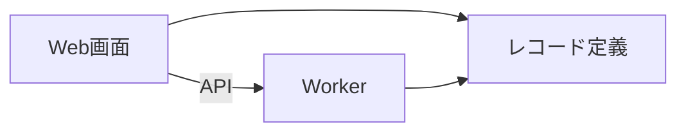
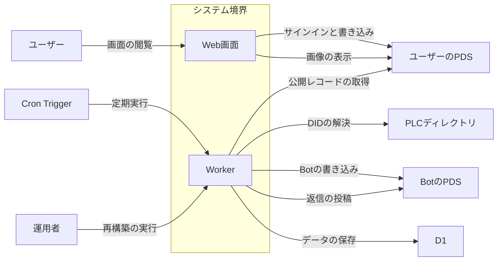
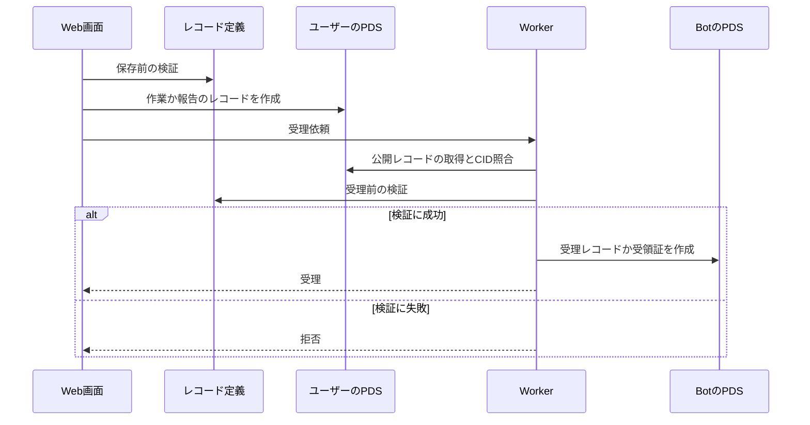
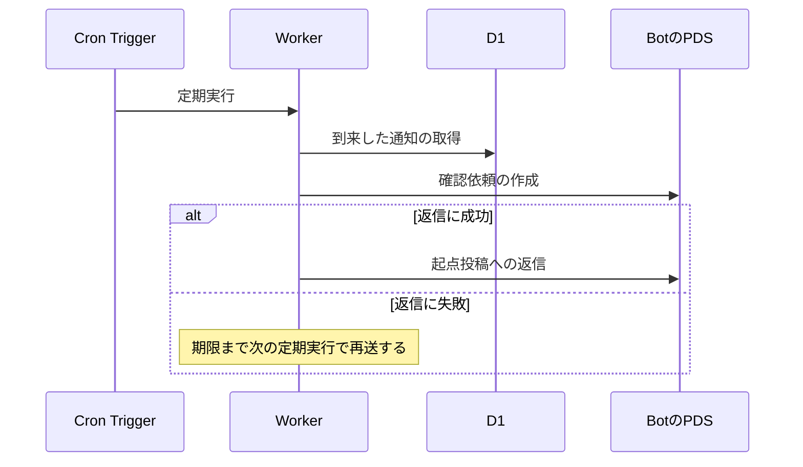
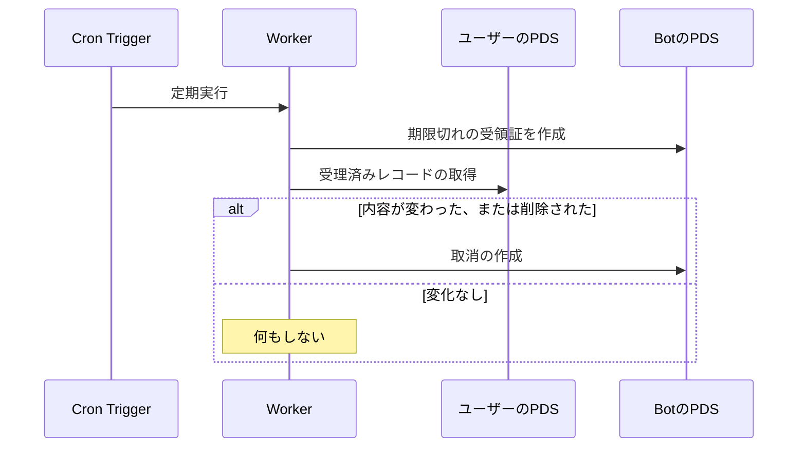
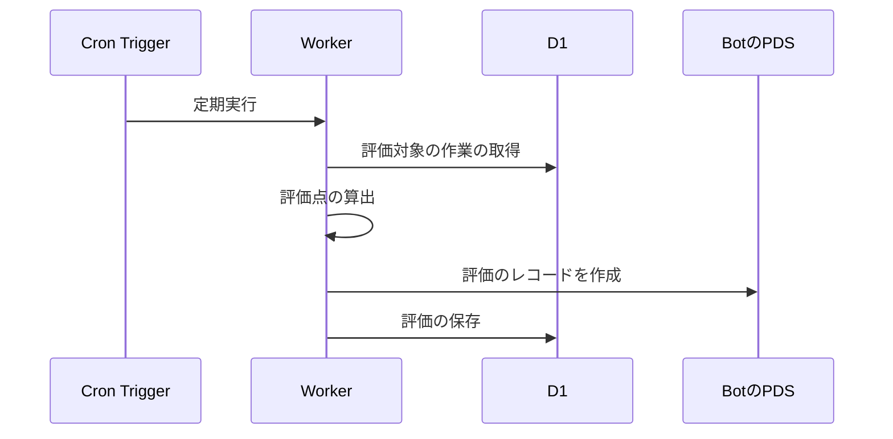
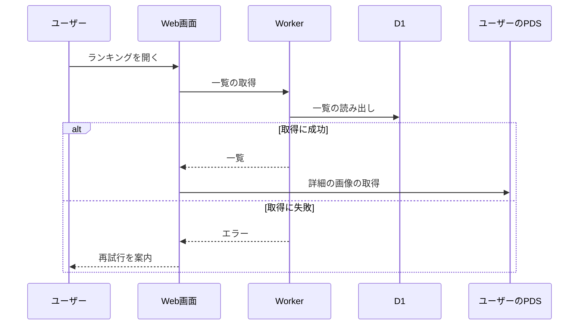
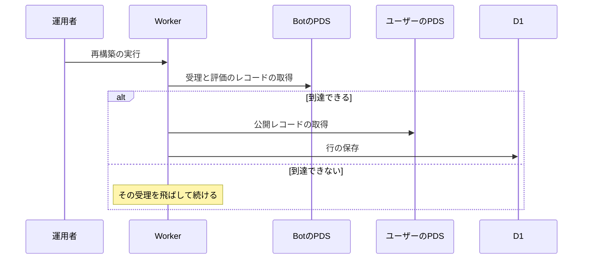

# shinchoku-chan アーキテクチャ

## 1. 目的と範囲

shinchoku-chan は、ユーザーが宣言した作業の進捗を Bot が確認し、報告を評価点つきのランキングとして公開するサービスである。
ユーザーのレコードはユーザー自身の PDS に、Bot が発行する証明は Bot の PDS に置き、データベースは両者から再構築できるキャッシュとして使う。
Bluesky の本体と課金の手続きは、このサービスの対象外である。

## 2. 構成要素

| 構成要素        | 種別 | 責務                                                   | 実装spec                                           |
| --------------- | ---- | ------------------------------------------------------ | -------------------------------------------------- |
| ユーザー        | 外部 | ブラウザで画面を操作する                               | -                                                  |
| 運用者          | 外部 | データベースの再構築を実行する                         | -                                                  |
| ユーザーのPDS   | 外部 | ユーザーのレコードと画像を保管する                     | -                                                  |
| BotのPDS        | 外部 | Bot が発行する証明のレコードを保管する                 | -                                                  |
| PLCディレクトリ | 外部 | DID から PDS の場所を解決する                          | -                                                  |
| Cron Trigger    | 外部 | 5分おきに定期実行を起動する                            | -                                                  |
| D1              | 外部 | データベースの行を保管する                             | -                                                  |
| Web画面         | 内部 | 作業の登録・報告の入力・ランキングの表示を行う         | web-task, web-ranking, ui-foundation               |
| Worker          | 内部 | API・受理・Bot の通知・評価・定期実行を提供する        | platform, receipt, bot-scheduler, ranking, scoring |
| レコード定義    | 内部 | 独自レコードの定義と検証を Web画面と Worker に共有する | lexicon                                            |

## 3. システム構成

内部の要素どうしの呼び出しは、画面から基盤へ一方向に進む。

## 4. 外部インターフェース

| IF                   | 方向 | 外部の要素      | 内部の要素 | 方式                      | 認証                     |
| -------------------- | ---- | --------------- | ---------- | ------------------------- | ------------------------ |
| 画面の閲覧           | 提供 | ユーザー        | Web画面    | HTTPS                     | なし                     |
| サインインと書き込み | 利用 | ユーザーのPDS   | Web画面    | OAuth と XRPC             | OAuth のアクセストークン |
| 画像の表示           | 利用 | ユーザーのPDS   | Web画面    | HTTPS（公開URL）          | なし                     |
| 公開レコードの取得   | 利用 | ユーザーのPDS   | Worker     | XRPC getRecord            | なし（公開）             |
| DIDの解決            | 利用 | PLCディレクトリ | Worker     | HTTPS                     | なし                     |
| Botの書き込み        | 利用 | BotのPDS        | Worker     | XRPC createRecord         | アプリパスワード         |
| 返信の投稿           | 利用 | BotのPDS        | Worker     | XRPC createRecord（投稿） | アプリパスワード         |
| 定期実行             | 提供 | Cron Trigger    | Worker     | scheduled イベント        | なし                     |
| データの保存         | 利用 | D1              | Worker     | SQL（バインディング）     | なし                     |
| 再構築の実行         | 提供 | 運用者          | Worker     | HTTPS（POST）             | 管理者トークン           |

システム境界の内側の要素と外部の要素は、IF の名前を付けた辺で結ぶ。

## 5. 機能

### 作業と報告の受理

- 関与: Web画面、レコード定義、ユーザーのPDS、Worker、BotのPDS

受理の処理は、検証に成功した場合だけ受理レコードか受領証を作る。

### 進捗確認の依頼

- 関与: Cron Trigger、Worker、D1、BotのPDS

確認の依頼は、返信に失敗した場合に期限まで再送する分岐を持つ。

### 期限切れと改変の検出

- 関与: Cron Trigger、Worker、ユーザーのPDS、BotのPDS

期限切れの記録と再確認は、定期実行のたびに行う。

### 評価の確定

- 関与: Cron Trigger、Worker、D1、BotのPDS

評価の確定は、結果確認が済んだ作業を定期実行で順に処理する。

### ランキングの閲覧

- 関与: ユーザー、Web画面、Worker、D1、ユーザーのPDS

ランキングの閲覧は、サインインなしで行える。

### データベースの再構築

- 関与: 運用者、Worker、BotのPDS、ユーザーのPDS、D1

再構築は、ユーザーのPDSに到達できない受理を飛ばして続ける。

## 6. データ

| データ                                       | 保管場所      | 書き込み主体 |
| -------------------------------------------- | ------------- | ------------ |
| 作業・進捗報告・結果報告のレコードと画像     | ユーザーのPDS | Web画面      |
| 受理・確認依頼・受領証・取消・評価のレコード | BotのPDS      | Worker       |
| 受理状況・評価・ランキングの行               | D1            | Worker       |
| システムオプションと利用資格                 | D1            | Worker       |

## 7. 信頼と検証

| 対象             | 信頼する前提                                | 検証手段                                         |
| ---------------- | ------------------------------------------- | ------------------------------------------------ |
| 受理依頼         | 依頼の送信元を信頼しない                    | 公開レコードを取得し、CID・参照・期限を照合する  |
| 受理時刻         | ユーザーのレコードの作成時刻を信頼しない    | Bot が受理した時刻を受理レコードに固定する       |
| 事前に作った報告 | 確認依頼を参照しない報告を有効にしない      | 報告が確認依頼と作業を参照していることを確認する |
| 二重の受理       | 同じ確認依頼を2回受理しない                 | 確認依頼ごとに受領証を1件だけ作る                |
| 受理後の改変     | 受理後の改変を許さない                      | 定期的に再確認して内容の変化を検出し取消を作る   |
| Bot の記録       | Bot のリポジトリに書けるのは Bot だけである | レコードを更新せず、追加だけで状態を表す         |

## 8. 技術基盤

| 領域               | 採用                    | 理由                                                   | 根拠              |
| ------------------ | ----------------------- | ------------------------------------------------------ | ----------------- |
| 実行基盤           | 単一の Worker           | 静的アセット・API・定期実行を1つの基盤で提供できる     | platform          |
| 定期実行           | Cron Trigger（5分おき） | 登録された処理を5分ごとに順に実行できる                | platform          |
| データベース       | D1                      | Bot のリポジトリから再構築できるキャッシュとして使える | platform          |
| ユーザーの書き込み | ブラウザの OAuth        | サーバーにユーザーのトークンを保存せずに書き込める     | web-task、poc/pds |
| Bot の認証         | アプリパスワード        | 専用アカウントのセッションを再利用して認証できる       | platform          |
| 画面の見た目       | 3層の設計値と基底部品   | 見た目を一箇所で管理して全部品へ反映できる             | ui-foundation     |

## 9. 横断的制約

| 制約                                | 値              | 根拠                |
| ----------------------------------- | --------------- | ------------------- |
| 受理依頼1件のCPU時間                | 10ミリ秒以内    | receipt、poc/worker |
| 受理依頼1件の外部通信               | 8回以内         | receipt             |
| 処理が空の定期実行1回のCPU時間      | 5ミリ秒以内     | platform            |
| 処理が空の定期実行1回の読み取り行数 | 20行以内        | platform            |
| 定期実行1回の通知処理               | 10件以内        | bot-scheduler       |
| ランキング一覧1リクエストの読み取り | 150行以内       | ranking             |
| データベースの使用量の警告          | 1日の上限の 80% | platform            |
| Bot が1日に作成できるレコード       | 約 11600 件     | poc/pds-limits      |
