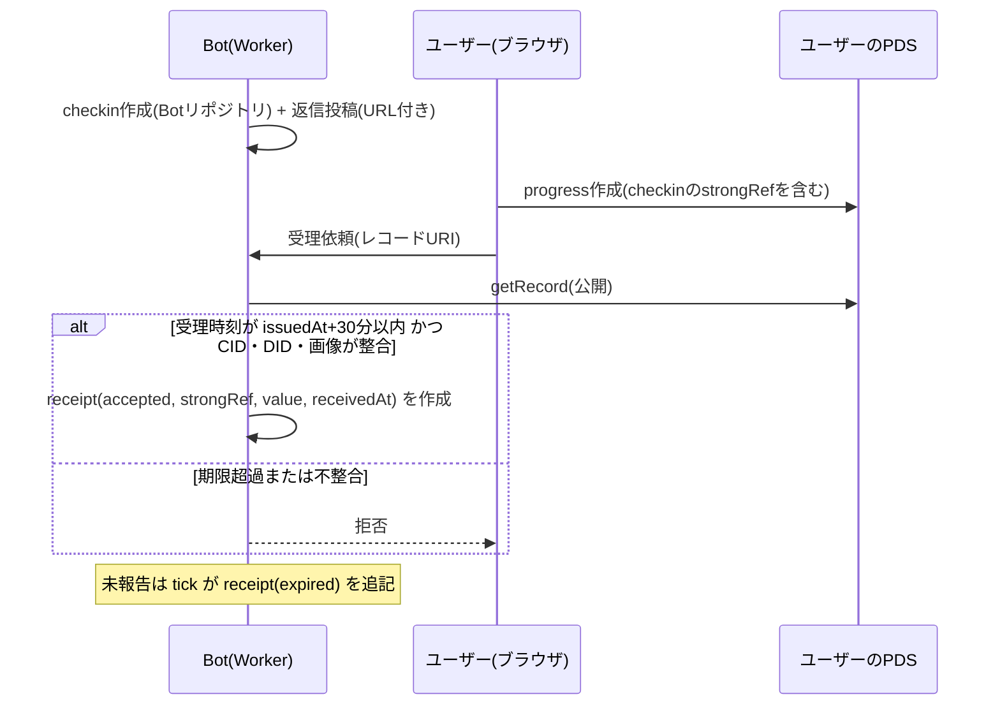

# shinchoku-chan アーキテクチャ

この文書は、仕様書（`specs/`）を書く前提となる全体方針と決定事項の記録である。要件の正本は `specs/<component>/` に置く。

## 1. 全体像

```mermaid
flowchart LR
  user["ユーザー(ブラウザ)"] -->|OAuth + 書き込み| pds["ユーザーのPDS"]
  user -->|受理依頼 / 閲覧| worker["Cloudflare Worker<br/>(Static Assets + API + Cron)"]
  worker -->|getRecord(公開XRPC)| pds
  worker -->|createRecord / 返信投稿| botpds["BotのPDS"]
  worker --> d1[("D1<br/>再構築可能なキャッシュ")]
  cron["Cron Trigger(5分おき)"] --> worker
```

- Web・API・Bot の定期実行を **1つの Worker** に同居させる（Cron Trigger は Pages Functions では使えないため）。
- ユーザーのトークンはサーバーに保存しない。ユーザーのPDSへの書き込みはブラウザの OAuth（公開クライアント）だけが行う。
- Worker が行うのは、公開レコードの読み取りと、Bot 自身のリポジトリ・投稿への書き込みだけである。
- D1 は「Bot のリポジトリから再構築できるキャッシュ」と位置づける。無料枠を超えてもデータは失われない。

## 2. 信頼モデル（受理）

ユーザーの PDS には書き込み時刻を強制できないため、「30分以内か」は **Bot が受理したか** で決める。



| 論点               | 方針                                                                                         |
| ------------------ | -------------------------------------------------------------------------------------------- |
| 時刻の基準         | ユーザーのレコードの `createdAt` は使わない。Bot の受領証の `receivedAt` を正とする          |
| 事前作成の防止     | ユーザーのレコードに checkin の strongRef（乱数 nonce を含む）を必須とする                   |
| 二重受理           | checkin ごとに受領証は1つ。2つ目以降は拒否する                                               |
| 改変の検知         | 受領証の strongRef の CID と、PDS上の現在のレコードの CID を照合する                         |
| 受理依頼の認証     | 不要。偽造できるのは本人のPDSへの書き込みだけで、他人のリポジトリには書けない               |
| Bot 側の改ざん耐性 | Bot のリポジトリに書けるのは Bot だけ。レコードは追記のみで更新しない                       |
| 削除と改変         | 削除は尊重（その作業をランキングから取り下げ）。改変は当該記録を除外。低頻度の再確認で検出  |

## 3. 技術選定

| 領域             | 採用                                                      | 採用しなかったもの                          |
| ---------------- | --------------------------------------------------------- | ------------------------------------------- |
| 実行基盤         | Cloudflare Workers 1本 + Cron(5分おきの tick) + D1       | Cloud Run + Scheduler、Durable Object Alarm |
| デプロイ         | 単一 Worker + Static Assets                               | Pages + 別 Worker                           |
| ユーザー書き込み | ブラウザ OAuth（公開クライアント）。サーバーはトークンを持たない | Worker が代理書き込み（refresh token 保管） |
| Bot 認証         | 専用アカウントの App Password（Worker Secret）            | Bot も OAuth                                |
| ランキング DB    | D1（Bot のリポジトリから再構築できるキャッシュ）          | Jetstream 常時購読（Durable Object が必要） |
| UI               | React + Vite、合成パターンで基底を拡張                    | Lit、Svelte                                 |
| スタイル         | CSS カスタムプロパティの3層トークン + CSS Modules         | Tailwind                                    |

### 無料枠との照合（2026-10 時点の確認値）

| 項目                  | 無料枠         | 想定                                               |
| --------------------- | -------------- | -------------------------------------------------- |
| Workers リクエスト    | 10万/日        | tick が 288/日、ユーザー操作が数百/日              |
| Workers CPU           | 10ms/回        | PDS 取得と CID 照合を1回の受理で行う。要 PoC       |
| Cron Trigger          | 5本/アカウント | 1本（5分おき）                                     |
| D1 読み取り・書き込み | 500万行・10万行/日 | 超過時はクエリが失敗する（2026-09-01 以降）。索引を張る |
| D1 容量               | 5GB            | 本文を含めても数MBの規模                           |

## 4. 仕様書の構成

仕様書は 1 ディレクトリ = 1 コンポーネントで、前提（他 spec への依存）は 2 件以内かつ連鎖禁止のため、次の構成とする。

| spec            | 種別     | 前提                      | 内容                                                    |
| --------------- | -------- | ------------------------- | ------------------------------------------------------- |
| lexicon         | 起点     | なし                      | 独自レコード定義・検証・互換性検査（作成済み）          |
| scoring         | 起点     | なし                      | 進捗曲線と y=x の乖離による評価点、欠測の補完と減点     |
| platform        | 起点     | なし                      | Worker、D1 スキーマ、システムオプション、時刻・時間帯の共通処理、PDS 読み取り |
| ui-foundation   | 起点     | なし                      | トークン、基底コンポーネントとその拡張の規約            |
| receipt         | 依存     | lexicon, platform         | 受理依頼の検証、受領証、期限切れ、再確認と取消          |
| bot-scheduler   | 依存     | lexicon, platform         | トリガー生成、選出、確認依頼と返信、結果確認            |
| ranking         | 依存     | platform, scoring         | 評価の確定、ランキング API                              |
| web-task        | 依存     | lexicon, ui-foundation    | OAuth ログイン、作業登録、進捗・結果の入力              |
| web-ranking     | 依存     | ui-foundation, platform   | ランキング表、詳細表示、プロフィールへのリンク          |

プレミアム（複数作業の並行）のため、platform に「ユーザーごとの同時進行数の上限」を持たせ、通知の選出単位は作業とする。lexicon は件数の制限を持たない。

## 5. 確定済みの運用ルール

| 項目                     | 内容                                                                                       |
| ------------------------ | ------------------------------------------------------------------------------------------ |
| 返信の起点               | 作業登録時にユーザーが Bot へメンションする起点投稿を作る。Bot はその投稿の子として返信する |
| 参加                     | 誰でも登録可。同時進行は1作業（プレミアムで拡張）                                          |
| 1日作業の確認帯          | 開始+12時間を含む帯。なければ最寄りの帯                                                    |
| 結果確認                 | 終了時刻以降で最も近い帯。終了が帯の内側ならその帯の残り区間からランダム                   |
| トリガー                 | 1日8回（オプション）。帯ごとに登録ユーザー数で比例配分し、帯内のランダム時刻に置く        |
| 欠測の補完               | 前後の実記録を結ぶ線上の値（端は最寄りの実記録）                                           |
| 欠測の減点               | 1件につき 2 点、上限 10 点（オプション）                                                   |
| 進捗の入力               | 実測値。進捗率は（実測値−開始値）／（ゴール値−開始値）                                     |
| Bot 側に保存しない情報   | ユーザーの自由記述。作業を削除したときに本文が残らないようにする                           |

## 6. 小さく確認する事項（実装前の検証）

| 検証                                                                 | 目的                                         |
| -------------------------------------------------------------------- | -------------------------------------------- |
| ブラウザ OAuth で独自コレクションの `repo:` と `blob:` 権限を要求する | bsky.social で独自 NSID の書き込みが通るか   |
| Worker 上での getRecord と CID 照合のCPU時間                         | 10ms 以内に収まるか                          |
| Bot の返信投稿（メンション付き起点投稿の子）                         | 返信が通知として届くか、bot ラベルの付与      |
| bsky.social の書き込みレート制限                                     | Bot が1日に書くレコード数の上限に収まるか    |

## 7. サブスクリプション拡張の受け皿

プレミアム機能は、利用資格（entitlement）の機能フラグで切り替える。資格はレコードではなく D1 で管理し、課金の仕組みとは切り離す。

| 拡張                       | 受け皿                                                                                              | lexicon への影響                                              |
| -------------------------- | --------------------------------------------------------------------------------------------------- | ------------------------------------------------------------- |
| 複数作業の並行             | 資格に同時進行数の上限を持たせる。選出の単位は作業                                                  | なし                                                          |
| 通知時間の1時間単位化      | 受理時に通知窓（分単位）へ解決して固定する。無料の朝・昼・夕も同じ窓へ変換する                      | 受理レコードの必須項目を窓の配列にしておく。作業レコードの任意項目で後から窓を追加できる |
| 1日の複数回通知            | 資格に回数の上限を持たせ、受理時に回数を固定する。確認依頼の連番は日をまたいだ通し番号               | 受理レコードに任意項目として追加できる                        |
| 通知の優先度               | 選出処理を「優先枠 → 通常枠」の2段にし、通常枠の上限を優先枠の人数に応じて拡張する                  | なし                                                          |
| Bot メッセージのキャラ設定 | 返信文をキャラ ID ごとのテンプレート集から引く。未設定は標準キャラ                                  | 作業レコードの任意項目として追加できる                        |

資格がないユーザーがプレミアム項目を書いたレコードを登録した場合、受理時に Bot が資格を確認し、資格外の項目を無視した内容で受理する。受理レコードには、実際に適用した値だけを固定する。

### 確定したプレミアムの運用ルール

| 項目               | 内容                                                                                                   |
| ------------------ | ------------------------------------------------------------------------------------------------------ |
| 優先度             | 窓内のトリガーで必ず選出する。通常枠の上限は、そのトリガーで選出したプレミアムの人数分だけ拡張する    |
| 通知窓             | 1時間単位、6:00〜23:00 の範囲内。無料の朝昼夕は 8:00〜20:00。1日の作業でも指定できる                   |
| 通知枠の数         | 設定できる窓の数はシステム固定値（初期 3）。ユーザーは超過して設定できない                             |
| 日の必須回数       | ユーザーが指定するスコア用の値。通知回数とは独立。不足1回ごとに欠測と同じ減点（−2点、上限 −10点）      |
| キャラ設定         | ユーザー単位。ユーザーの PDS に「希望」を書き、Bot が資格を確認して Bot 側に「適用」を追記する          |

追加するレコード（新しい識別子の追加のみで、既存の定義は変わらない）: 希望（ユーザー側）、適用（Bot側）。作業レコードには窓の配列と日の必須回数の任意項目を後から追加する。
