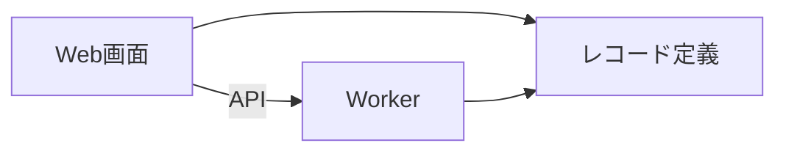
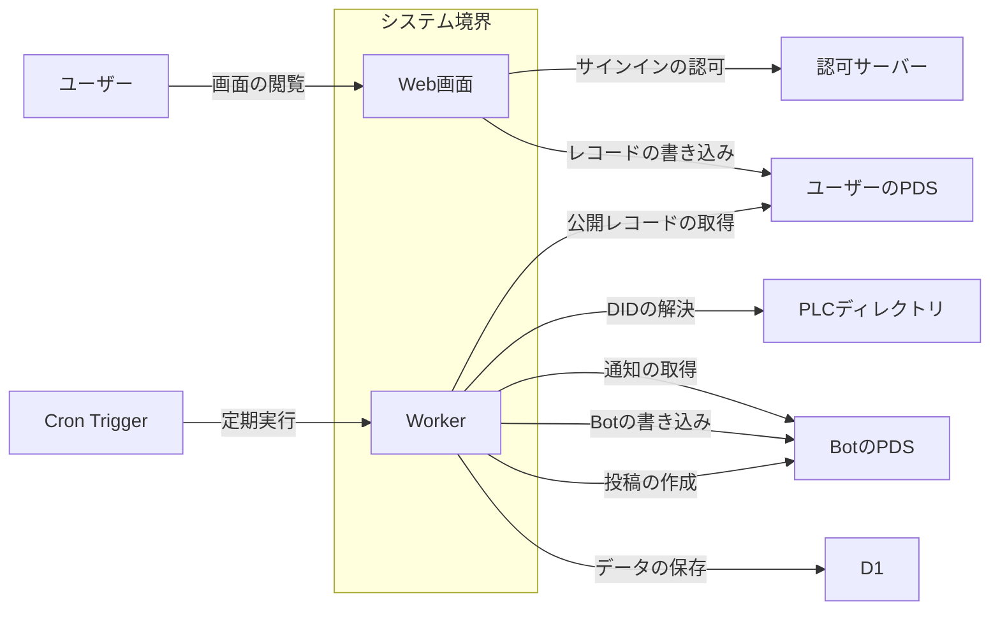
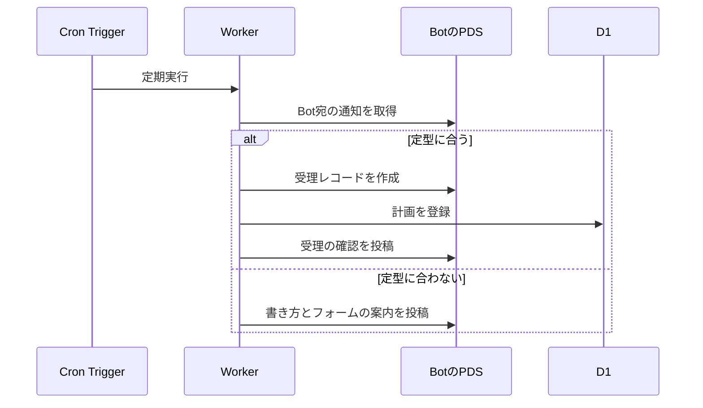
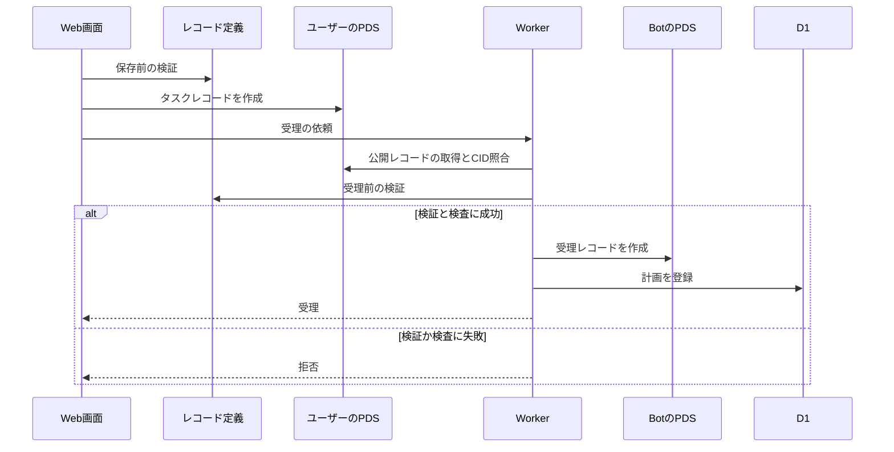
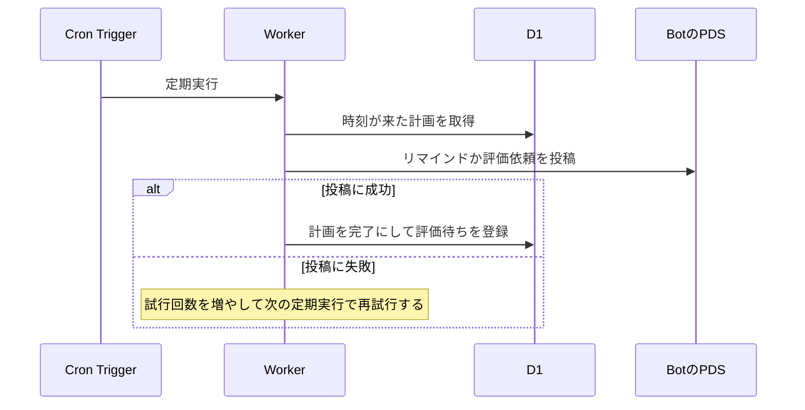
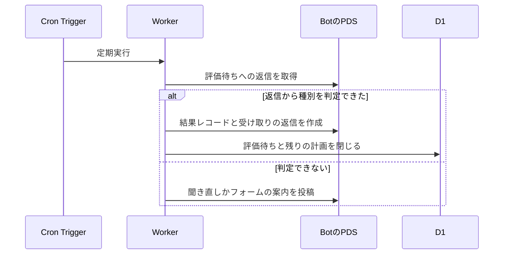
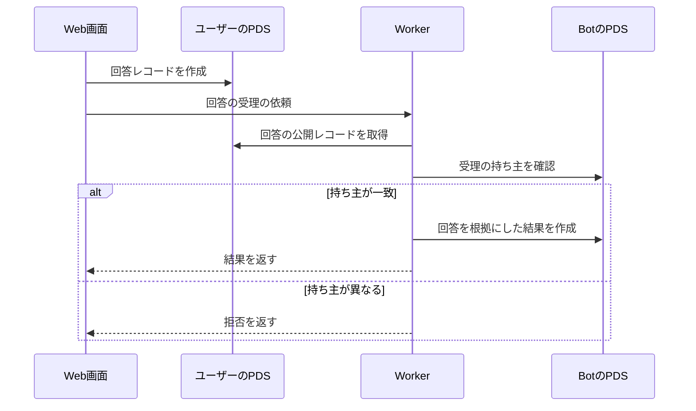

# shinchoku-chan アーキテクチャ

## 1. 目的と範囲

shinchoku-chan は、ユーザーが Bluesky の Bot へ送ったタスクを受け付け、期限にリマインドと評価の依頼を返し、返信から達成を記録するサービスである。
登録はメンションまたは Web フォームで行い、タスクと回答はユーザー自身の PDS に、受理と結果は Bot の PDS に置く。
データベースは、PDS から再構築できる計画の索引だけを持つ。
点数の算出・ランキング・Bluesky 本体と課金の手続きは、このサービスの対象外である。

## 2. 構成要素

| 構成要素        | 種別 | 責務                                                     | 実装spec                               |
| --------------- | ---- | -------------------------------------------------------- | -------------------------------------- |
| ユーザー        | 外部 | ブラウザで画面を操作し、Bluesky で Bot へ投稿する        | -                                      |
| ユーザーのPDS   | 外部 | ユーザーのタスクと回答のレコードを保管する               | -                                      |
| BotのPDS        | 外部 | Bot の受理と結果のレコードを保管し、Bot 宛の通知を返す   | -                                      |
| PLCディレクトリ | 外部 | DID から PDS の場所を解決する                            | -                                      |
| 認可サーバー    | 外部 | ブラウザのサインインを認可する                           | -                                      |
| Cron Trigger    | 外部 | 1 分おきに定期実行を起動する                             | -                                      |
| D1              | 外部 | 計画・評価待ちの投稿・Bot のセッションの行を保管する     | -                                      |
| Web画面         | 内部 | タスクの登録と評価の入力を受け付け、登録の仕方を案内する | web-form, ui-foundation                |
| Worker          | 内部 | 通知の受信・受理・投稿・評価・API・定期実行を提供する    | platform, intake, reminder, evaluation |
| レコード定義    | 内部 | 独自レコードの定義と検証を Web画面と Worker に共有する   | lexicon                                |

## 3. システム構成

内部の要素どうしの呼び出しは、画面から基盤へ一方向に進む。

## 4. 外部インターフェース

| IF                 | 方向 | 外部の要素      | 内部の要素 | 方式                      | 認証                         |
| ------------------ | ---- | --------------- | ---------- | ------------------------- | ---------------------------- |
| 画面の閲覧         | 提供 | ユーザー        | Web画面    | HTTPS                     | なし                         |
| サインインの認可   | 利用 | 認可サーバー    | Web画面    | OAuth                     | 公開クライアントの識別子     |
| レコードの書き込み | 利用 | ユーザーのPDS   | Web画面    | OAuth と XRPC             | OAuth のアクセストークン     |
| 公開レコードの取得 | 利用 | ユーザーのPDS   | Worker     | XRPC getRecord            | なし（公開）                 |
| DIDの解決          | 利用 | PLCディレクトリ | Worker     | HTTPS                     | なし                         |
| 通知の取得         | 利用 | BotのPDS        | Worker     | XRPC listNotifications    | アプリパスワードのセッション |
| Botの書き込み      | 利用 | BotのPDS        | Worker     | XRPC createRecord         | アプリパスワードのセッション |
| 投稿の作成         | 利用 | BotのPDS        | Worker     | XRPC createRecord（投稿） | アプリパスワードのセッション |
| 定期実行           | 提供 | Cron Trigger    | Worker     | scheduled イベント        | なし                         |
| データの保存       | 利用 | D1              | Worker     | 保存先の契約（D1 の実装） | なし                         |

システム境界の内側の要素と外部の要素は、IF の名前を付けた辺で結ぶ。

## 5. 機能

### メンションによるタスクの登録

- 関与: Cron Trigger, Worker, BotのPDS, D1

メンションの受理は、定型に合わない場合に書き方を返信する分岐を持つ。

### フォームによるタスクの登録

- 関与: Web画面, レコード定義, ユーザーのPDS, Worker, BotのPDS, D1

フォームの受理は、検証に成功した場合だけ受理レコードを作る。

### リマインドと評価依頼の投稿

- 関与: Cron Trigger, Worker, D1, BotのPDS

投稿は、失敗した場合に次の定期実行で再試行する分岐を持つ。

### 返信による評価

- 関与: Cron Trigger, Worker, BotのPDS, D1

返信の評価は、判定できない場合に聞き直しとフォームの案内へ進む分岐を持つ。

### フォームによる評価

- 関与: Web画面, ユーザーのPDS, Worker, BotのPDS

フォームの評価は、回答の持ち主が受理の持ち主と異なる場合に拒否する分岐を持つ。

## 6. データ

| データ                      | 保管場所      | 書き込み主体 |
| --------------------------- | ------------- | ------------ |
| タスク（フォーム経路）      | ユーザーのPDS | Web画面      |
| 回答（フォーム経路）        | ユーザーのPDS | Web画面      |
| 受理                        | BotのPDS      | Worker       |
| 結果                        | BotのPDS      | Worker       |
| 計画                        | D1            | Worker       |
| 評価待ちの投稿              | D1            | Worker       |
| Botのセッションと通知の位置 | D1            | Worker       |

## 7. 信頼と検証

| 対象                   | 信頼する前提                                    | 検証手段                                                       | 根拠             |
| ---------------------- | ----------------------------------------------- | -------------------------------------------------------------- | ---------------- |
| フォーム経路のレコード | ユーザーの PDS が返す内容は書き換えられていない | Worker が CID を再計算して照合する                             | platform, intake |
| フォームの回答         | 受理の持ち主だけが評価を確定できる              | 回答の URI の DID と受理の持ち主を照合する                     | evaluation       |
| Bot のレコード         | 受理と結果は Bot だけが作れる                   | Bot のセッションで作り、キーを秘密値から導いて二重の作成を拒む | platform         |
| ブラウザの権限         | ブラウザは最小の権限だけを持つ                  | タスクと回答の作成だけを OAuth で要求する                      | web-form         |
| 同時進行数の上限       | 資格は DID の一覧で与えられる                   | 受理の前に DID から上限を引き当てて進行中の数と比べる          | platform, intake |

## 8. 技術基盤

| 領域       | 採用                  | 理由                                                       | 根拠                |
| ---------- | --------------------- | ---------------------------------------------------------- | ------------------- |
| 実行基盤   | Cloudflare Workers    | 無料枠で API と毎分の定期実行を 1 つの Worker で提供できる | platform            |
| 受信方式   | 通知の定期的な取得    | 公開ポートを持たずに、メンションと返信を数秒で受け取れる   | poc/inbox, platform |
| データ保管 | D1                    | PDS から再構築できる索引だけを無料枠の範囲で保管できる     | platform            |
| 主データ   | PDS の独自レコード    | ユーザーのデータをユーザー自身の PDS に置ける              | lexicon             |
| 画面       | React と設計値の 3 層 | 部品を差し替えられ、見た目を設計値だけで変えられる         | ui-foundation       |

## 9. 横断的制約

| 制約                     | 値                        | 根拠                |
| ------------------------ | ------------------------- | ------------------- |
| 定期実行の周期           | 1 分おき                  | poc/inbox, platform |
| 通知から処理までの遅れ   | 90 秒以内                 | platform            |
| 1 回の実行の外部通信     | 50 回以内                 | poc/inbox           |
| 無料の同時進行数         | 1 件                      | platform            |
| 期限日の範囲             | 受理の翌日から 14 日以内  | intake              |
| 評価依頼から期限切れまで | 72 時間                   | platform            |
| 画面のスクリプトの大きさ | 圧縮後 200 キロバイト以下 | web-form            |
