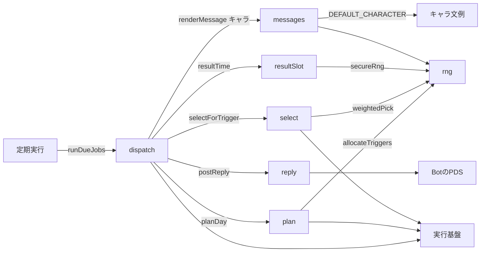
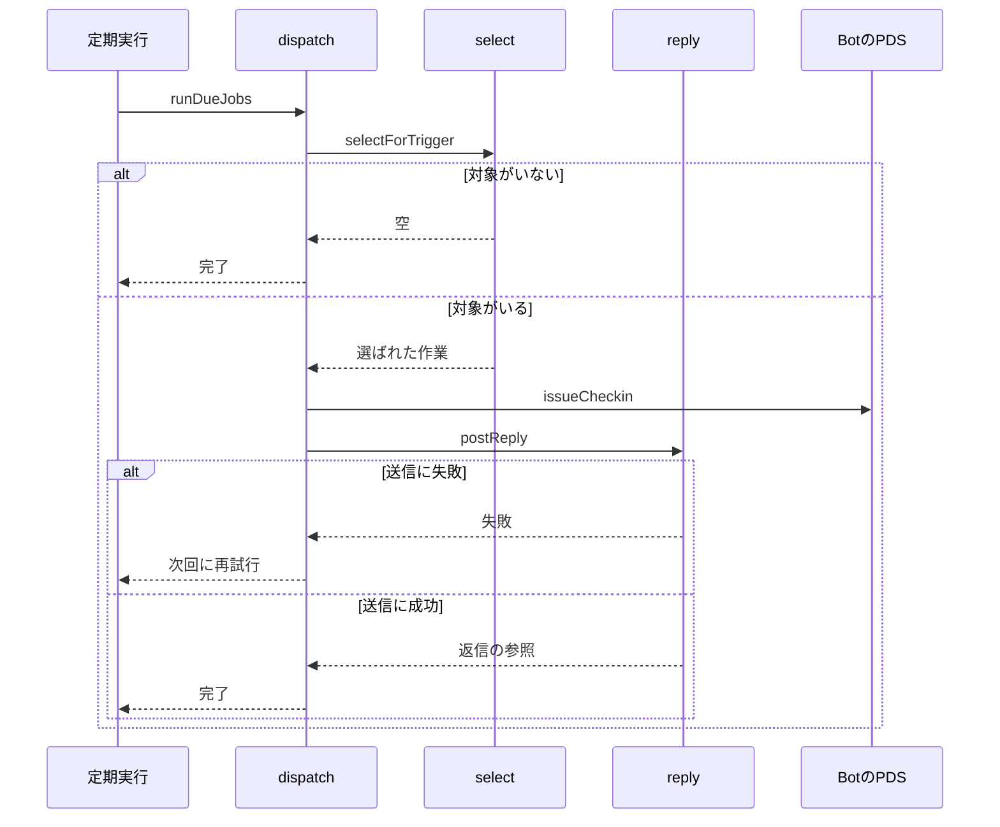

# Bot通知 設計書

## 1. 構成

| パス                    | 責務                                               |
| ----------------------- | -------------------------------------------------- |
| `src/bot/rng.ts`        | 乱数の抽象（本番は暗号用乱数、試験は固定列）       |
| `src/bot/plan.ts`       | 日次の計画（通知時刻の配分と生成、持ち越しの更新） |
| `src/bot/select.ts`     | 通知時刻ごとの対象の選出                           |
| `src/bot/resultSlot.ts` | 結果確認の通知時刻の算出                           |
| `src/bot/messages.ts`   | キャラ別の文例と文面の生成                         |
| `src/bot/reply.ts`      | 起点投稿への返信の送信                             |
| `src/bot/dispatch.ts`   | 期限の来た通知の実行と確認依頼の発行               |

## 2. 関係図・ワークフロー

通知処理の依存方向を示す。



通知時刻の実行の流れと、対象がない場合と送信失敗の分岐を示す。



## 3. 設計項目

### D-1: 乱数 (FR-3, FR-5, FR-7, FR-10)

```ts
export type Rng = { next(): number; int(min: number, max: number): number }

export function secureRng(): Rng {
  return {
    next: () => crypto.getRandomValues(new Uint32Array(1))[0] / 2 ** 32,
    int(min, max) {
      return min + Math.floor(this.next() * (max - min + 1))
    },
  }
}
```

試験では、固定列を返す Rng を渡す。計画と選出は、乱数以外の入力が同じなら同じ結果になる。

### D-2: 日次の計画 (FR-1, FR-2, FR-3, FR-4, FR-8)

```ts
export type Slot = "morning" | "noon" | "evening"

export function allocateTriggers(
  counts: Record<Slot, number>,
  total: number,
): Record<Slot, number>

export async function planDay(
  env: Env,
  dayStart: number,
  rng: Rng,
): Promise<void>
```

allocateTriggers の規則:

| 規則          | 内容                                                             |
| ------------- | ---------------------------------------------------------------- |
| 最低配分      | 人数が 1 以上の帯に 1 回ずつ。合計が足りなければ人数の多い帯から |
| 残りの配分    | 残り回数を人数の比で按分し、小数部の大きい帯から 1 回ずつ加える  |
| 人数が 0 の帯 | 0 回                                                             |

| 朝  | 昼  | 夕  | 合計 | 結果          |
| --- | --- | --- | ---- | ------------- |
| 5   | 0   | 5   | 8    | 朝4・昼0・夕4 |
| 1   | 0   | 9   | 8    | 朝2・昼0・夕6 |

planDay の手順:

| 手順 | 内容                                                                                                   |
| ---- | ------------------------------------------------------------------------------------------------------ |
| 1    | schedule_jobs に kind が plan、ref が dayStart の行があれば何もしない                                  |
| 2    | 前日に通知を受けなかった無料ユーザーの notify_state.missed_days を 1 増やし、受けたユーザーは 0 にする |
| 3    | 進行中の作業から、無料の作業の帯ごとの人数を数える（窓が朝・昼・夕のどれかに一致するもの）             |
| 4    | allocateTriggers で帯ごとの回数 K を決め、各帯を K 等分した区間ごとに乱数で時刻を決める                |
| 5    | trigger の行を保存する。ref は { slot, k: K, users: 帯の人数 }                                         |
| 6    | 優先資格の作業の各窓に、窓内の通知時刻がなければ、窓内の乱数の時刻で priority の行を保存する           |
| 7    | plan の行を done で保存する                                                                            |

### D-3: 通知対象の選出 (FR-5, FR-6, FR-7, NFR-2)

```ts
export async function selectForTrigger(
  env: Env,
  job: TriggerJob,
  now: number,
  rng: Rng,
): Promise<SelectedTask[]>

export function weightedPick<T extends { weight: number }>(
  items: T[],
  count: number,
  rng: Rng,
): T[]
```

| 手順 | 処理                                                                                                                |
| ---- | ------------------------------------------------------------------------------------------------------------------- |
| 1    | 進行中で、now が開始と終了の間にあり、窓のいずれかが now を含み、その窓の instance_key の確認依頼がない作業を集める |
| 2    | 優先資格の作業を priorityTasks、それ以外を normalTasks に分ける                                                     |
| 3    | priorityTasks はすべて選ぶ（P 件）                                                                                  |
| 4    | job が trigger の場合、X = min(maxUsersPerTrigger, ceil(users / k))、n = 1 から X の乱数                            |
| 5    | normalTasks から n + P 件を weightedPick で選ぶ。重み = 1 + priorityWeightPerMissedDay × missed_days                |
| 6    | job が priority の場合は、手順 3 の結果だけを返す                                                                   |

weightedPick は、重みに比例した確率で重複なしに count 件を選ぶ。件数が足りなければ全件を返す。

### D-4: 確認依頼の発行と返信 (FR-9, FR-12)

```ts
export async function issueCheckin(
  env: Env,
  task: SelectedTask,
  now: number,
): Promise<StrongRef>

export async function postReply(
  env: Env,
  anchor: StrongRef,
  text: string,
): Promise<StrongRef>
```

| 手順 | 内容                                                                                                                |
| ---- | ------------------------------------------------------------------------------------------------------------------- |
| 1    | instance_key（日付 + 作業 + 窓の番号）の確認依頼が D1 にあれば、その確認依頼を再利用する                            |
| 2    | なければ、乱数 16 バイトの nonce を持つ確認依頼（kind: progress）を Bot のリポジトリへ作り、D1 へ追加する           |
| 3    | issuedAt = now、expiresAt = now + checkinWindowMinutes                                                              |
| 4    | 返信を、root と parent を起点投稿にして投稿する。本文に確認用のリンク（PUBLIC_ORIGIN の /c/ 確認依頼の id）を含める |
| 5    | 返信の参照を checkins.reply_uri に保存する                                                                          |

| 状態                         | 次の定期実行での扱い                                        |
| ---------------------------- | ----------------------------------------------------------- |
| 手順 4 の失敗                | reply_uri が空で期限内の確認依頼に、手順 4 だけを再試行する |
| 期限を過ぎても返信がない     | 期限切れとして扱い、再試行しない                            |
| 作業が取り下げ、または終了後 | 進捗の確認依頼を作らず、再試行もしない                      |

### D-5: 結果確認の時刻 (FR-11)

```ts
export function resultTime(endsAt: number, rng: Rng): number
```

| 条件                                            | 結果確認の時刻の範囲                       |
| ----------------------------------------------- | ------------------------------------------ |
| 終了が 8:00〜20:00 の朝・昼・夕のいずれかの内側 | 終了時刻から、その帯の終わりまでの間の乱数 |
| 終了が 20:00 以降                               | 翌日の 8:00〜12:00 の間の乱数              |
| 終了が 8:00 より早い時刻                        | 同じ日の 8:00〜12:00 の間の乱数            |

| 終了時刻 | 範囲             |
| -------- | ---------------- |
| 10:00    | 10:00〜12:00     |
| 24:00    | 翌日 8:00〜12:00 |
| 14:00    | 14:00〜16:00     |

作業の終了後に、結果確認の確認依頼がなく result の行もない作業を見つけたら、resultTime で run_at を決めて result の行を保存する。実行時は進捗と同じ手順で確認依頼を作り、kind を result にして返信を送る。通常の通知数には数えない。

### D-6: 文例とキャラ (FR-10)

```ts
export const DEFAULT_CHARACTER = "standard"

export type Character = { id: string; progress: string[]; result: string[] }

export function renderMessage(
  characterId: string,
  kind: "progress" | "result",
  url: string,
  limitMinutes: number,
  rng: Rng,
): string
```

| 項目         | 内容                                                                             |
| ------------ | -------------------------------------------------------------------------------- |
| 文例         | キャラごとに進捗用 4 件以上、結果用 4 件以上。各文例は {url} と {minutes} を含む |
| 選択         | rng.int で 1 件を選ぶ。直前に使った文例と同じなら 1 回だけ選び直す               |
| 未知のキャラ | DEFAULT_CHARACTER を使う                                                         |
| 長さ         | 300 文字以内（リンクは 1 件の facet として付ける）                               |

### D-7: 定期実行への組み込み (NFR-1)

```ts
export async function runDueJobs(now: number, env: Env): Promise<void>
```

| 段階           | 内容                                                                                                 |
| -------------- | ---------------------------------------------------------------------------------------------------- |
| 計画           | 今日の plan の行がなければ planDay を呼ぶ                                                            |
| 結果確認の登録 | 終了後で result の行がない作業に、結果確認の時刻で result の行を保存する（10 件まで）                |
| 期限の来た通知 | state が pending で run_at が now を超えていない行を run_at 順に 10 件まで取り、実行して done にする |
| 再試行         | 返信が未送信で期限を超えていない確認依頼を 10 件まで取り、返信を再試行する                           |

1 回の実行で読む行数は、plan・作業・確認依頼を合わせて 200 行以下に収める。各クエリは索引（jobs_due、tasks_status_ends、checkins_open）を使う。

## 4. エラー処理

| 事象                             | 処理                                                        |
| -------------------------------- | ----------------------------------------------------------- |
| 返信の送信が失敗                 | 確認依頼は残し、期限内は次の定期実行で再試行する            |
| Bot のリポジトリへの書き込み失敗 | その通知の行は pending のまま残し、次の定期実行で再実行する |
| 行の実行中に例外                 | 他の行は続け、失敗を記録する                                |
| 通知対象が 0 件                  | 行を done にして終了する                                    |
| 帯の人数が 0                     | その帯には通知時刻を作らない                                |
