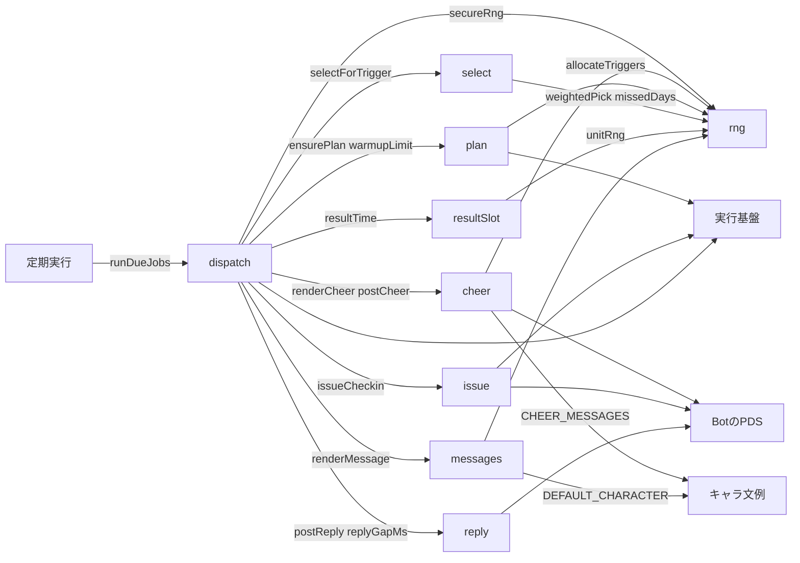
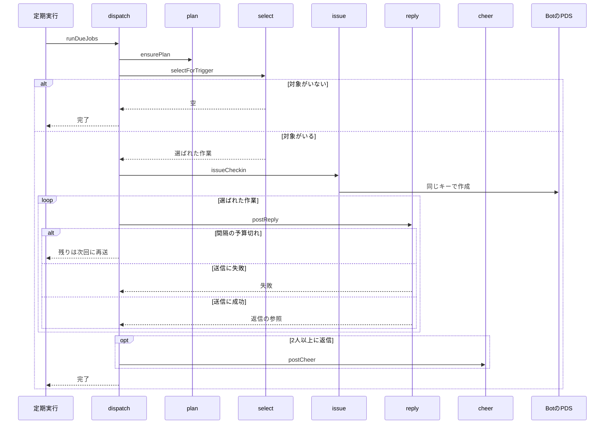

# Bot通知 設計書

## 1. 構成

| パス                    | 責務                                                         |
| ----------------------- | ------------------------------------------------------------ |
| `src/bot/rng.ts`        | 乱数の抽象（本番は暗号用乱数、試験は固定列、再現用は固定値） |
| `src/bot/plan.ts`       | 日次の計画（通知時刻の配分と生成）とウォームアップ           |
| `src/bot/select.ts`     | 通知時刻ごとの対象の選出                                     |
| `src/bot/issue.ts`      | 確認依頼のレコードの作成と登録                               |
| `src/bot/resultSlot.ts` | 結果確認の通知時刻の算出                                     |
| `src/bot/messages.ts`   | キャラ別の文例と文面の生成                                   |
| `src/bot/reply.ts`      | 起点投稿への返信の送信と、返信の間隔                         |
| `src/bot/cheer.ts`      | 応援の通常投稿の文面と送信（単独で取り外せる）               |
| `src/bot/dispatch.ts`   | 期限の来た通知の実行と、返信の再送                           |

## 2. 関係図・ワークフロー

通知処理の依存方向を示す。



通知時刻の実行の流れと、対象がない場合と送信失敗の分岐を示す。



## 3. 設計項目

### D-1: 乱数 (FR-2, FR-4, FR-5, FR-9)

```ts
export type Rng = { next(): number; int(min: number, max: number): number }

export function secureRng(): Rng {
  return {
    next: () => crypto.getRandomValues(new Uint32Array(1))[0] / 2 ** 32,
    int(min, max) {
      return min + Math.floor(this.next() * (max - min + 1))
    },
  }
}

export function unitRng(u: number): Rng // next は常に u を返し、int は min + floor(u × (max - min + 1))
```

試験では、固定列を返す Rng を渡す。計画と選出は、乱数以外の入力が同じなら同じ結果になる。unitRng は、保存しない乱数（結果確認の時刻）を再現するために使う。

### D-2: 日次の計画とウォームアップ (FR-1, FR-2, FR-3, FR-11)

```ts
export type Slot = "morning" | "noon" | "evening"

export function allocateTriggers(
  counts: Record<Slot, number>,
  total: number,
): Record<Slot, number>

export function warmupLimit(
  startDate: string | undefined,
  today: number,
  target: number,
  days: number,
): number

export async function ensurePlan(
  env: Env,
  now: number,
  rng: Rng,
): Promise<PlanRow>
```

allocateTriggers の規則:

| 規則          | 内容                                                             |
| ------------- | ---------------------------------------------------------------- |
| 最低配分      | 人数が 1 以上の帯に 1 回ずつ。合計が足りなければ人数の多い帯から |
| 残りの配分    | 残り回数を人数の比で按分し、小数部の大きい帯から 1 回ずつ加える  |
| 人数が 0 の帯 | 0 回                                                             |

| 朝  | 昼  | 夕  | 合計 | 結果          |
| --- | --- | --- | ---- | ------------- |
| 5   | 0   | 5   | 8    | 朝4・昼0・夕4 |
| 1   | 0   | 9   | 8    | 朝2・昼0・夕6 |

warmupLimit は、today を日番号（日本時間）、startDate を BOT_START_DATE として、1 日の通常の通知時刻の数を返す。経過日数 e = today − startDate の日番号（未設定または開始前は 0）とする。

| e         | 戻り値                             | 例（target 8、days 30）    |
| --------- | ---------------------------------- | -------------------------- |
| days 未満 | 1 + floor((target − 1) × e / days) | e=0 は 1、15 は 4、29 は 7 |
| days 以上 | target                             | 30 以降は 8                |

ensurePlan の手順:

| 手順 | 内容                                                                                                                                  |
| ---- | ------------------------------------------------------------------------------------------------------------------------------------- |
| 1    | plans.get で今日の計画があれば返す                                                                                                    |
| 2    | 回数 = warmupLimit(BOT_START_DATE, 今日, triggersPerDay, warmupDays)。ウォームアップ中かどうかは e が days 未満かで決まる             |
| 3    | tasks.countActiveBySlot で帯ごとの人数を得て、allocateTriggers で帯ごとの回数 K を決め、各帯を K 等分した区間ごとに乱数で時刻を決める |
| 4    | tasks.listPriority の各作業の各窓に、窓内の通常の通知時刻がなければ、窓内の乱数の時刻で優先の通知時刻を加える                         |
| 5    | 通知時刻の配列（id、種別、時刻、帯、K、人数、優先は作業と窓の番号）を plans.putIfAbsent で保存し、保存された計画を返す                |

並行して計画が作られても、保存される計画は 1 つだけで、全員が同じ計画を使う。

### D-3: 通知対象の選出 (FR-4, FR-5, NFR-2)

```ts
export type SelectedTask = { task: TaskRow; window: number }

export function missedDays(task: TaskRow, today: number): number {
  const last = task.lastNotifiedDay ?? dayNumber(task.startedAt) - 1
  return Math.max(0, today - last - 1)
}

export function selectForTrigger(
  trigger: PlanTrigger,
  candidates: TaskRow[],
  now: number,
  rng: Rng,
  o: { maxUsersPerTrigger: number; priorityWeight: number; warmup: boolean },
): SelectedTask[]

export function weightedPick<T extends { weight: number }>(
  items: T[],
  count: number,
  rng: Rng,
): T[]
```

| 手順 | 処理                                                                                            |
| ---- | ----------------------------------------------------------------------------------------------- |
| 1    | 候補のうち、窓のいずれかが now の分を含むものを残し、含む窓の番号を window とする               |
| 2    | lastNotifiedDay が今日で、notifiedWindows にその窓の番号が立っている作業を除く                  |
| 3    | trigger の種別が優先なら、trigger の作業が残っている場合にその 1 件だけを返す                   |
| 4    | 種別が通常なら、priority が真の作業をすべて選ぶ（P 件）                                         |
| 5    | X = warmup なら 1、そうでなければ min(maxUsersPerTrigger, ceil(users / k))。n = 1 から X の乱数 |
| 6    | priority が偽の作業から n 件を weightedPick で選ぶ。重み = 1 + priorityWeight × missedDays      |

weightedPick は、重みに比例した確率で重複なしに count 件を選ぶ。件数が足りなければ全件を返す。選出は保存先を読まない関数で、候補は呼び出し側が 1 回の読み出しで渡す。

### D-4: 確認依頼の発行 (FR-7)

```ts
export async function issueCheckin(
  env: Env,
  sel: SelectedTask,
  kind: "progress" | "result",
  now: number,
): Promise<OpenCheckinRow | null>
```

| 手順 | 内容                                                                                                                                                                                       |
| ---- | ------------------------------------------------------------------------------------------------------------------------------------------------------------------------------------------ |
| 1    | キー = checkinKey(RKEY_SECRET, 作業の id（受理のキー）, { day, window, kind })。結果確認の window は 0                                                                                     |
| 2    | 確認依頼（kind、progress なら seq = progressIssued + 1、乱数 16 バイトの nonce、issuedAt = now、expiresAt = now + checkinWindowMinutes）を、そのキーで putRecord（swapRecord を null）する |
| 3    | 作成済みだった場合、openCheckins.get で行があればそれを返す。なければ Bot のリポジトリの同じキーの受領証を引き、あれば解決済みとして null を返す                                           |
| 4    | openCheckinRowFromRecords で行（replyUri は空）を作り、openCheckins.put で登録する                                                                                                         |
| 5    | 進捗なら tasks.patch で lastNotifiedDay を今日、notifiedWindows に窓の番号を加え（日が替わっていれば置き換え）、progressIssued を 1 増やす。結果確認なら resultState を issued にする      |

手順 2 の後に手順 4 以降が失敗しても、同じ作業は次の通知時刻で再び選ばれ、手順 3 で登録がやり直される。確認依頼が二重に作られることはない。

### D-5: 返信と間隔 (FR-7, FR-12, NFR-3)

```ts
export async function postReply(
  env: Env,
  anchor: StrongRef,
  text: string,
): Promise<StrongRef>

export function replyGapMs(
  rng: Rng,
  o: { replyGapMinSeconds: number; replyGapMaxSeconds: number },
  budgetLeftMs: number,
): number | null
```

| 項目   | 内容                                                                                                          |
| ------ | ------------------------------------------------------------------------------------------------------------- |
| 返信   | root と parent を作業の起点投稿（anchorUri、anchorCid）にして、app.bsky.feed.post を作る                      |
| リンク | 本文のリンク（PUBLIC_ORIGIN の /c/ 確認依頼のキー）に link の facet を付ける。位置は UTF-8 のバイト数で数える |
| 間隔   | gap = rng.int(replyGapMinSeconds, replyGapMaxSeconds) × 1000。同じ定期実行の 2 件目以降の返信の前に待つ       |
| 予算   | 待ち時間の合計は 240000 ミリ秒まで。gap が残りの予算を超える場合は null を返し、残りの返信を次回へ回す        |

### D-6: 文例とキャラ (FR-8)

```ts
export const DEFAULT_CHARACTER = "standard"

export type Character = { id: string; progress: string[]; result: string[] }

export function renderMessage(
  characterId: string,
  kind: "progress" | "result",
  v: { url: string; minutes: number; title: string },
  rng: Rng,
  previous?: number,
): { text: string; index: number }
```

| 項目         | 内容                                                                                           |
| ------------ | ---------------------------------------------------------------------------------------------- |
| 文例         | キャラごとに進捗用 4 件以上、結果用 4 件以上。各文例は {title} と {url} と {minutes} を含む    |
| 選択         | rng.int で 1 件を選ぶ。previous（同じ実行で直前に使った文例の番号）と同じなら 1 回だけ選び直す |
| 作業名       | title を本文へそのまま入れる。長さは作業名の規則で 12 文字以内に収まっている                   |
| 未知のキャラ | DEFAULT_CHARACTER を使う                                                                       |
| 長さ         | 300 文字以内（リンクは 1 件の facet として付ける）                                             |

| 文例の例（standard、進捗）                                                        |
| --------------------------------------------------------------------------------- |
| 「{title}」の調子はどうですか？ {minutes}分以内に、こちらから教えてください {url} |
| 「{title}」の進み具合を聞かせてください。{minutes}分以内にどうぞ {url}            |

### D-7: 結果確認の時刻 (FR-9)

```ts
export function resultTime(endsAt: number, rng: Rng): number
```

| 条件                                            | 結果確認の時刻の範囲                       |
| ----------------------------------------------- | ------------------------------------------ |
| 終了が 8:00〜20:00 の朝・昼・夕のいずれかの内側 | 終了時刻から、その帯の終わりまでの間の乱数 |
| 終了が 20:00 以降                               | 翌日の 8:00〜12:00 の間の乱数              |
| 終了が 8:00 より早い時刻                        | 同じ日の 8:00〜12:00 の間の乱数            |

| 終了時刻 | 範囲             |
| -------- | ---------------- |
| 10:00    | 10:00〜12:00     |
| 24:00    | 翌日 8:00〜12:00 |
| 14:00    | 14:00〜16:00     |

結果確認の時刻は保存せず、unitRng(deriveUnit(RKEY_SECRET, ["result", 作業の id])) で何度でも同じ値を再現する。通常の通知数には数えない。

### D-8: 定期実行への組み込み (FR-10, NFR-1, NFR-3)

```ts
export async function runDueJobs(now: number, env: Env): Promise<void>
```

| 段階         | 内容                                                                                                                                                            |
| ------------ | --------------------------------------------------------------------------------------------------------------------------------------------------------------- |
| 計画         | ensurePlan で今日の計画を得る                                                                                                                                   |
| 起動する時刻 | 計画の通知時刻のうち、時刻が [floor(now / 300000) × 300000, その 300000 ミリ秒後) にあるもの。枠を過ぎた時刻は実行しない                                        |
| 候補         | tasks.listCandidates(now, 150) を 1 回だけ読み、通知時刻ごとの選出で共有する。同じ作業を 2 回選ばない                                                           |
| 結果確認     | tasks.listPendingResult(now, 10) のうち、resultTime が now 以下の作業を kind result で発行する                                                                  |
| 再送         | openCheckins.listUnreplied(now, 10) の行のうち、作業が取り下げ・終了後でないものに、返信だけを送る                                                              |
| 件数         | 発行と再送を合わせて 10 件まで。順序は結果確認、優先、通常、再送                                                                                                |
| 送信         | 発行を終えてから返信を 1 件ずつ送る。2 件目以降は replyGapMs の間隔を空け、成功したら openCheckins.patch で replyUri を保存する                                 |
| 応援         | 通知時刻ごとに、返信を送った件数が cheerMinReplies 以上で cheerEnabled が 1 なら、その通知時刻の返信の後に間隔を空けて postCheer を呼ぶ。予算切れなら投稿しない |

読む行数は、計画 1 行、候補 150 行、結果確認 10 行、再送 10 行の合計 171 行以下に収める。待ち時間の合計 240 秒に、通信と保存先の操作の 40 秒以内を加えて 280 秒以内に収める。

### D-9: 応援の通常投稿 (FR-6, FR-12)

```ts
export const CHEER_MESSAGES: string[]

export function renderCheer(now: number, rng: Rng): string

export async function postCheer(env: Env, text: string): Promise<StrongRef>
```

| 項目     | 内容                                                                                                                                                               |
| -------- | ------------------------------------------------------------------------------------------------------------------------------------------------------------------ |
| 文面     | 「{時刻} になりました。{応援}」。時刻は日本時間の HH:MM、応援は CHEER_MESSAGES から rng.int で 1 件を選ぶ                                                          |
| 固定文   | 4 件。「今日も一歩ずつ、進んでいきましょう。」「小さな前進も、立派な進捗です。」「無理せず、自分のペースで続けましょう。」「進捗を見守っています。いい調子です。」 |
| 投稿     | app.bsky.feed.post を返信ではない通常の投稿として作る。リンク・メンション・ユーザー名は含めない                                                                    |
| 分離     | cheer.ts は乱数の抽象のほかに、ほかの bot モジュールへ依存しない。呼び出しは dispatch の 1 か所だけである                                                          |
| 取り外し | cheerEnabled を 0 にすると呼ばれない。機構を見直すときは cheer.ts と呼び出し 1 か所を差し替えれば足りる                                                            |

## 4. エラー処理

| 事象                             | 処理                                                                     |
| -------------------------------- | ------------------------------------------------------------------------ |
| 返信の送信が失敗                 | 確認依頼は残し、期限内は次の定期実行で再試行する                         |
| Bot のリポジトリへの書き込み失敗 | その作業は登録されず、次の通知時刻で再び選ばれる                         |
| 保存先への登録の失敗             | 作成済みの確認依頼から次の通知時刻で登録をやり直す                       |
| 通知時刻の枠を過ぎた             | その通知時刻は実行しない。持ち越し日数が増えて次の機会に選ばれやすくなる |
| 行の実行中に例外                 | 他の行は続け、失敗を記録する                                             |
| 通知対象が 0 件                  | 何も作らずに終了する                                                     |
| 帯の人数が 0                     | その帯には通知時刻を作らない                                             |
