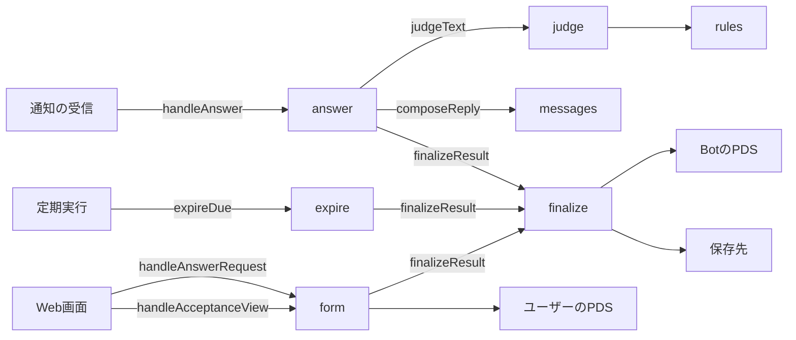
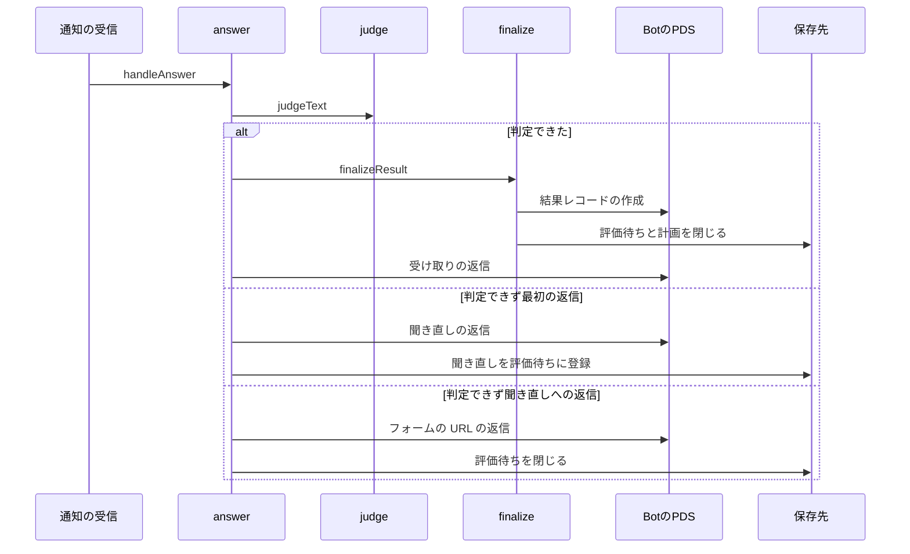
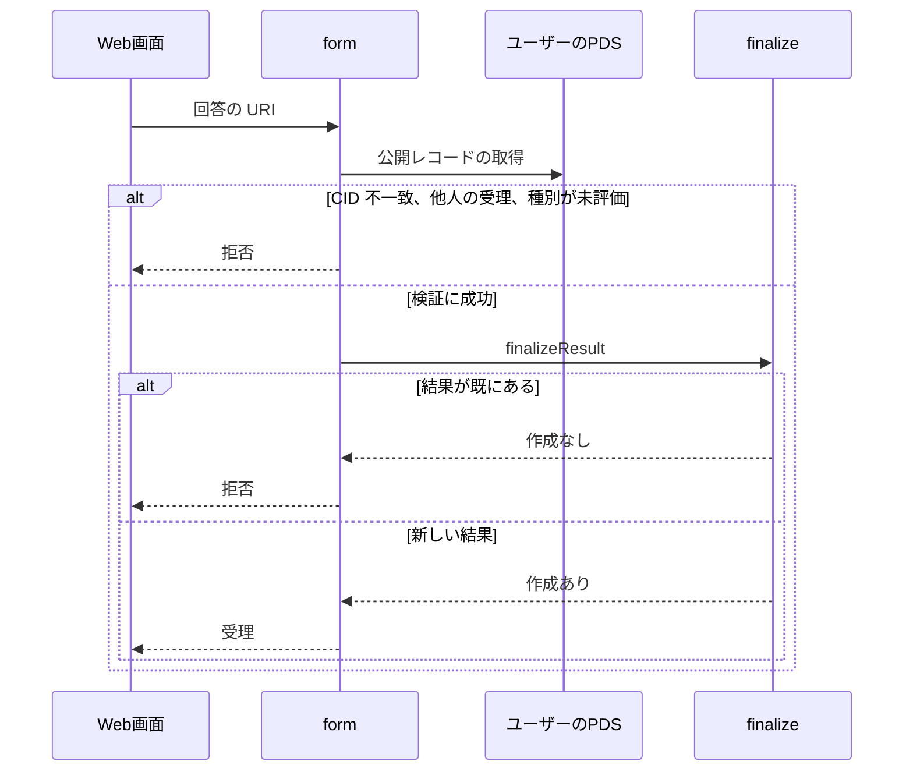

# 評価 設計書

## 1. 構成

| パス                         | 責務                                               |
| ---------------------------- | -------------------------------------------------- |
| `src/evaluation/rules.json`  | 結果の種別ごとの語の辞書（並び順が優先順位）       |
| `src/evaluation/judge.ts`    | 返信文の正規化と辞書による判定                     |
| `src/evaluation/finalize.ts` | 結果レコードの作成、評価待ちと計画の閉じ           |
| `src/evaluation/answer.ts`   | 返信の通知の処理（判定・聞き直し・フォームの案内） |
| `src/evaluation/expire.ts`   | 評価の期限切れの締め                               |
| `src/evaluation/form.ts`     | フォームの回答の受理 API と、受理の内容の公開 API  |
| `src/evaluation/messages.ts` | 受け取り・聞き直し・フォーム案内の文面             |

## 2. 関係図・ワークフロー

通知・期限切れ・フォームの 3 つの入口が結果の確定へ集まる依存を示す。



返信の判定から、結果の確定・聞き直し・フォーム案内に分かれる流れを示す。



フォームの回答の受理と、拒否の分岐を示す。



## 3. 設計項目

### D-1: 辞書 (FR-2)

```json
[
  { "outcome": "partial", "words": ["一部", "途中", "半分", "半ば", "少しだけ", "あと少し"] },
  { "outcome": "notdone", "words": ["できなかった", "出来なかった", "できてない", "できていない", "できず", "やれなかった", "やらなかった", "終わらなかった", "終わってない", "間に合わなかった", "ダメだった", "未達", "失敗"] },
  { "outcome": "done", "words": ["できた", "出来た", "できました", "やった", "やりました", "終わった", "終わりました", "完了", "済んだ", "達成", "クリア"] }
]
```

配列の並びが優先順位である。種別を足すときは要素を足し、語を足すときは words に足す。outcome は結果の種別の既知の値か、未知の値を使える。

### D-2: 判定 (FR-1, NFR-1)

```ts
export type Rule = { outcome: string; words: string[] }
export function judgeText(text: string, rules?: Rule[]): string | null
```

1. NFKC で正規化し、英字を小文字にし、空白と記号（句読点・感嘆符・三点リーダ・チルダ）を除く。
2. rules を先頭から順に見て、words のどれかが本文に含まれる最初の rule の outcome を返す。
3. どの語も含まれなければ null を返す。

否定の語を持つ notdone を done より前に置くことで、「できなかった」が done に当たらないようにする。

### D-3: 結果の確定 (FR-3, FR-6, FR-8, NFR-2)

```ts
export type FinalizeInput = {
  acceptanceUri: string; acceptanceCid: string
  outcome: string; basis?: { uri: string; cid: string }
}
export function finalizeResult(env: Env, store: Store, input: FinalizeInput, nowIso: string): Promise<{ created: boolean }>
```

1. rkey を deriveRkey(RKEY_SECRET, acceptanceUri) で求める。
2. 結果レコードを検証し、rkey で Bot の PDS に作る。同じキーが既にあれば created=false で終える。
3. created の値によらず、closePromptsOf と dropPlansOf で評価待ちと残りの計画を閉じる。

### D-4: 返信の処理 (FR-3, FR-4, FR-5, NFR-2)

```ts
export function handleAnswer(item: InboxItem): Promise<void>
```

| 評価待ちの状態              | 判定       | 処理                                                                            |
| --------------------------- | ---------- | ------------------------------------------------------------------------------- |
| open、種別 ask または reask | 判定できた | 受理レコードを取得し、finalizeResult（根拠は返信）、created なら受け取りを返信  |
| open、種別 ask              | null       | 聞き直しを返信し、その投稿を種別 reask の評価待ちに登録し、元の評価待ちを閉じる |
| open、種別 reask            | null       | フォームの URL を返信し、評価待ちを閉じる                                       |
| 見つからないか closed       | -          | 何もしない                                                                      |

返信はすべて、ユーザーの返信を親にしてユーザーをメンションする。フォームの URL は PUBLIC_ORIGIN/answer/受理のキーとする。

### D-5: 評価の期限切れ (FR-6)

```ts
export const expireDue: Job
```

duePlans(["expire"], 現在時刻, JOB_BATCH) の各計画について、受理レコードを取得し、outcome=unjudged・根拠なしで finalizeResult を呼ぶ。created の値によらず計画を done にする。この締めでは投稿しない。

### D-6: フォームの回答 (FR-7, FR-8)

```ts
// POST /api/answers  本文 { answerUri: string }
export function handleAnswerRequest(req: Request, env: Env): Promise<Response>
```

| 検査                                                    | 拒否の種別        |
| ------------------------------------------------------- | ----------------- |
| コレクションが回答、検証と CID の照合に成功する         | invalid           |
| 回答が指す受理が Bot のリポジトリにあり、CID が一致する | invalid           |
| 受理の持ち主が回答の URI の DID と一致する              | forbidden         |
| outcome が unjudged でない                              | invalid           |
| finalizeResult が created=true を返す                   | already_evaluated |

### D-7: 受理の内容の公開 (FR-9)

```ts
// GET /api/acceptances/:key
export function handleAcceptanceView(req: Request, env: Env, key: string): Promise<Response>
```

受理のキーで受理レコードと結果レコードを取得し、`{ text, dueDate, remindMinute, evaluated }` を返す。受理がなければ種別 not_found で返す。

### D-8: 文面 (FR-3, FR-4, FR-5)

```ts
export function composeReply(kind: "done" | "notdone" | "partial" | "other" | "reask" | "form", vars: Record<string, string>, seed: string): string
```

| 種別    | 文例の1つ                                                    |
| ------- | ------------------------------------------------------------ |
| done    | 「資料作成」できたんだね。おつかれさま!                      |
| notdone | 「資料作成」は今回は届かなかったね。また一緒にやろう。       |
| partial | 「資料作成」は途中まで進んだんだね。次につなげよう。         |
| other   | 「資料作成」の結果、受け取ったよ。                           |
| reask   | 読み取れなかったよ。「できた」か「できなかった」で教えてね。 |
| form    | うまく読み取れなかったので、こちらから入力してね。URL        |

各種別は 3 つの文例を持ち、seed（返信の URI）から決まった 1 つを選ぶ。結果の種別が既知でない値のときは other を使う。

## 4. エラー処理

| 事象                                 | 処理                                                     |
| ------------------------------------ | -------------------------------------------------------- |
| 受理レコードの取得に失敗             | 例外とし、通知の再試行に任せる                           |
| 結果レコードの作成に失敗（重複以外） | 例外とし、通知の再試行に任せる                           |
| 返信の投稿に失敗                     | 例外とし、再処理では結果が既にあるため受け取りは送らない |
| 辞書の JSON が不正                   | ビルドを失敗させる                                       |
| フォームの回答の検査に失敗           | 表の種別で拒否し、結果は作らない                         |
