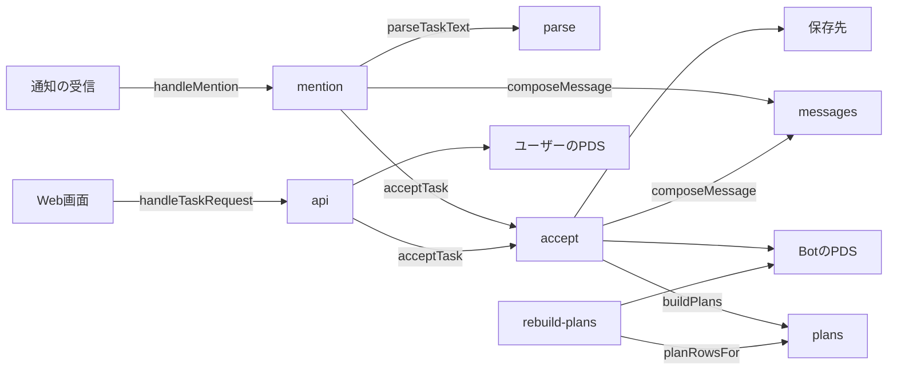
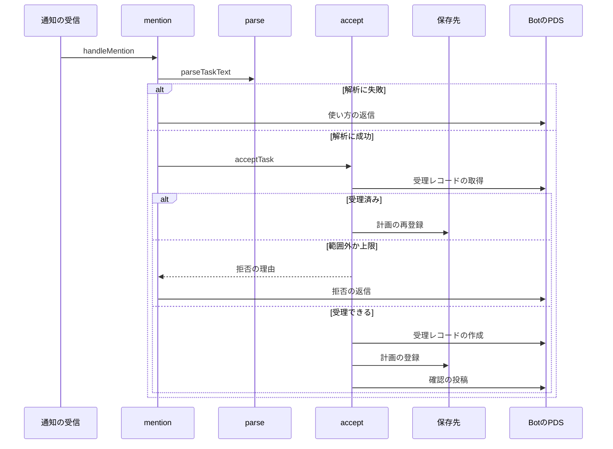
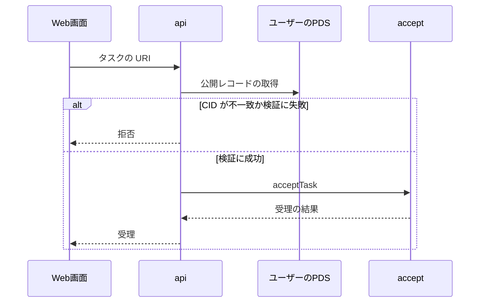

# タスク受理 設計書

## 1. 構成

| パス                        | 責務                                                   |
| --------------------------- | ------------------------------------------------------ |
| `src/intake/parse.ts`       | メンション本文の定型の解析                             |
| `src/intake/accept.ts`      | 受理の検査、受理レコードの作成、計画の登録、確認の投稿 |
| `src/intake/plans.ts`       | 受理から計画の行を生成する                             |
| `src/intake/messages.ts`    | 返信と確認の文面                                       |
| `src/intake/mention.ts`     | メンション経路の通知の処理                             |
| `src/intake/api.ts`         | フォーム経路の受理 API                                 |
| `scripts/rebuild-plans.mjs` | Bot の PDS のレコードから計画の SQL を作り直す         |

## 2. 関係図・ワークフロー

メンション経路とフォーム経路が、受理と計画の生成へ集まる依存を示す。



メンション経路の受理の流れと、解析失敗・受理済み・拒否の分岐を示す。



フォーム経路でレコードを検証して受理するまでの流れと、不一致の分岐を示す。



## 3. 設計項目

### D-1: 定型の解析 (FR-1, FR-2, NFR-2)

```ts
export type ParsedTask = { dueDate: string; remindMinute: number; text: string }
export type ParseResult =
  | { ok: true; task: ParsedTask }
  | { ok: false; reason: "no-due" | "no-time" | "no-text" | "text-invalid" }
export function parseTaskText(raw: string, nowMs: number): ParseResult
```

手順は次のとおりとする。

1. NFKC で正規化し（全角の数字と記号を半角にする）、「@ハンドル」の語を除き、空白を1つにまとめる。
2. 最初の「まで」より前を期限、その後の最初の「に」までを時刻、残りを内容として切り出す。
3. 内容の前後の空白を除き、検証の意味規則（内容の安全性と30文字）に通す。

| 項目 | 表現               | 解釈                                                         |
| ---- | ------------------ | ------------------------------------------------------------ |
| 期限 | M/D、M月D日        | 日本時間の今年。今日より前なら翌年                           |
| 期限 | YYYY/M/D、YYYY-M-D | 指定の年月日                                                 |
| 期限 | 明日、あさって     | 今日の翌日、翌々日                                           |
| 期限 | N日後              | 今日から N 日後（N は 1 以上 99 以下）                       |
| 時刻 | H時、H時M分        | 日本時間の H 時、H 時 M 分（H は 0 から 23、M は 0 から 59） |
| 時刻 | H時半、HH:MM       | H 時 30 分、HH 時 MM 分                                      |

### D-2: 受理の検査 (FR-4, FR-5)

| 検査       | 条件                                                             | 拒否の理由 |
| ---------- | ---------------------------------------------------------------- | ---------- |
| 期限の範囲 | 期限日が受理の日の翌日から 14 日後までに入る                     | range      |
| 時刻の余裕 | 期限日の評価依頼の時刻（ずらし込み）が受理から 30 分以上先である | too-soon   |
| 同時進行数 | countActive(owner) が maxActiveTasks(owner) 未満である           | limit      |

検査は受理済みの確認の後、受理レコードの作成の前に行う。検査の順は range、too-soon、limit とする。

### D-3: 受理の処理と確認 (FR-7, FR-8, FR-11, NFR-1)

```ts
export type AcceptInput = {
  owner: string; ownerHandle: string; origin: Origin
  text: string; dueDate: string; remindMinute: number
  replyTo?: { rootUri: string; rootCid: string; parentUri: string; parentCid: string }
}
export type AcceptResult =
  | { ok: true; created: boolean; rkey: string }
  | { ok: false; reason: "range" | "too-soon" | "limit" | "invalid" }
export function acceptTask(env: Env, store: Store, input: AcceptInput, nowMs: number): Promise<AcceptResult>
```

1. rkey を deriveRkey(RKEY_SECRET, 起点の URI) で求め、Bot の PDS に同じキーの受理レコードがあるか取得する。
2. あれば計画を再登録して created=false で終える。確認の投稿はしない。
3. なければ検査を行い、検証した受理レコードを rkey で作り、計画を登録し、確認を投稿する。
4. 確認の投稿は、replyTo があればその返信（メンション経路）、なければユーザーをメンションした新規投稿（フォーム経路）にする。

受理レコードの作成後に失敗しても、再処理は 1 から 2 へ進み、計画は冪等に登録される。

### D-4: 計画の生成 (FR-9, FR-10)

```ts
export function buildPlans(a: AcceptanceView, rkey: string, options: Options): PlanRow[]
export function planRowsFor(a: AcceptanceView, rkey: string, nowMs: number, options: Options): PlanRow[]
```

| 種別   | id                     | 時刻（ずらしの前）                           | 作る条件                           |
| ------ | ---------------------- | -------------------------------------------- | ---------------------------------- |
| remind | rkey:remind:YYYY-MM-DD | 受理日から期限日の前日の各日のリマインド時刻 | ずらした時刻が受理から 30 分以上先 |
| ask    | rkey:ask               | 期限日のリマインド時刻                       | 常に作る                           |
| expire | rkey:expire            | ask の時刻から EVAL_WAIT_HOURS 時間後        | 常に作る                           |

ずらしは、plan の id の SHA-256 の先頭 1 バイトを 21 で割った余りから 10 を引いた値を分として加える（範囲は -10 分から +10 分）。同じ id は常に同じ値になる。planRowsFor は、現在時刻より前の remind を除き、期限を過ぎた ask は現在時刻を時刻として返す。

### D-5: メンション経路 (FR-3)

```ts
export function handleMention(item: InboxItem): Promise<void>
export function composeMessage(kind: MessageKind, vars: Record<string, string>, seed: string): string
```

| 種別     | 文例の1つ                                                                             |
| -------- | ------------------------------------------------------------------------------------- |
| confirm  | 「資料作成」、10/25 までね。毎日 18 時ごろに声をかけるよ。                            |
| usage    | 読み取れなかったよ。「10/25まで 18時に 資料作成」の形で送ってね。フォームはこちら URL |
| limit    | 同時に預かれるのは N 件までだよ。今のが終わったらまた教えてね。                       |
| range    | 期限は明日から 14 日先までにしてね。                                                  |
| too-soon | 評価の時刻まで 30 分もないよ。もう少し先の時刻にしてね。                              |

各種別は 3 つの文例を持ち、seed（起点の URI）から決まった 1 つを選ぶ。返信は起点の投稿を親にして、ユーザーをメンションする。フォームの URL は PUBLIC_ORIGIN の /new とする。

### D-6: フォーム経路 (FR-6)

```ts
// POST /api/tasks  本文 { taskUri: string }
export function handleTaskRequest(req: Request, env: Env): Promise<Response>
```

1. taskUri のコレクションがタスクであることを確認する。
2. fetchPublicRecord で取得して CID を照合し、validateRecord で検証する。
3. URI の DID を持ち主とし、プロフィールからハンドルを得て、acceptTask に渡す。
4. 結果は共通の応答形式で返す。拒否の理由は種別 range、too-soon、limit、invalid として再試行不可にする。

### D-7: 計画の再構築 (FR-12)

```js
// node --experimental-strip-types scripts/rebuild-plans.mjs <BotのDID> > plans.sql
// wrangler d1 execute <DB名> --remote --file plans.sql
```

Bot の PDS の受理と結果のレコードを listRecords（1 ページ 100 件）で全件取得する。結果を持つ受理を除き、残りに planRowsFor を適用して `INSERT OR IGNORE INTO plan` の文を出力する。評価待ちの投稿は再構築の対象にしない。

## 4. エラー処理

| 事象                             | 処理                                             |
| -------------------------------- | ------------------------------------------------ |
| 解析に失敗                       | 使い方とフォームの URL を返信し、受理しない      |
| 検査で拒否                       | 理由に応じた返信を送り、受理しない               |
| Bot の PDS への書き込みに失敗    | 例外とし、通知の再試行に任せる                   |
| 確認の投稿に失敗                 | 例外とし、再処理では受理済みとして確認を送らない |
| フォーム経路の CID が不一致      | 種別 cid_mismatch で拒否する                     |
| フォーム経路のコレクションが不正 | 種別 invalid で拒否する                          |
