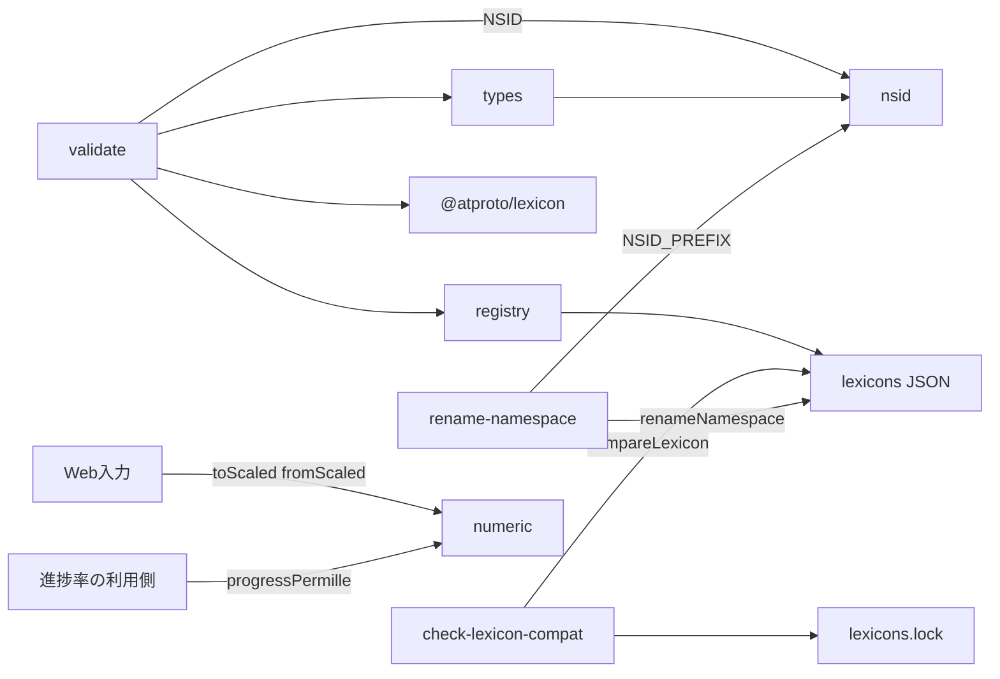
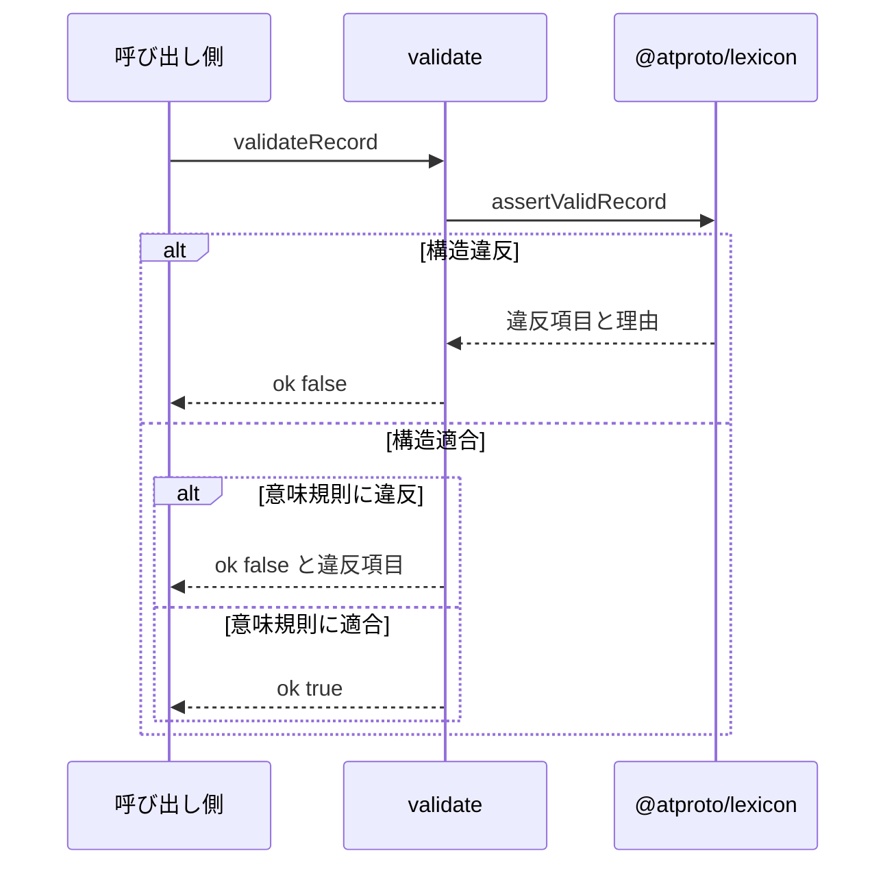
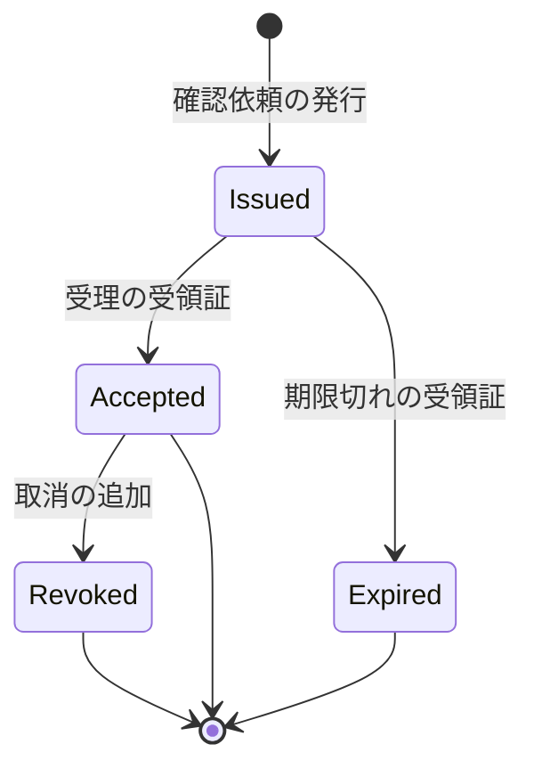

# 独自lexicon 設計書

## 1. 構成

| パス                               | 責務                                                      |
| ---------------------------------- | --------------------------------------------------------- |
| `lexicons/registry.ts`             | lexicons/ 配下の JSON 9ファイル（正本）を読み込んで束ねる |
| `src/lexicon/nsid.ts`              | 名前空間の接頭辞とコレクション識別子                      |
| `src/lexicon/types.ts`             | 各レコードの TypeScript 型                                |
| `src/lexicon/numeric.ts`           | 整数スケール値の変換と進捗率の算出                        |
| `src/lexicon/validate.ts`          | 構造検証と意味規則の検証                                  |
| `scripts/rename-namespace.mjs`     | 名前空間の接頭辞の一括変更                                |
| `scripts/check-lexicon-compat.mjs` | 公開済みスキーマとの互換性検査                            |
| `lexicons.lock.json`               | 公開済みスキーマのスナップショット                        |

## 2. 関係図・ワークフロー

検証・変換・名前空間の依存方向を示す。



検証の呼び出しから結果までの流れと、違反時の分岐を示す。



Bot側レコードの追加による状態の進み方を示す。



## 3. 設計項目

### D-1: 名前空間と識別子 (FR-5, FR-9)

```ts
export const NSID_PREFIX = "com.example.shinchoku"

export const NSID = {
  defs: `${NSID_PREFIX}.defs`,
  task: `${NSID_PREFIX}.task`,
  progress: `${NSID_PREFIX}.progress`,
  result: `${NSID_PREFIX}.result`,
  enrollment: `${NSID_PREFIX}.bot.enrollment`,
  checkin: `${NSID_PREFIX}.bot.checkin`,
  receipt: `${NSID_PREFIX}.bot.receipt`,
  revocation: `${NSID_PREFIX}.bot.revocation`,
  evaluation: `${NSID_PREFIX}.bot.evaluation`,
} as const

export type CollectionNsid = (typeof NSID)[Exclude<keyof typeof NSID, "defs">]
```

| コレクション | 書き込み主体 | 書き込み方法                         |
| ------------ | ------------ | ------------------------------------ |
| task         | ユーザー     | ブラウザの OAuth セッションで作成    |
| progress     | ユーザー     | ブラウザの OAuth セッションで作成    |
| result       | ユーザー     | ブラウザの OAuth セッションで作成    |
| bot.\*       | Bot          | Bot アカウントのセッションで作成のみ |

名前空間の一括変更は次の手順で行う。

```js
// node scripts/rename-namespace.mjs <旧接頭辞> <新接頭辞>
export function renameNamespace(root, from, to) {
  // 1. to が NSID の規則（3区間以上、各区間は英数字とハイフン）を満たすことを確認する
  // 2. lexicons.lock.json が空オブジェクトでなければ中止する（公開後は変更不可）
  // 3. lexicons/ のディレクトリを from の階層から to の階層へ移動する
  // 4. 各 JSON の id と ref 内の from を to へ置換する
  // 5. nsid.ts の NSID_PREFIX の値を to へ書き換える
}
```

### D-2: 共通定義と列挙 (FR-2, FR-3, FR-7)

共通定義 `defs` のフィールド制約。

| 定義       | 型      | 制約                                                                                                              |
| ---------- | ------- | ----------------------------------------------------------------------------------------------------------------- |
| metric     | object  | name, unit, scale, startValue, goalValue をすべて必須                                                             |
| name       | string  | maxGraphemes 30, maxLength 150                                                                                    |
| unit       | string  | maxGraphemes 10, maxLength 50                                                                                     |
| scale      | integer | 0 以上 3 以下（小数桁数）                                                                                         |
| startValue | integer | -1000000000 以上 1000000000 以下（scale 倍した整数）                                                              |
| goalValue  | integer | 同上                                                                                                              |
| slot       | string  | knownValues: morning, noon, evening。maxLength 20                                                                 |
| timeWindow | object  | startMinute, endMinute を必須。0 以上 1440 以下の整数（JST の 0 時からの分）。endMinute は startMinute より大きい |

列挙は `knownValues` で定義し、`enum` は使わない。未知の値は構造検証を通過し、意味規則は未知の値に対して追加の制約を課さない。

意味規則（この定義に関わるもの）。

| 規則                                         | 違反時の理由コード    |
| -------------------------------------------- | --------------------- |
| startValue と goalValue が異なる             | metric-range-empty    |
| durationDays が 2 以上のとき slot が存在する | slot-required         |
| durationDays が 1 のとき slot が存在しない   | slot-forbidden        |
| durationDays が 1 以上 7 以下の整数          | duration-out-of-range |

### D-3: ユーザー側レコード (FR-1, FR-4, FR-11, NFR-2)

3種とも key は tid。1ユーザーが同時に持てる件数をスキーマで制限しない。

task（作業）

| フィールド   | 型                         | 必須 | 制約                                        |
| ------------ | -------------------------- | ---- | ------------------------------------------- |
| summary      | string                     | 必須 | maxGraphemes 300, maxLength 1500            |
| title        | string                     | 必須 | minLength 1, maxGraphemes 12, maxLength 120 |
| goal         | string                     | 必須 | maxGraphemes 200, maxLength 1000            |
| metric       | defs#metric                | 必須 |                                             |
| durationDays | integer                    | 必須 | 1 以上 7 以下                               |
| slot         | defs#slot                  | 任意 | 2日以上で必須（意味規則）                   |
| startImage   | blob                       | 任意 | image/jpeg, image/png, image/webp, 1000000B |
| anchor       | com.atproto.repo.strongRef | 必須 | 起点投稿（Bot へのメンションを含む投稿）    |
| createdAt    | datetime                   | 必須 |                                             |

progress（進捗報告）

| フィールド | 型                         | 必須 | 制約                            |
| ---------- | -------------------------- | ---- | ------------------------------- |
| task       | com.atproto.repo.strongRef | 必須 | 作業レコード                    |
| checkin    | com.atproto.repo.strongRef | 必須 | Bot の確認依頼レコード          |
| value      | integer                    | 必須 | 作業の scale 倍した実測値       |
| note       | string                     | 任意 | maxGraphemes 140, maxLength 700 |
| evidence   | blob                       | 任意 | startImage と同じ形式と上限     |
| createdAt  | datetime                   | 必須 |                                 |

result（結果報告）

| フィールド  | 型                         | 必須 | 制約                             |
| ----------- | -------------------------- | ---- | -------------------------------- |
| task        | com.atproto.repo.strongRef | 必須 | 作業レコード                     |
| checkin     | com.atproto.repo.strongRef | 必須 | Bot の確認依頼レコード           |
| finalValue  | integer                    | 必須 | 作業の scale 倍した最終実測値    |
| description | string                     | 必須 | maxGraphemes 500, maxLength 2500 |
| evidence    | blob                       | 任意 | startImage と同じ形式と上限      |
| createdAt   | datetime                   | 必須 |                                  |

```ts
// types.ts: コレクション識別子から型を引く
export type RecordOf<K extends CollectionNsid> = RecordMap[K]
```

最大サイズの見積り: 文字列の maxLength の合計は task で 2770 バイト以下、JSON の構造を含めても 10 キロバイトを超えない。

### D-4: Bot側の受理と確認依頼 (FR-5, FR-6)

Bot 側の全レコードに更新日時の項目は置かない。enrollment・checkin・receipt の key は any とし、値は書き込み側が決める（receipt は対応する checkin と同じ key）。revocation・evaluation の key は tid とする。

enrollment（受理：作業の開始時刻の確定）

| フィールド   | 型                         | 必須 | 制約                                                                                               |
| ------------ | -------------------------- | ---- | -------------------------------------------------------------------------------------------------- |
| subject      | did                        | 必須 | 作業の所有者                                                                                       |
| task         | com.atproto.repo.strongRef | 必須 | 作業レコード                                                                                       |
| startedAt    | datetime                   | 必須 | Bot が受理した時刻（開始時刻）                                                                     |
| endsAt       | datetime                   | 必須 | startedAt に durationDays を加えた時刻                                                             |
| durationDays | integer                    | 必須 | 1 以上 7 以下                                                                                      |
| windows      | defs#timeWindow の配列     | 必須 | 1 件以上 10 件以下。解決済みの通知窓（無料の朝昼夕は窓へ変換した値、1日の作業では Bot が決めた窓） |
| dailyTarget  | integer                    | 必須 | 1 以上 10 以下。1日に必要な記録数（スコアの減点基準。無料は 1）                                    |
| scale        | integer                    | 必須 | 作業の metric と同じ値                                                                             |
| startValue   | integer                    | 必須 | 同上                                                                                               |
| goalValue    | integer                    | 必須 | 同上                                                                                               |

自由記述の文字列は Bot 側に複製しない。作業レコードが削除されたとき、Bot 側に本文が残らない。

checkin（確認依頼の発行）

| フィールド | 型                         | 必須 | 制約                                  |
| ---------- | -------------------------- | ---- | ------------------------------------- |
| subject    | did                        | 必須 |                                       |
| enrollment | com.atproto.repo.strongRef | 必須 |                                       |
| kind       | string                     | 必須 | knownValues: progress, result         |
| seq        | integer                    | 任意 | 進捗の連番（1 から）。result では省略 |
| nonce      | string                     | 必須 | 22 文字の base64url（乱数 16 バイト） |
| issuedAt   | datetime                   | 必須 | 30分の起点                            |
| expiresAt  | datetime                   | 必須 | issuedAt より後                       |

### D-5: Bot側の受領証・取消・評価 (FR-5, FR-6, FR-7)

receipt（受領証）

| フィールド | 型                         | 必須 | 制約                                        |
| ---------- | -------------------------- | ---- | ------------------------------------------- |
| subject    | did                        | 必須 |                                             |
| checkin    | com.atproto.repo.strongRef | 必須 |                                             |
| status     | string                     | 必須 | knownValues: accepted, expired              |
| record     | com.atproto.repo.strongRef | 任意 | accepted のとき必須。ユーザーの報告レコード |
| value      | integer                    | 任意 | accepted のとき必須。受理時点の実測値       |
| receivedAt | datetime                   | 必須 | Bot が受け付けた時刻（有効な時刻はこの値）  |

revocation（取消）

| フィールド | 型                         | 必須 | 制約                           |
| ---------- | -------------------------- | ---- | ------------------------------ |
| subject    | did                        | 必須 |                                |
| target     | com.atproto.repo.strongRef | 必須 | 取消す受領証または受理         |
| reason     | string                     | 必須 | knownValues: tampered, deleted |
| detectedAt | datetime                   | 必須 |                                |

evaluation（評価）

| フィールド        | 型                         | 必須 | 制約                               |
| ----------------- | -------------------------- | ---- | ---------------------------------- |
| subject           | did                        | 必須 |                                    |
| enrollment        | com.atproto.repo.strongRef | 必須 |                                    |
| algorithm         | string                     | 必須 | 採点方式の版名。maxLength 32       |
| scoreHundredths   | integer                    | 必須 | 0 以上 10000 以下（評価点の100倍） |
| finalRatePermille | integer                    | 必須 | 最終進捗率の千分率                 |
| missingCount      | integer                    | 必須 | 0 以上 64 以下                     |
| finalizedAt       | datetime                   | 必須 |                                    |

状態は記録の組み合わせで決まる。作業全体の取消は enrollment に対する revocation で表し、その作業の全記録を無効とする。

| 状態     | 条件                                               |
| -------- | -------------------------------------------------- |
| Issued   | checkin があり、対応する receipt がない            |
| Accepted | receipt が accepted で、対応する revocation がない |
| Expired  | receipt が expired                                 |
| Revoked  | accepted の receipt に対する revocation がある     |

### D-6: 整数スケール値 (FR-2)

```ts
export function toScaled(value: number, scale: number): number {
  return Math.round(value * 10 ** scale)
}

export function fromScaled(scaled: number, scale: number): number {
  return scaled / 10 ** scale
}

export function progressPermille(
  range: { startValue: number; goalValue: number },
  value: number,
): number {
  if (range.startValue === range.goalValue)
    throw new RangeError("metric-range-empty")
  return Math.round(
    ((value - range.startValue) * 1000) / (range.goalValue - range.startValue),
  )
}
```

| startValue | goalValue | value | 結果 |
| ---------- | --------- | ----- | ---- |
| 0          | 100       | 25    | 250  |
| 80         | 60        | 70    | 500  |
| 0          | 100       | 120   | 1200 |

### D-7: 検証 (FR-8, FR-12, NFR-1)

```ts
export type ValidationIssue = { path: string; reason: string }
export type ValidationResult =
  | { ok: true }
  | { ok: false; issues: ValidationIssue[] }

export function validateRecord(
  nsid: CollectionNsid,
  value: unknown,
): ValidationResult
```

lexicon 定義は起動時に1回だけ読み込み、以降は再利用する。時間予算の内訳は次のとおり。

| 段階     | 内容                                                 | 時間予算 |
| -------- | ---------------------------------------------------- | -------- |
| 構造検証 | assertValidRecord による型・必須・文字数・列挙の検査 | 3ミリ秒  |
| 意味規則 | 識別子ごとの規則（下表）の検査                       | 1ミリ秒  |
| 余裕     | 実行環境のばらつき                                   | 1ミリ秒  |

title-unsafe は、title が改行・制御文字・半角全角の @ # / : ・英数字に挟まれた半角の . のいずれかを含むときの違反である。

| 識別子     | 意味規則                                                                                                     |
| ---------- | ------------------------------------------------------------------------------------------------------------ |
| task       | metric-range-empty, slot-required, slot-forbidden, title-unsafe                                              |
| enrollment | endsAt が startedAt より後。windows の各要素で startMinute が endMinute より小さい                           |
| checkin    | expiresAt が issuedAt より後。kind が progress のとき seq が存在する                                         |
| receipt    | status が accepted のとき record と value が存在し、expired のとき存在しない。未知の status は追加の制約なし |
| revocation | 追加の意味規則なし                                                                                           |
| evaluation | 追加の意味規則なし                                                                                           |

### D-8: 互換性検査 (FR-10)

```js
// node scripts/check-lexicon-compat.mjs [--update]
// lexicons.lock.json: { "<nsid>": { required: string[], properties: Record<string, object> } }
export function compareLexicon(published, current) {
  // 違反の配列 { nsid, path, kind } を返す。空配列なら互換
}
```

| 変更                           | 判定 | kind                 |
| ------------------------------ | ---- | -------------------- |
| 任意プロパティの追加           | 許容 |                      |
| 文字数や値の上限の引き上げ     | 許容 |                      |
| knownValues への値の追加       | 許容 |                      |
| プロパティの削除               | 違反 | property-removed     |
| 必須の追加・削除               | 違反 | required-changed     |
| 型・ref の変更                 | 違反 | type-changed         |
| 上限の引き下げ・下限の引き上げ | 違反 | constraint-tightened |

`--update` はスナップショットを現在の lexicons で上書きする。公開前は空オブジェクトとして互換とみなす。

## 4. エラー処理

| 事象                                 | 処理                                      |
| ------------------------------------ | ----------------------------------------- |
| 構造違反                             | 違反項目と理由を issues に入れて ok false |
| 意味規則違反                         | 理由コードを issues に入れて ok false     |
| 未知のコレクション識別子             | RangeError を投げる                       |
| 開始値とゴール値が同じで進捗率を算出 | RangeError を投げる                       |
| 公開後の接頭辞変更                   | 何も書き換えず終了コード 1 で中止する     |
| 互換性違反                           | 違反の一覧を出力し終了コード 1 で終了する |
