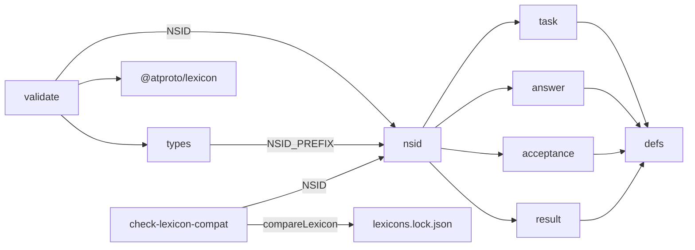
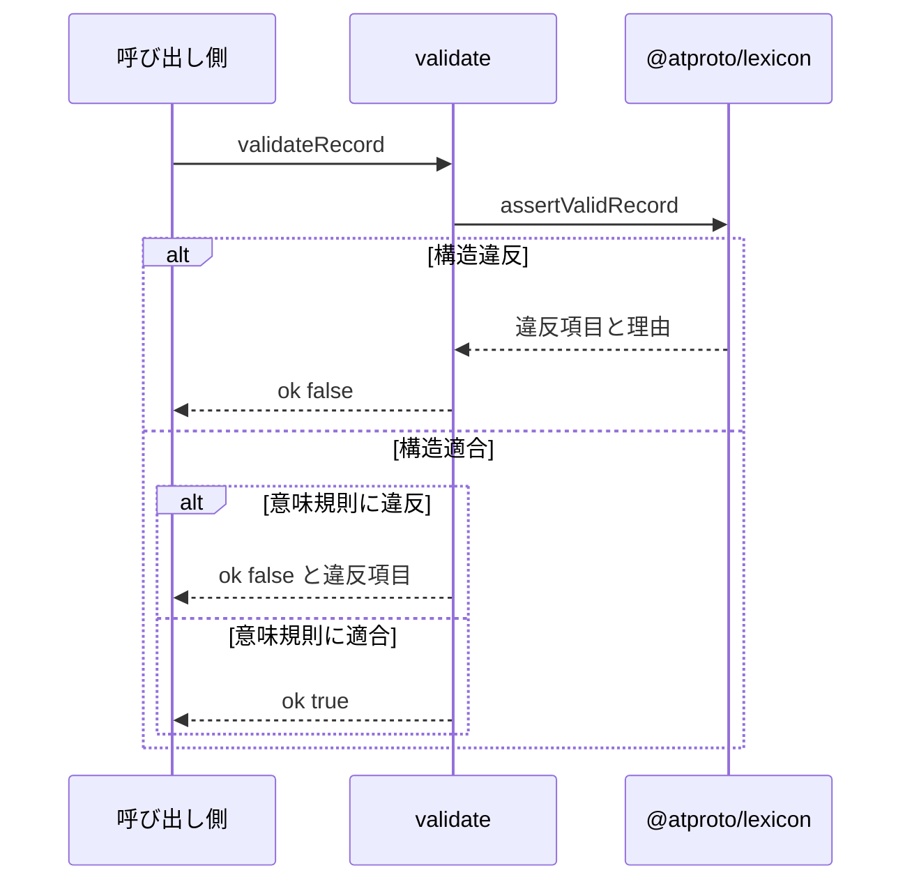

# 独自lexicon 設計書

## 1. 構成

| パス                                                 | 責務                                 |
| ---------------------------------------------------- | ------------------------------------ |
| `lexicons/com/example/shinchoku/defs.json`           | 結果の種別・起点・日時の共通定義     |
| `lexicons/com/example/shinchoku/task.json`           | ユーザー側のタスクレコード           |
| `lexicons/com/example/shinchoku/answer.json`         | ユーザー側の回答レコード             |
| `lexicons/com/example/shinchoku/bot/acceptance.json` | Bot 側の受理レコード                 |
| `lexicons/com/example/shinchoku/bot/result.json`     | Bot 側の結果レコード                 |
| `src/lexicon/nsid.ts`                                | 名前空間の接頭辞とコレクション識別子 |
| `src/lexicon/types.ts`                               | 各レコードの TypeScript 型           |
| `src/lexicon/validate.ts`                            | 構造検証と意味規則の検証             |
| `scripts/check-lexicon-compat.mjs`                   | 公開済みスキーマとの互換性検査       |

## 2. 関係図・ワークフロー

検証と互換性検査が、スキーマの正本をどの向きで読むかを示す。



検証の呼び出しから結果までの流れと、違反時の分岐を示す。



## 3. 設計項目

### D-1: 名前空間と識別子 (FR-9)

```ts
export const NSID_PREFIX = "com.example.shinchoku"

export const NSID = {
  defs: `${NSID_PREFIX}.defs`,
  task: `${NSID_PREFIX}.task`,
  answer: `${NSID_PREFIX}.answer`,
  acceptance: `${NSID_PREFIX}.bot.acceptance`,
  result: `${NSID_PREFIX}.bot.result`,
} as const
```

| コレクション | 書き込み主体 | 書き込み方法                         |
| ------------ | ------------ | ------------------------------------ |
| task         | ユーザー     | ブラウザの OAuth セッションで作成    |
| answer       | ユーザー     | ブラウザの OAuth セッションで作成    |
| bot.\*       | Bot          | Bot アカウントのセッションで作成のみ |

Bot 側の定義は更新日時の項目を持たず、更新や削除の手順を持たない。

### D-2: 共通定義 (FR-3, FR-5, FR-7)

| 定義         | 型      | 制約                                                                                  |
| ------------ | ------- | ------------------------------------------------------------------------------------- |
| outcome      | string  | knownValues: done, notdone, partial, unjudged。maxLength 30。enum は使わない          |
| dueDate      | string  | 形式 YYYY-MM-DD の日本時間の暦日。maxLength 10                                        |
| remindMinute | integer | 0 以上 1439 以下（日本時間の 0 時からの分）                                           |
| origin       | union   | postOrigin（参照は uri と cid）と taskOrigin（参照は uri と cid）の閉じていない union |

未知の outcome は構造検証を通過し、意味規則は未知の値に追加の制約を課さない。

### D-3: ユーザー側レコード (FR-1, FR-2, FR-4)

| レコード | 必須項目                               | 任意項目 | キー |
| -------- | -------------------------------------- | -------- | ---- |
| task     | text, dueDate, remindMinute, createdAt | なし     | tid  |
| answer   | acceptance, outcome, createdAt         | note     | tid  |

| 項目       | 型                         | 制約                                           |
| ---------- | -------------------------- | ---------------------------------------------- |
| text       | string                     | minGraphemes 1, maxGraphemes 30, maxLength 300 |
| note       | string                     | maxGraphemes 200, maxLength 2000               |
| acceptance | com.atproto.repo.strongRef | 受理レコードの uri と cid                      |
| createdAt  | string                     | format datetime                                |

### D-4: Bot 側レコード (FR-6, FR-8, FR-9)

| レコード   | 必須項目                                               | 任意項目 | キー                      |
| ---------- | ------------------------------------------------------ | -------- | ------------------------- |
| acceptance | owner, origin, text, dueDate, remindMinute, acceptedAt | なし     | 起点の URI から導く固定値 |
| result     | acceptance, outcome, decidedAt                         | basis    | 受理の URI から導く固定値 |

- owner は format did の文字列とし、受理の持ち主を示す。
- basis は com.atproto.repo.strongRef で、判定の根拠にした返信投稿か回答レコードを指す。
- キーの型は any とし、固定値のため、同じ入力からの二重の作成は拒否される。

### D-5: 検証 (FR-10, NFR-1, NFR-2)

```ts
export type ValidationResult =
  | { ok: true }
  | { ok: false; issues: { path: string; code: string; message: string }[] }

export function validateRecord(nsid: CollectionNsid, record: unknown): ValidationResult
```

構造検証の後に、次の意味規則を検査する。

| 規則                                                       | 理由コード       |
| ---------------------------------------------------------- | ---------------- |
| text が改行・制御文字・@・URL の形・ハッシュ記号を含まない | text-unsafe      |
| dueDate が実在する暦日である                               | due-invalid      |
| origin が postOrigin か taskOrigin のどちらか1つである     | origin-ambiguous |
| result の outcome が unjudged 以外のとき basis がある      | basis-required   |
| result の outcome が unjudged のとき basis がない          | basis-forbidden  |

検証関数の平均実行時間と、上限長で埋めたレコードの JSON の大きさを、それぞれ測る。

### D-6: 互換性検査 (FR-11)

```js
// node scripts/check-lexicon-compat.mjs  公開済みスナップショット lexicons.lock.json と比較する
export function compareLexicon(published, current) {
  // 必須項目の追加、型・制約の変更、knownValues の削除、項目の削除を破壊的変更として返す
  // 任意項目の追加と knownValues の追加は許可する
}
```

スナップショットが空のときは検査せず終了コード 0 で終わる。破壊的変更があれば終了コード 1 で、変更箇所を列挙する。

## 4. エラー処理

| 事象                   | 処理                                                 |
| ---------------------- | ---------------------------------------------------- |
| 構造検証に失敗         | 違反した項目と理由コードを返し、レコードは作成しない |
| 意味規則に違反         | 理由コードと項目名を返し、レコードは作成しない       |
| 未知の outcome を受信  | 構造検証は成功とし、呼び出し側が未知の値として扱う   |
| 互換性検査で破壊的変更 | 終了コード 1 で変更箇所を表示する                    |
