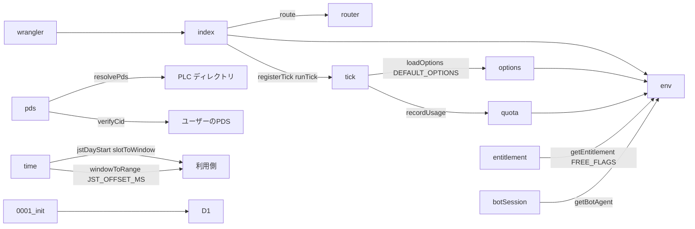
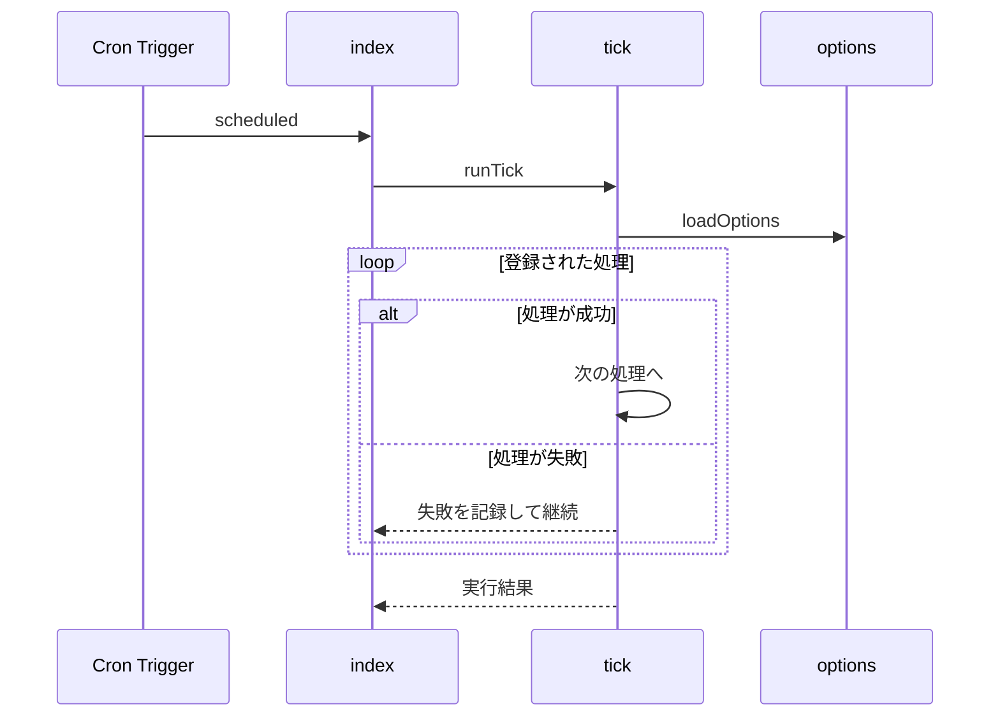

# 実行基盤 設計書

## 1. 構成

| パス                          | 責務                                           |
| ----------------------------- | ---------------------------------------------- |
| `wrangler.toml`               | Worker・静的アセット・D1・Cron・環境変数の宣言 |
| `src/worker/index.ts`         | fetch と scheduled の入口                      |
| `src/worker/router.ts`        | APIの経路表と共通の応答形式                    |
| `src/worker/tick.ts`          | 5分おきの処理の登録と実行                      |
| `src/platform/env.ts`         | Worker の環境の型                              |
| `src/platform/options.ts`     | システムオプションの既定値と読み出し           |
| `src/platform/time.ts`        | 日本時間の日境界と通知窓の変換                 |
| `src/platform/pds.ts`         | DID の解決、公開レコードの取得、CID の照合     |
| `src/platform/botSession.ts`  | Bot のセッションの取得と更新                   |
| `src/platform/entitlement.ts` | 利用資格の機能フラグの読み出し                 |
| `src/platform/quota.ts`       | D1 の使用行数の記録と警告                      |
| `migrations/0001_init.sql`    | D1 のスキーマ                                  |

## 2. 関係図・ワークフロー

構成要素の依存方向を示す。



定期実行の流れと、処理の失敗時の分岐を示す。



## 3. 設計項目

### D-1: 入口と経路表 (FR-1, FR-12)

```ts
export type ApiError = {
  error: { kind: string; message: string; retryable: boolean }
}

export type Route = {
  method: "GET" | "POST"
  path: string // 例: /api/ranking
  handler: (req: Request, env: Env) => Promise<Response>
}

export function route(
  req: Request,
  env: Env,
  routes: Route[],
): Promise<Response>
```

| 条件                            | 応答                                                 |
| ------------------------------- | ---------------------------------------------------- |
| パスが `/api/` で始まり経路あり | handler の応答                                       |
| パスが `/api/` で始まり経路なし | 404 と ApiError（kind: not-found, retryable: false） |
| `/api/` 以外                    | 静的アセットへ渡す（wrangler.toml の assets 宣言）   |

wrangler.toml の主な宣言: `main`, `[assets] directory = "dist/web"`, `[[d1_databases]]`, `[triggers] crons = ["*/5 * * * *"]`, 環境変数 `BOT_DID` `BOT_HANDLE` `PUBLIC_ORIGIN`, シークレット `BOT_APP_PASSWORD`。

### D-2: 定期実行 (FR-2, FR-3, NFR-1, NFR-2)

```ts
export type TickHandler = {
  name: string
  run: (now: number, env: Env) => Promise<void>
}

export function registerTick(handler: TickHandler): void
export async function runTick(now: number, env: Env): Promise<TickResult[]>
```

| 段階                 | 内容                                                          |
| -------------------- | ------------------------------------------------------------- |
| オプションの読み出し | system_options の全行（20行以下）を1回で読む                  |
| 処理の実行           | 登録順に1つずつ実行。例外は握りつぶさず name とともに記録する |
| 結果                 | { name, ok, ms, error? } の配列                               |

処理が空の場合に読む行は system_options の行だけである。

### D-3: システムオプション (FR-4)

```ts
export const DEFAULT_OPTIONS = {
  triggersPerDay: 8,
  maxUsersPerTrigger: 10,
  checkinWindowMinutes: 30,
  penaltyPerMissingHundredths: 200,
  penaltyCapHundredths: 1000,
  freeWindowRange: [480, 1200],
  premiumWindowRange: [360, 1380],
  maxWindows: 3,
  maxDailyTarget: 3,
  recheckIntervalHours: 24,
  priorityWeightPerMissedDay: 1,
} as const

export async function loadOptions(env: Env): Promise<typeof DEFAULT_OPTIONS>
```

| 規則     | 内容                                                                        |
| -------- | --------------------------------------------------------------------------- |
| 優先順位 | system_options の値、なければ既定値                                         |
| 検証     | 整数は範囲を満たすこと。範囲外の保存値は無視して既定値を使い、警告を記録    |
| 範囲     | triggersPerDay 1〜24、maxUsersPerTrigger 1〜50、checkinWindowMinutes 5〜120 |

### D-4: 日本時間 (FR-5)

```ts
export const JST_OFFSET_MS = 9 * 60 * 60 * 1000

export function jstDayStart(ms: number): number {
  return (
    Math.floor((ms + JST_OFFSET_MS) / 86_400_000) * 86_400_000 - JST_OFFSET_MS
  )
}

export function slotToWindow(slot: "morning" | "noon" | "evening"): {
  startMinute: number
  endMinute: number
} {
  return {
    morning: { startMinute: 480, endMinute: 720 },
    noon: { startMinute: 720, endMinute: 960 },
    evening: { startMinute: 960, endMinute: 1200 },
  }[slot]
}

export function windowToRange(
  dayStart: number,
  w: { startMinute: number; endMinute: number },
): { from: number; to: number } {
  return {
    from: dayStart + w.startMinute * 60_000,
    to: dayStart + w.endMinute * 60_000,
  }
}
```

### D-5: PDS の読み取りと CID 照合 (FR-6)

```ts
export async function resolvePds(did: string): Promise<string>

export async function verifyCid(
  pds: string,
  uri: string,
): Promise<{ ok: boolean; cid: string; value: unknown }>
```

| 手順 | 内容                                                                           |
| ---- | ------------------------------------------------------------------------------ |
| 1    | did:plc は PLC ディレクトリ、did:web は .well-known の DID 文書から PDS を得る |
| 2    | com.atproto.repo.getRecord を公開で呼び、value と cid を得る                   |
| 3    | value を IPLD へ変換し dag-cbor で符号化、sha-256 で CID を再計算する          |
| 4    | 再計算した CID と応答の cid が一致すれば ok                                    |

DID 文書は 1 つの受理処理の中で 1 回だけ取得し、使い回す。

### D-6: Bot のセッション (FR-7)

```ts
export async function getBotAgent(env: Env): Promise<BotAgent>
```

| 状態                           | 処理                                              |
| ------------------------------ | ------------------------------------------------- |
| bot_session に有効な accessJwt | そのまま使う                                      |
| accessJwt の期限切れ           | refreshJwt で更新し、bot_session を書き換える     |
| refreshJwt の期限切れ・未保存  | アプリパスワードで createSession を呼び、保存する |
| 認証失敗                       | 例外を投げ、定期実行に失敗として記録させる        |

### D-7: データベースのスキーマ (FR-10)

```sql
CREATE TABLE system_options (key TEXT PRIMARY KEY, value TEXT NOT NULL);
CREATE TABLE bot_session (id INTEGER PRIMARY KEY CHECK (id = 1), access_jwt TEXT, refresh_jwt TEXT, expires_at INTEGER);
CREATE TABLE entitlements (did TEXT PRIMARY KEY, plan TEXT NOT NULL, flags TEXT NOT NULL, valid_until INTEGER);
CREATE TABLE notify_state (did TEXT PRIMARY KEY, last_notified_day INTEGER, missed_days INTEGER NOT NULL DEFAULT 0);
CREATE TABLE quota_usage (day INTEGER PRIMARY KEY, rows_read INTEGER NOT NULL, rows_written INTEGER NOT NULL);
```

```sql
CREATE TABLE tasks (
  id TEXT PRIMARY KEY, did TEXT NOT NULL, handle TEXT NOT NULL,
  task_uri TEXT NOT NULL, task_cid TEXT NOT NULL, enrollment_uri TEXT NOT NULL,
  summary TEXT NOT NULL, goal TEXT NOT NULL, metric_name TEXT NOT NULL, metric_unit TEXT NOT NULL,
  scale INTEGER NOT NULL, start_value INTEGER NOT NULL, goal_value INTEGER NOT NULL,
  duration_days INTEGER NOT NULL, daily_target INTEGER NOT NULL, windows TEXT NOT NULL,
  started_at INTEGER NOT NULL, ends_at INTEGER NOT NULL, evidence_required INTEGER NOT NULL,
  checked_at INTEGER NOT NULL DEFAULT 0,
  status TEXT NOT NULL CHECK (status IN ('active','ended','withdrawn'))
);
CREATE INDEX tasks_did_status ON tasks (did, status);
CREATE INDEX tasks_status_ends ON tasks (status, ends_at);
CREATE TABLE checkins (
  id TEXT PRIMARY KEY, task_id TEXT NOT NULL, did TEXT NOT NULL, kind TEXT NOT NULL, seq INTEGER,
  checkin_uri TEXT NOT NULL, checkin_cid TEXT NOT NULL, reply_uri TEXT,
  issued_at INTEGER NOT NULL, expires_at INTEGER NOT NULL,
  status TEXT NOT NULL CHECK (status IN ('issued','accepted','expired'))
);
CREATE INDEX checkins_task ON checkins (task_id, issued_at);
CREATE INDEX checkins_open ON checkins (status, expires_at);
```

```sql
CREATE TABLE reports (
  checkin_id TEXT PRIMARY KEY, task_id TEXT NOT NULL, receipt_uri TEXT NOT NULL, receipt_cid TEXT NOT NULL,
  record_uri TEXT NOT NULL, record_cid TEXT NOT NULL, value INTEGER NOT NULL, received_at INTEGER NOT NULL,
  note TEXT, revoked TEXT, checked_at INTEGER NOT NULL DEFAULT 0
);
CREATE INDEX reports_checked ON reports (checked_at);
CREATE INDEX reports_task ON reports (task_id, received_at);
CREATE TABLE schedule_jobs (
  id INTEGER PRIMARY KEY AUTOINCREMENT, kind TEXT NOT NULL, run_at INTEGER NOT NULL, ref TEXT,
  state TEXT NOT NULL DEFAULT 'pending' CHECK (state IN ('pending','done'))
);
CREATE INDEX jobs_due ON schedule_jobs (state, run_at);
CREATE TABLE evaluations (
  task_id TEXT PRIMARY KEY, score_hundredths INTEGER NOT NULL, final_rate_permille INTEGER NOT NULL,
  missing_count INTEGER NOT NULL, algorithm TEXT NOT NULL, evaluation_uri TEXT, finalized_at INTEGER NOT NULL
);
CREATE INDEX evaluations_score ON evaluations (score_hundredths DESC);
```

### D-8: 利用資格 (FR-8, FR-9)

```ts
export type EntitlementFlags = {
  maxConcurrentTasks: number
  maxWindows: number
  windowRange: [number, number]
  priority: boolean
  characterSelectable: boolean
}

export const FREE_FLAGS: EntitlementFlags = {
  maxConcurrentTasks: 1,
  maxWindows: 0,
  windowRange: [480, 1200],
  priority: false,
  characterSelectable: false,
}

export async function getEntitlement(
  env: Env,
  did: string,
  now: number,
): Promise<EntitlementFlags>
```

| 条件                                | 結果                            |
| ----------------------------------- | ------------------------------- |
| 行がない、または valid_until が過去 | FREE_FLAGS                      |
| 行があり有効                        | flags の JSON を解析して返す    |
| flags の JSON が壊れている          | FREE_FLAGS を返し警告を記録する |

maxWindows が 0 のとき、朝昼夕の選択だけを使う。

### D-9: 使用量の保護 (FR-11)

```ts
export async function recordUsage(
  env: Env,
  now: number,
  read: number,
  written: number,
): Promise<void>
```

| 項目         | 内容                                                                        |
| ------------ | --------------------------------------------------------------------------- |
| 集計の単位   | UTC の日（D1 の上限の更新時刻に合わせる）                                   |
| 読み取り上限 | 5000000 行/日、警告は 4000000 行                                            |
| 書き込み上限 | 100000 行/日、警告は 80000 行                                               |
| 警告         | 超えた最初の1回だけ console.warn に記録する（quota_usage に警告済みを保持） |

## 4. エラー処理

| 事象                        | 処理                                            |
| --------------------------- | ----------------------------------------------- |
| 定期実行の処理が例外        | 失敗として記録し、後続の処理を続ける            |
| システムオプションが範囲外  | 既定値を使い、警告を記録する                    |
| DID の解決に失敗            | 例外を投げ、呼び出し側が再試行可否を判断する    |
| CID が一致しない            | ok を false にして返す（例外にしない）          |
| Bot の認証に失敗            | 例外を投げ、定期実行に失敗として記録させる      |
| D1 の上限超過でクエリが失敗 | 例外を投げ、API は retryable を true にして返す |
