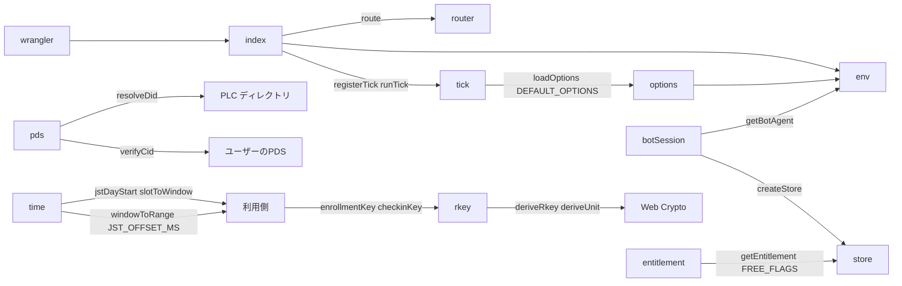
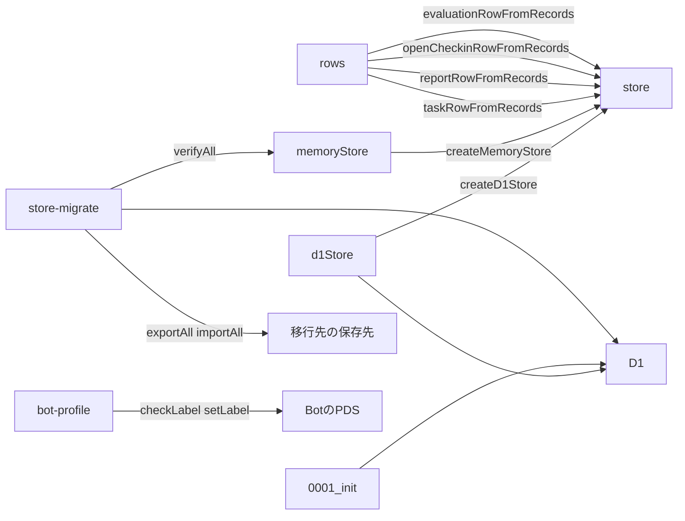
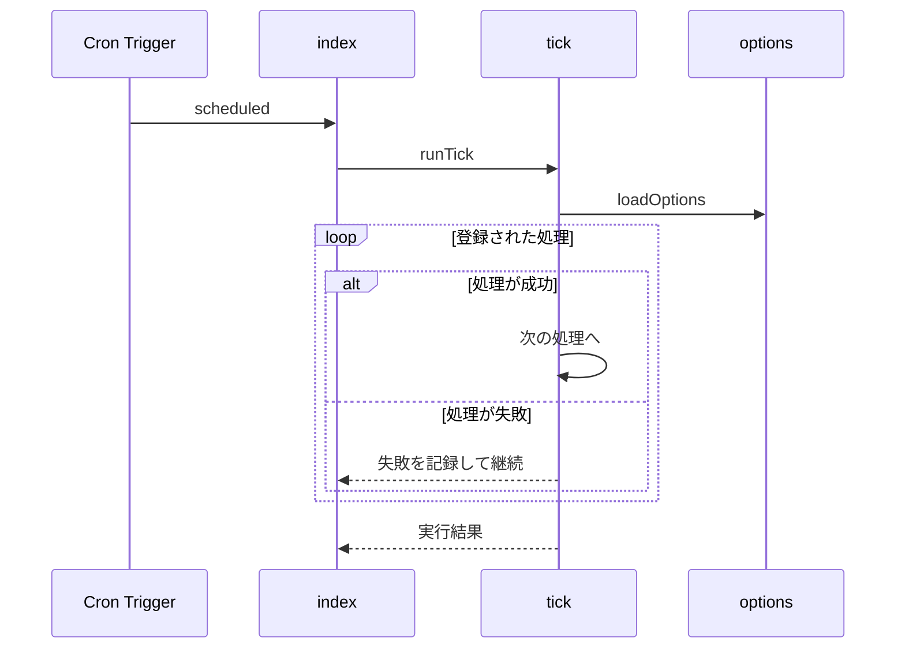
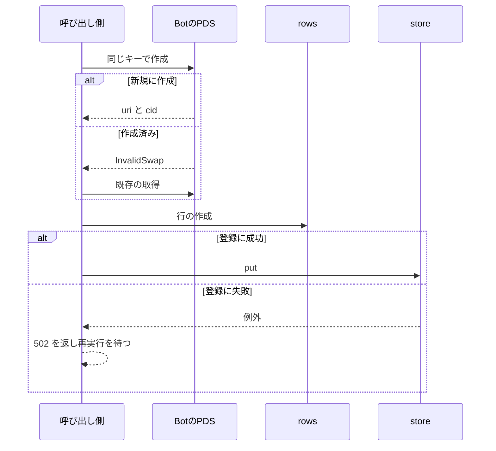

# 実行基盤 設計書

## 1. 構成

| パス                          | 責務                                                   |
| ----------------------------- | ------------------------------------------------------ |
| `wrangler.toml`               | Worker・静的アセット・D1・Cron・環境変数の宣言         |
| `src/worker/index.ts`         | fetch と scheduled の入口                              |
| `src/worker/router.ts`        | APIの経路表と共通の応答形式                            |
| `src/worker/tick.ts`          | 5分おきの処理の登録と実行                              |
| `src/platform/env.ts`         | Worker の環境の型                                      |
| `src/platform/options.ts`     | システムオプションの既定値と環境変数からの読み出し     |
| `src/platform/time.ts`        | 日本時間の日境界と通知窓の変換                         |
| `src/platform/pds.ts`         | DID の解決、公開レコードの取得、CID の照合             |
| `src/platform/botSession.ts`  | Bot のセッションの取得と更新                           |
| `src/platform/entitlement.ts` | 利用資格の機能フラグの読み出し                         |
| `src/platform/rkey.ts`        | Bot のレコードのキーの導出                             |
| `src/platform/store.ts`       | 保存先の契約、行の型、保存先の選択                     |
| `src/platform/rows.ts`        | レコードから行を作る純粋関数                           |
| `src/platform/d1Store.ts`     | D1 による契約の実装                                    |
| `src/platform/memoryStore.ts` | メモリによる契約の実装（試験と移行の検証に使う）       |
| `migrations/0001_init.sql`    | D1 のスキーマ                                          |
| `scripts/store-migrate.mjs`   | 保存先の間の移行（運用者の端末で実行する）             |
| `scripts/bot-profile.mjs`     | Bot の自己ラベルの確認と設定（運用者の端末で実行する） |

## 2. 関係図・ワークフロー

Worker 側の構成要素の依存方向を示す。



保存先の契約と、実装・運用スクリプトの依存方向を示す。



定期実行の流れと、処理の失敗時の分岐を示す。



レコードの作成から行の登録までの流れと、作成済みと登録失敗の分岐を示す。



## 3. 設計項目

### D-1: 入口と経路表 (FR-1, FR-12)

```ts
export function route(
  req: Request,
  env: Env,
  routes: Route[],
): Promise<Response>
```

| 型または条件                    | 内容                                                                  |
| ------------------------------- | --------------------------------------------------------------------- |
| Route                           | { method: GET または POST, path: 例 /api/ranking, handler(req, env) } |
| ApiError                        | { error: { kind, message, retryable } }                               |
| パスが `/api/` で始まり経路あり | handler の応答                                                        |
| パスが `/api/` で始まり経路なし | 404 と ApiError（kind: not-found, retryable: false）                  |
| `/api/` 以外                    | 静的アセットへ渡す（wrangler.toml の assets 宣言）                    |

wrangler.toml の主な宣言: `main`, `[assets] directory = "dist/web"`, `[[d1_databases]]`, `[triggers] crons = ["*/5 * * * *"]`。環境変数は `BOT_DID` `BOT_HANDLE` `PUBLIC_ORIGIN` `BOT_START_DATE`（本番の公開ドメインで稼働を始めた日。YYYY-MM-DD）`STORE_KIND`（d1 または移行先の名前。既定は d1）と、`OPT_` で始まるシステムオプション。シークレットは `BOT_APP_PASSWORD` `RKEY_SECRET` `ADMIN_TOKEN` と、移行先の接続情報。

### D-2: 定期実行 (FR-2, NFR-1, NFR-2)

```ts
export type TickHandler = {
  name: string
  run: (now: number, env: Env) => Promise<void>
}

export function registerTick(handler: TickHandler): void
export async function runTick(now: number, env: Env): Promise<TickResult[]>
```

| 段階       | 内容                                                          |
| ---------- | ------------------------------------------------------------- |
| オプション | 環境変数から読む。保存先は読まない                            |
| 処理の実行 | 登録順に1つずつ実行。例外は握りつぶさず name とともに記録する |
| 結果       | { name, ok, ms, error? } の配列                               |

### D-3: システムオプション (FR-3)

```ts
export function loadOptions(env: Env): typeof DEFAULT_OPTIONS
```

| DEFAULT_OPTIONS の項目                                                            | 既定値と範囲                                                                                 |
| --------------------------------------------------------------------------------- | -------------------------------------------------------------------------------------------- |
| triggersPerDay、maxUsersPerTrigger、checkinWindowMinutes                          | 8（1〜24）、5（1〜50）、30（5〜120）                                                         |
| penaltyPerMissingHundredths、penaltyCapHundredths                                 | 200、1000                                                                                    |
| freeWindowRange、premiumWindowRange                                               | [480, 1200]、[360, 1380]                                                                     |
| maxWindows、maxDailyTarget、recheckIntervalHours、priorityWeightPerMissedDay      | 3、3、24、1                                                                                  |
| warmupDays、replyGapMinSeconds、replyGapMaxSeconds、cheerMinReplies、cheerEnabled | 30（1〜90）、5（0〜60）、30（replyGapMinSeconds 以上 120 以下）、2（2〜50）、1（0 または 1） |

| 規則       | 内容                                                                                                   |
| ---------- | ------------------------------------------------------------------------------------------------------ |
| 環境変数名 | OPT\_ に、オプション名を大文字の単語区切り（アンダースコア）にした値を続ける。例: OPT_TRIGGERS_PER_DAY |
| 値の形式   | 整数は10進数、範囲は「最小,最大」                                                                      |
| 優先順位   | 環境変数の値、なければ既定値                                                                           |
| 検証       | 範囲外や形式違いの値は無視して既定値を使い、警告を記録する                                             |

### D-4: 日本時間 (FR-4)

| 名前                       | 定義                                                                               |
| -------------------------- | ---------------------------------------------------------------------------------- |
| JST_OFFSET_MS              | 9 \* 60 \* 60 \* 1000                                                              |
| jstDayStart(ms)            | floor((ms + JST_OFFSET_MS) / 86400000) \* 86400000 - JST_OFFSET_MS                 |
| slotToWindow(slot)         | morning は 480〜720、noon は 720〜960、evening は 960〜1200（JST の 0 時からの分） |
| windowToRange(dayStart, w) | from は dayStart + w.startMinute × 60000、to は dayStart + w.endMinute × 60000     |

日の境界は日本時間の深夜 0 時である。

### D-5: PDS の読み取りと CID 照合 (FR-5)

```ts
export async function resolveDid(
  did: string,
): Promise<{ pds: string; handle: string | null }>

export async function verifyCid(
  pds: string,
  uri: string,
): Promise<{ ok: boolean; cid: string; value: unknown }>
```

| 手順 | 内容                                                                                                                                                          |
| ---- | ------------------------------------------------------------------------------------------------------------------------------------------------------------- |
| 1    | did:plc は PLC ディレクトリ、did:web は .well-known の DID 文書から PDS と handle を得る。handle は alsoKnownAs の at:// の値で、独自ドメインの handle も同じ |
| 2    | com.atproto.repo.getRecord を公開で呼び、value と cid を得る                                                                                                  |
| 3    | value を IPLD へ変換し dag-cbor で符号化、sha-256 で CID を再計算する                                                                                         |
| 4    | 再計算した CID と応答の cid が一致すれば ok                                                                                                                   |

DID 文書は 1 つの受理処理の中で 1 回だけ取得し、使い回す。

### D-6: Bot のセッション (FR-6)

```ts
export async function getBotAgent(env: Env): Promise<BotAgent>
```

| 状態                          | 処理                                              |
| ----------------------------- | ------------------------------------------------- |
| 保存先に有効な accessJwt      | そのまま使う                                      |
| accessJwt の期限切れ          | refreshJwt で更新し、保存先の行を書き換える       |
| refreshJwt の期限切れ・未保存 | アプリパスワードで createSession を呼び、保存する |
| 認証失敗                      | 例外を投げ、定期実行に失敗として記録させる        |

accessJwt の有効期間は 120 分、refreshJwt は 90 日、refreshSession の上限は 1 分あたり 60 回、createSession の上限は 1 アカウントあたり 1 日 10 回である。createSession は定期実行のたびに呼ばず、成功した結果は必ず保存する。更新で得た refreshJwt も毎回保存する。保存先の行を失っても、createSession を 1 回呼べば復旧する。

### D-7: 利用資格 (FR-7)

```ts
export async function getEntitlement(
  env: Env,
  did: string,
  now: number,
): Promise<EntitlementFlags>
```

| 名前または条件                     | 内容                                                                                                   |
| ---------------------------------- | ------------------------------------------------------------------------------------------------------ |
| EntitlementFlags                   | maxConcurrentTasks、maxWindows、windowRange、priority、characterSelectable                             |
| FREE_FLAGS                         | maxConcurrentTasks 1、maxWindows 0、windowRange [480, 1200]、priority false、characterSelectable false |
| 行がない、または validUntil が過去 | FREE_FLAGS                                                                                             |
| 行があり有効                       | flags の JSON を解析して返す                                                                           |
| flags の JSON が壊れている         | FREE_FLAGS を返し警告を記録する                                                                        |

maxWindows が 0 のとき、朝昼夕の選択だけを使う。

### D-8: 保存先の契約 (FR-8, NFR-3)

```ts
export function createStore(env: Env): DataStore
export function createMemoryStore(): DataStore
export function createD1Store(db: D1Database): DataStore
```

| 集合         | 操作                                                                                                                                                                                                                                                                                         |
| ------------ | -------------------------------------------------------------------------------------------------------------------------------------------------------------------------------------------------------------------------------------------------------------------------------------------- |
| botSession   | get()、put(row)                                                                                                                                                                                                                                                                              |
| entitlements | get(did)                                                                                                                                                                                                                                                                                     |
| plans        | get(dayStart)、putIfAbsent(row)（先に保存された行があればそれを返す）                                                                                                                                                                                                                        |
| tasks        | get(id)、getMany(ids)、getByTaskUri(uri)、put(row)、putMany(rows)、patch(id, fields)、countActive(did)、countActiveBySlot(dayStart)、listPriority(dayStart, limit)、listCandidates(now, limit)、listPendingResult(now, limit)、listFinalizable(now, limit)、listDueForRecheck(before, limit) |
| openCheckins | get(id)、getMany(ids)、put(row)、putMany(rows)、patch(id, { replyUri })、delete(id)、deleteMany(ids)、listExpired(now, limit)、listUnreplied(now, limit)                                                                                                                                     |
| reports      | get(checkinId)、put(row)、putMany(rows)、patch(checkinId, fields)、listByTask(taskId)、listDueForRecheck(before, limit)                                                                                                                                                                      |
| evaluations  | get(taskId)、getMany(ids)、put(row)、putMany(rows)、patch(taskId, fields)、listStale(limit)、page({ sort, order, after, limit })                                                                                                                                                             |

読み出しの条件は次のとおり。結果はすべて指定の並びで limit 件までである。

| 操作                                     | 条件                                                                                                               | 並び                   |
| ---------------------------------------- | ------------------------------------------------------------------------------------------------------------------ | ---------------------- |
| tasks.countActiveBySlot                  | status が active、endsAt が dayStart より後、priority が偽、窓が朝・昼・夕のいずれかに一致する作業を帯ごとに数える | なし                   |
| tasks.listPriority                       | status が active、endsAt が dayStart より後、priority が真                                                         | startedAt の昇順       |
| tasks.listCandidates                     | status が active、startedAt が now 以下、endsAt が now より後、いずれかの窓が now の分を含む                       | startedAt の昇順       |
| tasks.listPendingResult                  | status が active、endsAt が now 以下、resultState が none                                                          | endsAt の昇順          |
| tasks.listFinalizable                    | status が active、endsAt が now 以下、resultState が accepted または expired                                       | endsAt の昇順          |
| tasks.listDueForRecheck                  | status が withdrawn 以外、checkedAt が before より小さい                                                           | checkedAt の昇順       |
| reports.listDueForRecheck                | revoked が空、checkedAt が before より小さい                                                                       | checkedAt の昇順       |
| openCheckins.listExpired                 | expiresAt が now より小さい                                                                                        | expiresAt の昇順       |
| openCheckins.listUnreplied               | replyUri が空、expiresAt が now 以上                                                                               | expiresAt の昇順       |
| evaluations.listStale / evaluations.page | stale が真 / visible が真                                                                                          | page は 論理配置の並び |

| 規則         | 内容                                                                                                                                                                          |
| ------------ | ----------------------------------------------------------------------------------------------------------------------------------------------------------------------------- |
| 操作の粒度   | 1 操作は保存先への往復 1 回で済ませる。結合を含めない。getMany・putMany・deleteMany は複数行を 1 回の往復で扱う                                                               |
| 保存先の言語 | 契約の型だけに依存する。SQL や特定の保存先のコマンドは実装の中に閉じる。put は同じ主キーを上書きして 2 回呼んでも結果が同じになり、patch は存在しない主キーに対して何もしない |
| 試験         | 同じ契約の試験を d1Store と memoryStore の両方に実行し、結果が一致することを確認する                                                                                          |
| 保存先の選択 | createStore が STORE_KIND の値で実装を選ぶ。未知の値は例外を投げる                                                                                                            |

### D-9: 行の型と論理配置 (FR-8)

| 集合         | 主キー           | 項目                                                                                                                                                                                                                                                                                                                                                                                                                                                                       |
| ------------ | ---------------- | -------------------------------------------------------------------------------------------------------------------------------------------------------------------------------------------------------------------------------------------------------------------------------------------------------------------------------------------------------------------------------------------------------------------------------------------------------------------------- |
| botSession   | 固定の 1 行      | accessJwt、refreshJwt、expiresAt                                                                                                                                                                                                                                                                                                                                                                                                                                           |
| entitlements | did              | plan、flags（JSON の文字列）、validUntil                                                                                                                                                                                                                                                                                                                                                                                                                                   |
| plans        | dayStart         | triggers（通知時刻の配列。時刻・種別・帯・回数・人数・作業・窓の番号を持つ）                                                                                                                                                                                                                                                                                                                                                                                               |
| tasks        | id（受理のキー） | did、handle、taskUri、taskCid、anchorUri、anchorCid、enrollmentUri、enrollmentCid、pds、title、summary、goal、metricName、metricUnit、scale、startValue、goalValue、durationDays、dailyTarget、windows、startedAt、endsAt、evidenceRequired、priority、status（active／ended／withdrawn）、resultState（none／issued／accepted／expired）、lastNotifiedDay、notifiedWindows（当日に通知した窓の番号のビット列）、progressIssued（発行済みの進捗の確認依頼の数）、checkedAt |
| openCheckins | id               | taskId、did、kind（progress／result）、seq、checkinUri、checkinCid、replyUri、issuedAt、expiresAt                                                                                                                                                                                                                                                                                                                                                                          |
| reports      | checkinId        | taskId、kind、receiptUri、receiptCid、recordUri、recordCid、value、receivedAt、note、revoked、checkedAt                                                                                                                                                                                                                                                                                                                                                                    |
| evaluations  | taskId           | handle、summary、durationDays、scoreHundredths、finalRatePermille、missingCount、algorithm、evaluationUri、finalizedAt、stale、visible                                                                                                                                                                                                                                                                                                                                     |

| 集合         | 副次の引き方                                                  | page の並び                                                          |
| ------------ | ------------------------------------------------------------- | -------------------------------------------------------------------- |
| tasks        | taskUri、did と status、status と endsAt、status と checkedAt | なし                                                                 |
| openCheckins | expiresAt                                                     | なし                                                                 |
| reports      | taskId、checkedAt                                             | なし                                                                 |
| evaluations  | stale、visible と評価点、visible と最終進捗度                 | 評価点または最終進捗度、finalizedAt、taskId の順。昇順・降順を選べる |

論理配置は保存先を替えても変わらない契約である。tasks.patch で変えられる項目は、status、resultState、lastNotifiedDay、notifiedWindows、progressIssued、checkedAt である。日時は UTC のミリ秒の整数、真偽は真偽値、windows と triggers は配列で扱う。evaluations は一覧に必要な項目（handle、summary、durationDays）を持ち、結合なしで並べられる。

### D-10: 作成と登録の分離 (FR-8)

| 関数                                                                       | 入力                                                           | 出力           |
| -------------------------------------------------------------------------- | -------------------------------------------------------------- | -------------- |
| taskRowFromRecords({ enrollment, enrollmentRef, task, owner, flags })      | 受理と作業のレコード、所有者の did と handle、利用資格のフラグ | TaskRow        |
| reportRowFromRecords({ receipt, receiptRef, kind, userRecord, recordRef }) | 受領証とユーザーの報告のレコードと参照                         | ReportRow      |
| openCheckinRowFromRecords({ checkin, checkinRef, taskId, replyUri })       | 確認依頼のレコードと参照、返信の URI                           | OpenCheckinRow |
| evaluationRowFromRecords({ evaluation, evaluationRef, task })              | 評価のレコードと参照、作業の行                                 | EvaluationRow  |

入力のレコードの型は、必要な項目だけを持つ構造的な型である。lexicon のレコードの型はこれを満たすため、行の作成は特定のレコード定義に依存しない。

| 段階       | 内容                                                                                                       |
| ---------- | ---------------------------------------------------------------------------------------------------------- |
| 作成       | ユーザーまたは Bot のリポジトリへレコードを書く。Bot のレコードは導出したキーで作る                        |
| 行の作成   | 上の関数で、レコードの値だけから行を作る。保存先も時刻も乱数も読まない                                     |
| 登録       | 行を put する。主キーはレコードの URI またはキーから決まり、何度登録しても同じ結果になる                   |
| 作成済み   | 作成が InvalidSwap で拒否されたら、既存のレコードを取得して行の作成へ進む                                  |
| 登録の失敗 | 呼び出し側は 502 と再試行可を返す。次の依頼または定期実行が、作成済みのレコードから登録をやり直す          |
| 再構築     | Bot のリポジトリのレコードを列挙し、同じ関数で行を作って登録する。通常の処理と再構築で行の作り方を分けない |

### D-11: Bot のレコードのキー (FR-9)

```ts
export async function deriveRkey(s: string, p: string[]): Promise<string>
export async function deriveUnit(s: string, p: string[]): Promise<number>
```

| 関数または項目                        | 内容                                                                                                                                     |
| ------------------------------------- | ---------------------------------------------------------------------------------------------------------------------------------------- |
| deriveRkey                            | HMAC-SHA-256(secret, parts を縦棒でつないだ文字列) の先頭 16 バイトを 22 文字の base64url にする                                         |
| enrollmentKey(secret, taskUri)        | deriveRkey(secret, [enrollment, taskUri])                                                                                                |
| checkinKey(secret, enrollmentRkey, i) | deriveRkey(secret, [checkin, enrollmentRkey, i.day, i.window, i.kind])。day は日本時間の YYYYMMDD、結果確認の window は 0                |
| 秘密値                                | シークレット RKEY_SECRET。知らない者はキーを推測できず、確認用リンクの識別子も推測されない                                               |
| 二重作成                              | putRecord に swapRecord の null を付けて作る。同じキーの 2 回目以降は InvalidSwap で拒否される。受領証は対応する確認依頼と同じキーを使う |
| deriveUnit(secret, parts)             | HMAC の先頭 6 バイトを 2 の 48 乗で割った 0 以上 1 未満の値。保存せずに同じ乱数を再現する                                                |

### D-12: D1 のスキーマ (FR-8)

| テーブル      | 主キー                | 索引                                                                                                                                             |
| ------------- | --------------------- | ------------------------------------------------------------------------------------------------------------------------------------------------ |
| bot_session   | id（1 のみ）          | なし                                                                                                                                             |
| entitlements  | did                   | なし                                                                                                                                             |
| plans         | day_start             | なし                                                                                                                                             |
| tasks         | id（task_uri は一意） | (did, status)、(status, ends_at)、(status, checked_at)                                                                                           |
| open_checkins | id                    | (expires_at)                                                                                                                                     |
| reports       | checkin_id            | (checked_at)、(task_id, received_at)                                                                                                             |
| evaluations   | task_id               | (visible, score_hundredths DESC, finalized_at DESC, task_id DESC)、(visible, final_rate_permille DESC, finalized_at DESC, task_id DESC)、(stale) |

D1 の実装は、列名をスネークケースへ対応させ、真偽は 0 と 1、配列は JSON の文字列として保存する。tasks の task_uri は一意とし、status と resultState は取りうる値を CHECK 制約で縛る。スキーマの正本は migrations/0001_init.sql である。

### D-13: 運用スクリプト (FR-10, FR-11)

```js
// node scripts/store-migrate.mjs export --from d1 --dir dump
// node scripts/store-migrate.mjs import --to <移行先> --dir dump
// node scripts/store-migrate.mjs verify --from d1 --to <移行先>
export async function exportAll(source, dir) // 集合ごとに <dir>/<集合>.jsonl を書き出す
export async function importAll(target, dir) // 行を put で取り込む。何度実行しても結果が同じ
export async function verifyAll(source, target) // 件数と、各行の JSON の正規形のハッシュを比べる
// node scripts/bot-profile.mjs check | set
export async function checkLabel(did) // 公開のプロフィールに bot の自己ラベルがあれば true
export async function setLabel(session) // 既存のプロフィールの項目を保ち、bot を加えて書く
```

| 項目         | 内容                                                                                                                                                                                                    |
| ------------ | ------------------------------------------------------------------------------------------------------------------------------------------------------------------------------------------------------- |
| 書式         | 1 行目に { format: 1, collection, count }、2 行目以降に行の型の JSON。キー名は行の型と同じ                                                                                                              |
| 実行場所     | 運用者の端末。Worker には含めない。接続情報は端末の環境変数で渡す                                                                                                                                       |
| 移行の手順   | Cron を止める → export → import → verify → STORE_KIND を切り替えてデプロイ → Cron を再開                                                                                                                |
| 再構築で代替 | tasks・reports・evaluations は、移行先に対して再構築を実行しても復元できる                                                                                                                              |
| 複製が必要   | plans・entitlements は再構築できないため必ず複製する。botSession は複製しなくてよい（createSession で復旧する）                                                                                         |
| 移行の失敗   | import が途中で止まっても再実行すれば同じ結果になる。verify が不一致なら、切り替えずに中止する                                                                                                          |
| 自己ラベル   | check は app.bsky.actor.profile の self を getRecord で取り、labels に bot があれば終了コード 0、なければ 1。set は既存のプロフィールを取得し、swapRecord に取得時の CID を付けて、bot を加えて書き戻す |

## 4. エラー処理

| 事象                       | 処理                                            |
| -------------------------- | ----------------------------------------------- |
| 定期実行の処理が例外       | 失敗として記録し、後続の処理を続ける            |
| システムオプションが範囲外 | 既定値を使い、警告を記録する                    |
| DID の解決に失敗           | 例外を投げ、呼び出し側が再試行可否を判断する    |
| CID が一致しない           | ok を false にして返す（例外にしない）          |
| Bot の認証に失敗           | 例外を投げ、定期実行に失敗として記録させる      |
| 保存先の操作が失敗         | 例外を投げ、API は retryable を true にして返す |
| 移行の検証が不一致         | 不一致の集合と件数を出力し、終了コード 1 で終了 |
