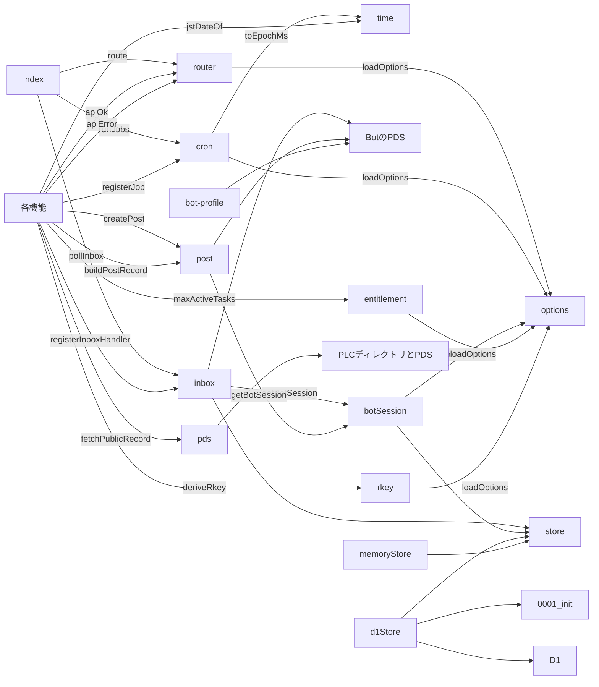
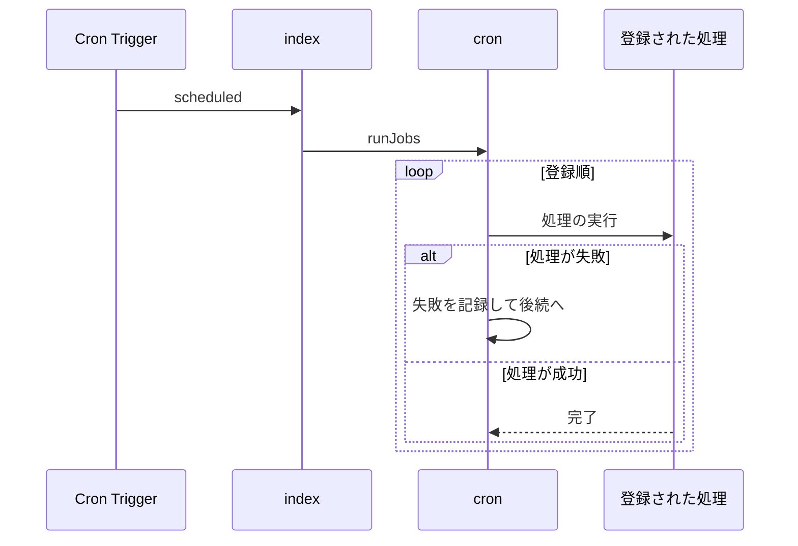
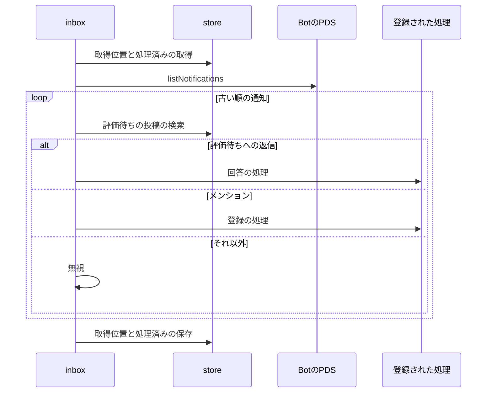

# 実行基盤 設計書

## 1. 構成

| パス                          | 責務                                           |
| ----------------------------- | ---------------------------------------------- |
| `src/worker/index.ts`         | fetch と scheduled の入口                      |
| `src/worker/router.ts`        | API の経路表と共通の応答形式                   |
| `src/worker/cron.ts`          | 定期実行の処理の登録と順次実行                 |
| `src/worker/inbox.ts`         | 通知の取得、重複の排除、回答と登録への振り分け |
| `src/platform/options.ts`     | システムオプションの読み込みと検証             |
| `src/platform/time.ts`        | 日本時間の変換                                 |
| `src/platform/pds.ts`         | DID の解決、公開レコードの取得、CID の照合     |
| `src/platform/botSession.ts`  | Bot のセッションの取得と更新                   |
| `src/platform/post.ts`        | Bot の投稿の組み立てと作成                     |
| `src/platform/entitlement.ts` | DID からタスク数の上限を引き当てる             |
| `src/platform/store.ts`       | 保存先の契約と行の型                           |
| `src/platform/d1Store.ts`     | D1 による保存先の実装                          |
| `src/platform/memoryStore.ts` | 試験用のメモリによる保存先の実装               |
| `src/platform/rkey.ts`        | Bot のレコードのキーの導出                     |
| `migrations/0001_init.sql`    | D1 のスキーマ                                  |
| `scripts/bot-profile.mjs`     | Bot の自己ラベルの確認                         |

## 2. 関係図・ワークフロー

入口から保存先と外部サービスまでの依存方向を示す。



定期実行の起動から後続の処理までの流れと、失敗時の分岐を示す。



通知の取得から登録された処理への振り分けまでの流れと、分類の分岐を示す。



## 3. 設計項目

### D-1: 入口と応答形式 (FR-1)

```ts
export type ApiResult<T> =
  | { ok: true; data: T }
  | { ok: false; error: { type: string; message: string; retryable: boolean } }

export function apiOk<T>(data: T): Response
export function apiError(type: string, message: string, retryable: boolean, status: number): Response
export function route(req: Request, env: Env): Promise<Response>
```

| パス     | 処理                                        |
| -------- | ------------------------------------------- |
| /api/*   | 経路表から処理を選び、共通の応答形式で返す  |
| それ以外 | 静的アセットを返し、未知のパスは index.html |

経路表は機能ごとの処理を登録して拡張する。未登録の API パスは種別 not_found、再試行不可で返す。

### D-2: 定期実行 (FR-2, NFR-1)

```ts
export type Job = { name: string; run: (env: Env, nowMs: number) => Promise<void> }
export function registerJob(job: Job): void
export function runJobs(env: Env, nowMs: number): Promise<{ name: string; ok: boolean }[]>
```

wrangler の cron は毎分（`* * * * *`）とする。処理は登録順に1つずつ実行し、例外は処理名とともに記録して後続へ進む。1回の実行で使える外部通信は50回のため、各処理は自分の分の上限を持つ。

### D-3: システムオプション (FR-3)

```ts
export function loadOptions(env: Env): Options
```

| 名前               | 既定値 | 範囲               | 用途                           |
| ------------------ | ------ | ------------------ | ------------------------------ |
| FREE_MAX_ACTIVE    | 1      | 1 から 20          | 無料の同時進行数               |
| PREMIUM_MAX_ACTIVE | 5      | 1 から 50          | 有料の同時進行数               |
| PREMIUM_DIDS       | 空     | DID のカンマ区切り | 有料の資格を持つ DID           |
| JOB_BATCH          | 10     | 1 から 40          | 1回の実行で処理する計画の件数  |
| EVAL_WAIT_HOURS    | 72     | 1 から 168         | 評価依頼から期限切れまでの時間 |
| BOT_HANDLE         | なし   | 必須               | Bot のハンドル                 |
| BOT_DID            | なし   | 必須               | Bot の DID                     |
| PUBLIC_ORIGIN      | なし   | 必須               | 画面の公開 URL                 |

環境変数の値が型や範囲に合わないとき、既定値を使い、警告を記録する。必須の値が欠けたときは起動時に失敗する。秘密値は別に BOT_APP_PASSWORD と RKEY_SECRET を持つ。

### D-4: 日本時間 (FR-4)

```ts
export function toEpochMs(dueDate: string, minuteOfDay: number): number
export function jstDateOf(epochMs: number): string
```

日本時間は UTC+9 固定で、夏時間を持たない。日の境界は日本時間の 0 時とする。

| 入力                 | 出力                              |
| -------------------- | --------------------------------- |
| 2026-10-25, 1080     | 2026-10-25 18:00 日本時間の実時刻 |
| 2026-10-25T15:00:00Z | 日付 2026-10-26                   |

### D-5: PDS の読み取りと CID 照合 (FR-5)

```ts
export function fetchPublicRecord(uri: string): Promise<{ value: unknown; cid: string }>
```

1. at:// の URI から DID を取り出し、did:plc は PLC ディレクトリ、did:web は .well-known から DID 文書を得る。
2. DID 文書の PDS の場所に対して com.atproto.repo.getRecord を呼ぶ。
3. 取得した value を dag-cbor で符号化し、sha-256 の CIDv1 を再計算する。
4. 再計算した CID が応答の cid と一致しなければ、種別 cid_mismatch の例外とする。

### D-6: Bot のセッション (FR-6)

```ts
export function getBotSession(env: Env, store: Store): Promise<BotSession>
```

| 状態                                            | 動作                                                      |
| ----------------------------------------------- | --------------------------------------------------------- |
| 保存済みで、アクセストークンの期限まで 5 分以上 | そのまま返す                                              |
| アクセストークンが期限切れ付近                  | refreshSession で更新して保存する                         |
| 更新に失敗                                      | createSession でログインし直して保存する（1日 10 回まで） |

保存先のキー値 bot-session に、2 つのトークンと取得時刻を JSON で保存する。

### D-7: プレミアム資格 (FR-7)

```ts
export function maxActiveTasks(did: string, options: Options): number
```

PREMIUM_DIDS に did が含まれれば PREMIUM_MAX_ACTIVE、含まれなければ FREE_MAX_ACTIVE を返す。比較は DID の文字列の完全一致とする。

### D-8: 保存先の契約と D1 のスキーマ (FR-8, NFR-2, NFR-3)

```ts
export interface Store {
  putPlans(rows: PlanRow[]): Promise<void> // 既存の id は無視する
  duePlans(kinds: string[], nowMs: number, limit: number): Promise<PlanRow[]>
  updatePlan(id: string, state: PlanState, attempts: number): Promise<void>
  countActive(owner: string): Promise<number>
  putPrompt(row: PromptRow): Promise<void>
  findPrompt(postUri: string): Promise<PromptRow | null>
  closePrompt(postUri: string): Promise<void>
  closePromptsOf(acceptanceUri: string): Promise<void>
  dropPlansOf(acceptanceUri: string): Promise<void> // pending の計画を dropped にする
  getKv(key: string): Promise<string | null>
  setKv(key: string, value: string): Promise<void>
}
```

| テーブル | 主キー   | 列                                                                             |
| -------- | -------- | ------------------------------------------------------------------------------ |
| plan     | id       | owner, acceptance_uri, kind, due_at, state（pending, done, dropped）, attempts |
| prompt   | post_uri | acceptance_uri, owner, kind, state（open, closed）, created_at                 |
| kv       | key      | value                                                                          |

plan に (state, due_at) と (owner, state) の索引を張る。countActive は、pending の計画か open の prompt を持つ acceptance_uri の個数を返す。D1 の各操作は 1 回の呼び出し（複数行は batch）で完結する。

### D-9: Bot のレコードのキー (FR-9)

```ts
export function deriveRkey(secret: string, input: string): Promise<string>
```

HMAC-SHA256(secret, input) の先頭 10 バイトを base32（小文字）で符号化した 16 文字を返す。同じ入力は同じキーになり、Bot のリポジトリへの二重の作成は PDS に拒否される。

### D-10: 通知の受信と配信 (FR-10, NFR-4)

```ts
export type InboxItem = {
  uri: string; cid: string; authorDid: string; authorHandle: string
  text: string; indexedAt: string
  reply?: { parentUri: string; parentCid: string; rootUri: string; rootCid: string }
}
export type InboxHandler = (item: InboxItem) => Promise<void>
export function registerInboxHandler(kind: "mention" | "answer", handler: InboxHandler): void
export const pollInbox: Job
```

1. キー値 inbox-cursor（ISO 日時）を読み、なければ現在時刻とする。キー値 inbox-seen（直近 200 件の URI の JSON 配列）も読む。
2. listNotifications を reasons=mention,reply・limit=50 で呼ぶ。indexedAt が「取得位置の 300 秒前」より古い通知に達するか、2 ページ読んだら止める。
3. 古い順に並べ、Bot 自身の投稿と処理済みの URI を除く。
4. reply の親が評価待ち（prompt が open）なら回答の処理へ、そうでなく reason が mention なら登録の処理へ渡す。ほかは無視する。
5. 処理が成功した URI を処理済みに加える。失敗した URI は加えず、取得位置の 300 秒の重なりの範囲で次の実行が再試行する。
6. 取得位置は、取得した最新の indexedAt に進める。

登録された処理は、同じ通知を再び受けても結果が変わらない（冪等な）作りにする。

### D-11: Bot の投稿 (FR-11)

```ts
export type PostInput = {
  text: string
  mentions?: { handle: string; did: string }[]
  links?: { text: string; url: string }[]
  reply?: { rootUri: string; rootCid: string; parentUri: string; parentCid: string }
}
export function buildPostRecord(input: PostInput, nowIso: string): Record<string, unknown>
export function createPost(env: Env, store: Store, input: PostInput): Promise<{ uri: string; cid: string }>
```

| facet   | 範囲の求め方                                                              |
| ------- | ------------------------------------------------------------------------- |
| mention | text 中の「@handle」の出現位置を UTF-8 のバイト単位で求め、did を持たせる |
| link    | text 中の links[].text の出現位置をバイト単位で求め、url を持たせる       |

投稿の言語は ja とする。本文が 300 文字を超えるときは種別 post_too_long の例外とする。

### D-12: 運用スクリプト (FR-12)

```js
// node scripts/bot-profile.mjs  Bot のプロフィールを取得し、自己ラベル bot の有無を表示する
// 付いていれば終了コード 0、付いていなければ 1
```

## 4. エラー処理

| 事象                             | 処理                                                      |
| -------------------------------- | --------------------------------------------------------- |
| 処理の例外                       | 処理名と理由を記録し、後続の処理を実行する                |
| 環境変数が範囲外                 | 既定値を使い、警告を記録する                              |
| PDS の取得に失敗                 | 再試行可否つきの種別で返す（通信は可、404 は不可）        |
| CID が一致しない                 | 種別 cid_mismatch の例外とし、再試行しない                |
| 通知の取得に失敗                 | 取得位置を進めず、次の実行で再試行する                    |
| Bot のログインが連続して失敗     | その実行では Bot への書き込みを諦め、次の実行で再試行する |
| 登録された処理が通知の処理に失敗 | 処理済みに加えず、重なりの範囲で再試行する                |
| 保存先の一意制約に違反           | 冪等な登録として成功扱いにする                            |
