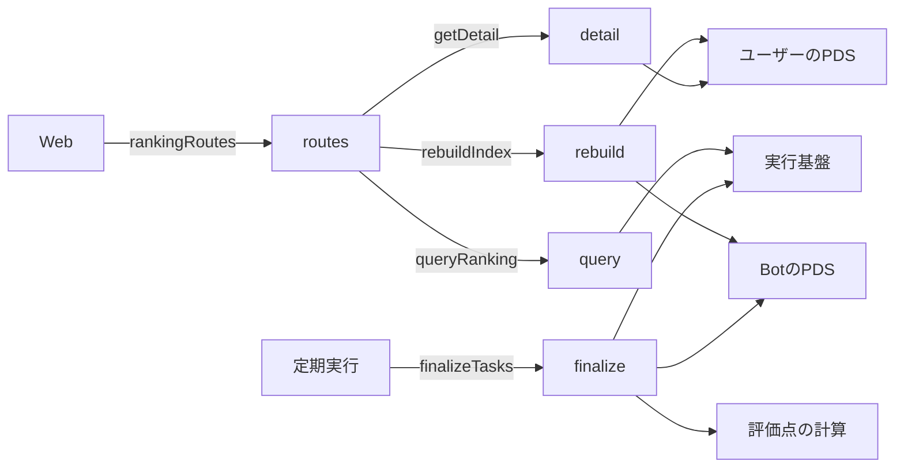
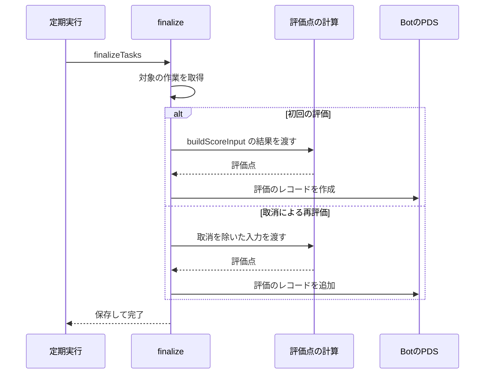

# ランキング 設計書

## 1. 構成

| パス                      | 責務                               |
| ------------------------- | ---------------------------------- |
| `src/ranking/finalize.ts` | 評価の入力の組み立てと確定、再評価 |
| `src/ranking/query.ts`    | 一覧のクエリとページ送り           |
| `src/ranking/detail.ts`   | 詳細の組み立てと画像のURL          |
| `src/ranking/routes.ts`   | ランキングの API 経路              |
| `src/ranking/rebuild.ts`  | データベースの再構築               |

## 2. 関係図・ワークフロー

ランキング処理の依存方向を示す。



評価の確定の流れと、再評価の分岐を示す。



## 3. 設計項目

### D-1: 評価の入力 (FR-2)

```ts
export function buildScoreInput(
  task: TaskRow,
  reports: ReportRow[],
): ScoreInput {
  const range = { startValue: task.start_value, goalValue: task.goal_value }
  const alive = reports.filter((r) => r.revoked === null)
  const progress = alive.filter((r) => r.kind === "progress")
  const result = alive.find((r) => r.kind === "result")
  return {
    startedAt: task.started_at,
    endsAt: task.ends_at,
    dailyTarget: task.daily_target,
    records: progress.map((r) => ({
      at: r.received_at,
      permille: progressPermille(range, r.value),
    })),
    final: result ? { permille: progressPermille(range, result.value) } : null,
  }
}
```

reports には kind がないため、checkins と結合して取得する。

```sql
SELECT r.*, c.kind FROM reports r JOIN checkins c ON c.id = r.checkin_id WHERE r.task_id = ?
```

### D-2: 評価の確定 (FR-1, FR-3)

```ts
export async function finalizeTasks(now: number, env: Env): Promise<void>
```

```sql
SELECT t.* FROM tasks t
WHERE t.status = 'active' AND t.ends_at <= ?
  AND EXISTS (SELECT 1 FROM checkins c WHERE c.task_id = t.id AND c.kind = 'result' AND c.status IN ('accepted','expired'))
LIMIT 5
```

| 手順 | 内容                                                                                                             |
| ---- | ---------------------------------------------------------------------------------------------------------------- |
| 1    | 上のクエリで最大 5 件の作業を取る                                                                                |
| 2    | 作業ごとに buildScoreInput で入力を作り、computeScore で結果を得る                                               |
| 3    | Bot のリポジトリに evaluation を作る（scoreHundredths、finalRatePermille、missingCount、algorithm、finalizedAt） |
| 4    | evaluations に行を追加し、tasks.status を ended にする                                                           |
| 5    | 手順 3 が失敗した作業は、status を active のまま残し、次の定期実行で再試行する                                   |

評価の入力に使う penaltyPerMissingHundredths と penaltyCapHundredths は、システムオプションから読む。

### D-3: 再評価 (FR-4, FR-5)

| 手順 | 内容                                                                                              |
| ---- | ------------------------------------------------------------------------------------------------- |
| 1    | evaluations.stale が 1 の行を 5 件まで取る（受理側の再確認が取消を作ったときに 1 にする）         |
| 2    | 評価の入力を、取消を除いて作り直し、評価点を再計算する                                            |
| 3    | Bot のリポジトリへ新しい evaluation を作り、evaluations の行を新しい値で更新し、stale を 0 にする |
| 4    | tasks.status が withdrawn の作業は再評価せず、ランキングの対象外のままにする                      |

最新の評価は evaluations の行が持つ。Bot のリポジトリには、finalizedAt の新しい evaluation が最新として残る。

### D-4: 一覧 (FR-6, FR-7, FR-10, FR-11, NFR-1, NFR-2)

```ts
export type SortKey = "score" | "rate"
export type RankingQuery = {
  sort: SortKey
  order: "asc" | "desc"
  cursor?: string
}
export type RankingRow = {
  taskId: string
  handle: string
  profileUrl: string
  summary: string
  durationDays: number
  scoreHundredths: number
  finalRatePermille: number
}

export async function queryRanking(
  env: Env,
  q: RankingQuery,
): Promise<{ rows: RankingRow[]; next?: string }>
```

```sql
SELECT e.task_id, e.score_hundredths, e.final_rate_permille, e.finalized_at, t.handle, t.summary, t.duration_days
FROM evaluations e JOIN tasks t ON t.id = e.task_id
WHERE t.status = 'ended' AND (e.score_hundredths, e.finalized_at, e.task_id) < (?, ?, ?)
ORDER BY e.score_hundredths DESC, e.finalized_at DESC, e.task_id DESC LIMIT 51
```

| 項目               | 内容                                                                                                       |
| ------------------ | ---------------------------------------------------------------------------------------------------------- |
| 並べ替えの基準     | score は score_hundredths、rate は final_rate_permille。それぞれ専用の索引を持つ                           |
| 昇順               | 同じクエリで比較を逆にし、並びをすべて昇順にする                                                           |
| ページ送り         | 51 件目の有無で next を決める。cursor は最後の行の（基準値、finalized_at、task_id）を base64url にしたもの |
| 概要の冒頭         | 80 文字までで切り、超える場合は末尾に省略記号を付ける                                                      |
| プロフィールの URL | https://bsky.app/profile/ にユーザー名（handle）を続けた値                                                 |
| 読み取り行数       | 最大で評価 51 行と作業 51 行。索引だけで並べ、全件を走査しない                                             |

### D-5: 詳細 (FR-8, FR-9)

```ts
export async function getDetail(
  env: Env,
  taskId: string,
): Promise<RankingDetail | null>
```

| 項目               | 内容                                                                                              |
| ------------------ | ------------------------------------------------------------------------------------------------- |
| D1 から            | ゴール、指標、概要の全文、期間、評価点、最終進捗度、欠測件数、結果の説明（reports.note）          |
| PDS から           | 作業レコードの startImage、結果の記録の evidence。DID 文書 1 回と getRecord 2 回の最大 3 回の通信 |
| 画像の URL         | {PDS}/xrpc/com.atproto.sync.getBlob?did={DID}&cid={blob の CID}                                   |
| レコードが削除済み | 該当する画像を省略し、そのほかの項目は D1 の値を返す                                              |
| 対象外             | tasks.status が ended 以外の作業は null を返す                                                    |

### D-6: API 経路 (FR-11)

```ts
export const rankingRoutes: Route[] = [
  { method: "GET", path: "/api/ranking", handler: rankingHandler },
  { method: "GET", path: "/api/ranking/detail", handler: detailHandler },
  { method: "POST", path: "/api/admin/rebuild", handler: rebuildHandler },
]
```

| 経路                    | 入力                           | 応答                        |
| ----------------------- | ------------------------------ | --------------------------- |
| GET /api/ranking        | sort、order、cursor            | { rows, next }              |
| GET /api/ranking/detail | id                             | RankingDetail、なければ 404 |
| POST /api/admin/rebuild | ヘッダー x-admin-token、cursor | { processed, next }         |

閲覧の 2 経路は認証を要求しない。再構築の経路だけ、シークレット ADMIN_TOKEN と一致するヘッダーを要求する。

### D-7: 再構築 (FR-12)

```ts
export async function rebuildIndex(
  env: Env,
  cursor: string | null,
): Promise<{ processed: number; next: string | null }>
```

| 手順 | 内容                                                                                                                           |
| ---- | ------------------------------------------------------------------------------------------------------------------------------ |
| 1    | Bot のリポジトリの enrollment を listRecords で 20 件ずつ取る（cursor で続きを取る）                                           |
| 2    | 受理ごとに、ユーザーの作業レコードを取得して CID を照合し、tasks に概要・ゴール・指標を復元する                                |
| 3    | その作業の checkin、receipt、revocation、evaluation を Bot のリポジトリから取り、checkins と reports と evaluations を復元する |
| 4    | 取消のある受領証は revoked を、削除されている作業は status を withdrawn にする                                                 |
| 5    | 1 回の呼び出しで処理する受理は 20 件。1 回あたりの通信は 50 回以内に収める                                                     |

自由記述の文字列は Bot のリポジトリにないため、ユーザーの PDS から復元する。作業レコードが削除されていれば、その作業は withdrawn とする。

## 4. エラー処理

| 事象                             | 処理                                                         |
| -------------------------------- | ------------------------------------------------------------ |
| 不正な sort、order、cursor       | 400 と共通の形式のエラーを返す                               |
| 存在しない作業、対象外の作業     | 詳細は 404 を返す                                            |
| 評価のレコードの作成失敗         | 作業を active のまま残し、次の定期実行で再試行する           |
| 画像の取得元のレコードが削除済み | 画像だけ省略して返す                                         |
| 再構築の認証失敗                 | 401 を返す                                                   |
| ユーザーの PDS に到達できない    | 再構築ではその受理を飛ばして next を進め、飛ばした件数を返す |
