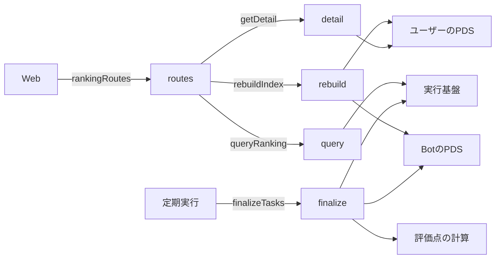
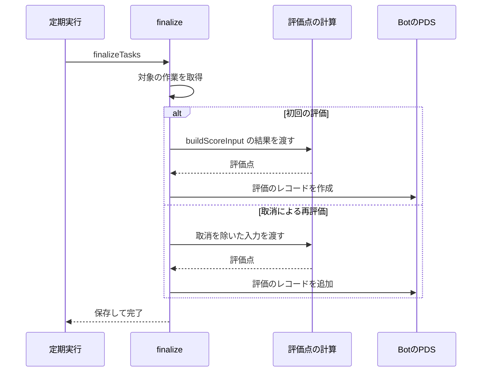

# ランキング 設計書

## 1. 構成

| パス                      | 責務                               |
| ------------------------- | ---------------------------------- |
| `src/ranking/finalize.ts` | 評価の入力の組み立てと確定、再評価 |
| `src/ranking/query.ts`    | 一覧のクエリとページ送り           |
| `src/ranking/detail.ts`   | 詳細の組み立てと画像のURL          |
| `src/ranking/routes.ts`   | ランキングの API 経路              |
| `src/ranking/rebuild.ts`  | データベースの再構築               |

## 2. 関係図・ワークフロー

ランキング処理の依存方向を示す。



評価の確定の流れと、再評価の分岐を示す。



## 3. 設計項目

### D-1: 評価の入力 (FR-2)

```ts
export function buildScoreInput(
  task: TaskRow,
  reports: ReportRow[],
): ScoreInput {
  const range = { startValue: task.startValue, goalValue: task.goalValue }
  const alive = reports.filter((r) => r.revoked === null)
  const progress = alive.filter((r) => r.kind === "progress")
  const result = alive.find((r) => r.kind === "result")
  return {
    startedAt: task.startedAt,
    endsAt: task.endsAt,
    dailyTarget: task.dailyTarget,
    records: progress.map((r) => ({
      at: r.receivedAt,
      permille: progressPermille(range, r.value),
    })),
    final: result ? { permille: progressPermille(range, result.value) } : null,
  }
}
```

報告の行は kind を持つため、reports.listByTask の 1 回の読み出しで入力が組み立つ。

### D-2: 評価の確定 (FR-1, FR-3)

```ts
export async function finalizeTasks(now: number, env: Env): Promise<void>
```

作業の取得は tasks.listFinalizable(now, 5) で行う。結果確認が受理または期限切れになった終了済みの作業が、終了の古い順に最大 5 件返る。

| 手順 | 内容                                                                                                                               |
| ---- | ---------------------------------------------------------------------------------------------------------------------------------- |
| 1    | tasks.listFinalizable で最大 5 件の作業を取る                                                                                      |
| 2    | 作業ごとに buildScoreInput で入力を作り、computeScore で結果を得る                                                                 |
| 3    | Bot のリポジトリに evaluation を writeBotRecord で作る（scoreHundredths、finalRatePermille、missingCount、algorithm、finalizedAt） |
| 4    | evaluationRowFromRecords で行を作り evaluations.put、tasks.patch で status を ended にする                                         |
| 5    | 手順 3 か手順 4 が失敗した作業は、status を active のまま残し、次の定期実行で再試行する                                            |

評価の入力に使う penaltyPerMissingHundredths と penaltyCapHundredths は、システムオプションから読む。

### D-3: 再評価 (FR-4, FR-5)

| 手順 | 内容                                                                                                |
| ---- | --------------------------------------------------------------------------------------------------- |
| 1    | evaluations.listStale で 5 件まで取る（受理側の再確認が取消を作ったときに stale を真にする）        |
| 2    | 評価の入力を、取消を除いて作り直し、評価点を再計算する                                              |
| 3    | Bot のリポジトリへ新しい evaluation を作り、evaluations.put で行を新しい値と stale の偽で置き換える |
| 4    | 行の visible が偽（取り下げ）の作業は再評価せず、ランキングの対象外のままにする                     |

最新の評価は評価の行が持つ。Bot のリポジトリには、finalizedAt の新しい evaluation が最新として残る。

### D-4: 一覧 (FR-6, FR-7, FR-10, FR-11, NFR-1, NFR-2)

```ts
export type SortKey = "score" | "rate"
export type RankingQuery = {
  sort: SortKey
  order: "asc" | "desc"
  cursor?: string
}
export type RankingRow = {
  taskId: string
  handle: string
  profileUrl: string
  summary: string
  durationDays: number
  scoreHundredths: number
  finalRatePermille: number
}

export async function queryRanking(
  env: Env,
  q: RankingQuery,
): Promise<{ rows: RankingRow[]; next?: string }>
```

一覧は evaluations.page({ sort, order, after, limit: 51 }) の 1 回の読み出しで得る。評価の行が handle、summary、durationDays を持つため、作業の行との結合はない。

| 項目               | 内容                                                                                                     |
| ------------------ | -------------------------------------------------------------------------------------------------------- |
| 並べ替えの基準     | score は scoreHundredths、rate は finalRatePermille。visible が真の行だけを、それぞれ専用の索引で並べる  |
| 昇順               | order に asc を渡し、比較を逆にして並びをすべて昇順にする                                                |
| ページ送り         | 51 件目の有無で next を決める。cursor は最後の行の（基準値、finalizedAt、taskId）を base64url にしたもの |
| 概要の冒頭         | 80 文字までで切り、超える場合は末尾に省略記号を付ける                                                    |
| プロフィールの URL | https://bsky.app/profile/ にユーザー名（handle）を続けた値                                               |
| 読み取り行数       | 最大で評価 51 行。索引だけで並べ、全件を走査しない                                                       |

### D-5: 詳細 (FR-8, FR-9)

```ts
export async function getDetail(
  env: Env,
  taskId: string,
): Promise<RankingDetail | null>
```

| 項目               | 内容                                                                                                                                                        |
| ------------------ | ----------------------------------------------------------------------------------------------------------------------------------------------------------- |
| 保存先から         | tasks.get、evaluations.get、reports.listByTask の 3 回で、ゴール、指標、概要の全文、期間、評価点、最終進捗度、欠測件数、結果の説明（結果報告の note）を得る |
| PDS から           | 作業レコードの startImage、結果の記録の evidence。DID 文書 1 回と getRecord 2 回の最大 3 回の通信                                                           |
| 画像の URL         | {PDS}/xrpc/com.atproto.sync.getBlob?did={DID}&cid={blob の CID}                                                                                             |
| レコードが削除済み | 該当する画像を省略し、そのほかの項目は保存先の値を返す                                                                                                      |
| 対象外             | 評価の行がない、または visible が偽の作業は null を返す                                                                                                     |

### D-6: API 経路 (FR-11)

```ts
export const rankingRoutes: Route[] = [
  { method: "GET", path: "/api/ranking", handler: rankingHandler },
  { method: "GET", path: "/api/ranking/detail", handler: detailHandler },
  { method: "POST", path: "/api/admin/rebuild", handler: rebuildHandler },
]
```

| 経路                    | 入力                           | 応答                                |
| ----------------------- | ------------------------------ | ----------------------------------- |
| GET /api/ranking        | sort、order、cursor            | { rows, next }                      |
| GET /api/ranking/detail | id                             | RankingDetail、なければ 404         |
| POST /api/admin/rebuild | ヘッダー x-admin-token、cursor | { phase, processed, skipped, next } |

閲覧の 2 経路は認証を要求しない。再構築の経路だけ、シークレット ADMIN_TOKEN と一致するヘッダーを要求する。

### D-7: 再構築 (FR-12)

```ts
export async function rebuildIndex(
  env: Env,
  cursor: string | null,
): Promise<{
  phase: number
  processed: number
  skipped: number
  next: string | null
}>
```

再構築は、Bot のリポジトリのコレクションを種類ごとに段階を分けて走査する。cursor は { 段階の番号、listRecords の続き } を base64url にしたもので、運用者のスクリプトが next が空になるまで繰り返し呼ぶ。行の主キーはレコードから決まり、集計は最大値と論理和で行うため、同じ段階を何度実行しても結果が変わらない。

| 段階 | 走査と上限               | 処理                                                                                                                                                                          | 通信の最大 |
| ---- | ------------------------ | ----------------------------------------------------------------------------------------------------------------------------------------------------------------------------- | ---------- |
| 1    | enrollment を 15 件ずつ  | resolveDid と作業レコードの取得・CID 照合の後、getEntitlement の資格で taskRowFromRecords の行を作り tasks.putMany。削除済みの作業は空の文字列で補い withdrawn                | 47         |
| 2    | checkin を 100 件ずつ    | 期限切れの確認依頼の行を openCheckins.putMany。作業の progressIssued を seq の最大、lastNotifiedDay と notifiedWindows を発行日時の最大、resultState を issued にする         | 4          |
| 3    | receipt を 40 件ずつ     | accepted は報告の記録を取得して reportRowFromRecords の行を reports.putMany。解決済みの行を openCheckins.deleteMany。結果確認の resultState を accepted または expired にする | 46         |
| 4    | evaluation を 100 件ずつ | 作業ごとに finalizedAt が最新の評価を evaluationRowFromRecords で evaluations.putMany。作業の status を ended にする                                                          | 5          |
| 5    | revocation を 15 件ずつ  | 受領証への取消は reports の revoked を設定し、取消が評価より新しければ stale を真にする。受理への取消は status を withdrawn、評価の visible を偽にする                        | 46         |

| 規則         | 内容                                                                                                                                 |
| ------------ | ------------------------------------------------------------------------------------------------------------------------------------ |
| 通信の上限   | 1 回の呼び出しの外部への通信と保存先の操作の合計は 50 回以内。段階ごとの件数はこの上限から決めた                                     |
| 作業の特定   | 受理のキーが作業の id である。checkin・evaluation の作業は受理の参照から、receipt の作業は報告の記録の作業の参照から求める           |
| 自由記述     | Bot のリポジトリにないため、ユーザーの PDS から復元する。PDS は DID 文書から解決し、独自ドメインの handle のユーザーも同じ手順で扱う |
| 期限内の依頼 | 期限内の確認依頼は登録しない。飛ばした件数に数える                                                                                   |
| 規模         | 作業 100 件（Bot のレコード約 900 件）で約 20 回の呼び出し。通信の総数は、作業の件数にほぼ比例する                                   |

## 4. エラー処理

| 事象                             | 処理                                                        |
| -------------------------------- | ----------------------------------------------------------- |
| 不正な sort、order、cursor       | 400 と共通の形式のエラーを返す                              |
| 存在しない作業、対象外の作業     | 詳細は 404 を返す                                           |
| 評価のレコードの作成失敗         | 作業を active のまま残し、次の定期実行で再試行する          |
| 画像の取得元のレコードが削除済み | 画像だけ省略して返す                                        |
| 再構築の認証失敗                 | 401 を返す                                                  |
| ユーザーの PDS に到達できない    | 段階 1 ではその受理を飛ばし、skipped に数えて next を進める |
