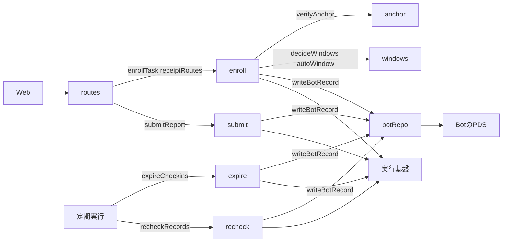
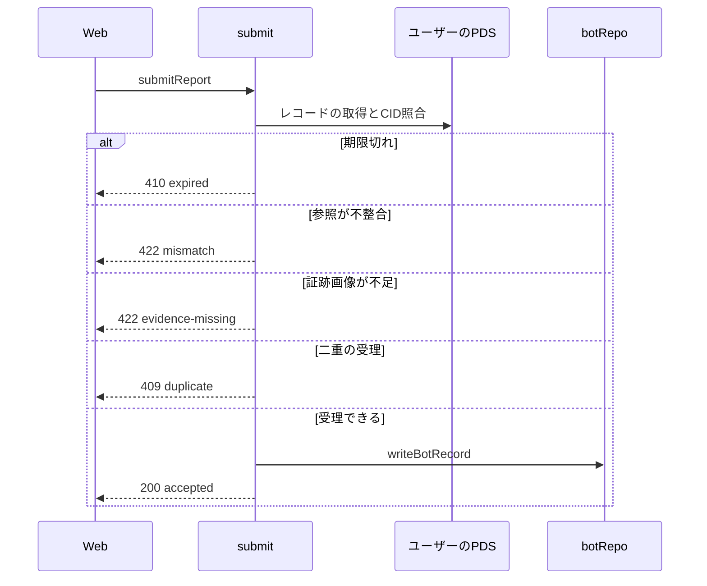

# 受理と再確認 設計書

## 1. 構成

| パス                     | 責務                                            |
| ------------------------ | ----------------------------------------------- |
| `src/receipt/routes.ts`  | 受理依頼のAPI経路                               |
| `src/receipt/enroll.ts`  | 作業の受理                                      |
| `src/receipt/anchor.ts`  | 起点投稿の検証                                  |
| `src/receipt/windows.ts` | 通知窓の決定（朝昼夕の変換と1日作業の自動選択） |
| `src/receipt/submit.ts`  | 進捗報告と結果報告の受理                        |
| `src/receipt/expire.ts`  | 期限切れの受領証の作成                          |
| `src/receipt/recheck.ts` | 受理済みレコードの再確認と取消                  |
| `src/receipt/botRepo.ts` | Bot のリポジトリへの書き込み                    |

## 2. 関係図・ワークフロー

受理処理の依存方向を示す。



報告の受理の流れと、拒否される場合の分岐を示す。



## 3. 設計項目

### D-1: API経路 (FR-12, NFR-2)

```ts
export const receiptRoutes: Route[] = [
  { method: "POST", path: "/api/enroll", handler: enrollHandler },
  { method: "POST", path: "/api/submit", handler: submitHandler },
  { method: "GET", path: "/api/checkin", handler: checkinHandler },
]
```

| 経路             | 入力               | 成功の応答                                                                                                                                           |
| ---------------- | ------------------ | ---------------------------------------------------------------------------------------------------------------------------------------------------- |
| POST /api/enroll | { taskUri }        | 200 { taskId, startedAt, endsAt, windows }                                                                                                           |
| POST /api/submit | { recordUri }      | 200 { status: "accepted", receiptUri }                                                                                                               |
| GET /api/checkin | ?id=<確認依頼のid> | 未解決: 200 { now, did, kind, status: issued, expiresAt, taskRef, checkinRef, metric, evidenceRequired, taskSummary }。解決済み: 200 { now, status } |

taskRef と checkinRef は uri と cid の組である。metric は名称・単位・小数桁数・開始値・ゴール値を持つ。認証は要求しない。偽造できるのは本人のリポジトリへの書き込みだけで、不正な依頼は検証で拒否される。確認依頼が未解決かどうかは保存先の openCheckins にあるかで決め、なければ Bot のリポジトリの同じキーの受領証から status を返す（なければ 404）。同じ依頼は Bot のレコードのキーが同じになるため 1 回に絞られ、2 回目以降は最初の結果を返す。

### D-2: 作業の受理 (FR-1, FR-3, FR-4, FR-12)

```ts
export async function enrollTask(
  env: Env,
  taskUri: string,
  now: number,
): Promise<EnrollResult>

export type EnrollResult =
  | {
      ok: true
      taskId: string
      startedAt: number
      endsAt: number
      windows: Window[]
    }
  | { ok: false; status: 409 | 422 | 502; reason: string }
```

| 手順 | 内容                                                                                        | 失敗時               |
| ---- | ------------------------------------------------------------------------------------------- | -------------------- |
| 1    | taskUri の collection が task であること                                                    | 422 bad-uri          |
| 2    | tasks.getByTaskUri で登録済みなら、保存済みの結果を返す                                     | （同じ結果）         |
| 3    | resolveDid で PDS と handle を得て、レコードを取得し CID を照合、構造と意味規則を検証する   | 422 invalid-record   |
| 4    | 起点投稿を検証する                                                                          | 422 anchor-invalid   |
| 5    | tasks.countActive が資格の同時進行数未満であること                                          | 409 limit-reached    |
| 6    | 通知窓を決定する                                                                            | —                    |
| 7    | startedAt = now、endsAt = now + durationDays × 86400000                                     | —                    |
| 8    | Bot のリポジトリへ受理レコード（enrollment）を enrollmentKey のキーで作る。dailyTarget は 1 | 502 bot-write-failed |
| 9    | taskRowFromRecords で行を作り tasks.put で登録する。priority は資格の優先度                 | 502 store-failed     |

手順 8 の writeBotRecord が作成済みを返したときは、既存の受理レコードの startedAt・endsAt・windows を使って手順 9 へ進む。手順 9 が失敗した場合も、同じ依頼を再送すれば同じ内容で登録がやり直される。

### D-3: 起点投稿の検証 (FR-2)

```ts
export async function verifyAnchor(
  env: Env,
  did: string,
  anchor: StrongRef,
): Promise<boolean>
```

| 条件                                                                     | 結果  |
| ------------------------------------------------------------------------ | ----- |
| anchor.uri のリポジトリが did と同じで、collection が app.bsky.feed.post | 続行  |
| 取得した投稿の CID が anchor.cid と一致                                  | 続行  |
| 投稿の facets に Bot の DID へのメンションが含まれる                     | true  |
| 上記のいずれかを満たさない                                               | false |

### D-4: 通知窓の決定 (FR-5)

```ts
export function decideWindows(
  task: { durationDays: number; slot?: Slot },
  startedAt: number,
  endsAt: number,
): Window[] {
  if (task.durationDays >= 2) return [slotToWindow(task.slot!)]
  return [autoWindow(startedAt, endsAt)]
}

export function autoWindow(startedAt: number, endsAt: number): Window
```

autoWindow の手順:

| 手順 | 内容                                                                                 |
| ---- | ------------------------------------------------------------------------------------ |
| 1    | 開始から終了までの各日（日本時間）の朝・昼・夕の範囲を候補にし、開始と終了で切り取る |
| 2    | 切り取った幅が 60 分未満の候補を除く                                                 |
| 3    | 目標時刻 = startedAt + 12 時間                                                       |
| 4    | 目標時刻を含む候補があればそれ、なければ目標時刻に最も近い候補（同距離なら早い方）   |
| 5    | 選んだ候補の朝・昼・夕の窓（切り取る前の範囲）を返す                                 |

| 開始  | 目標    | 選ばれる窓      |
| ----- | ------- | --------------- |
| 07:00 | 19:00   | 夕（960〜1200） |
| 10:00 | 22:00   | 夕（960〜1200） |
| 21:00 | 翌09:00 | 朝（480〜720）  |

### D-5: 報告の受理 (FR-6, FR-7, FR-8, FR-12, NFR-1, NFR-2)

```ts
export async function submitReport(
  env: Env,
  recordUri: string,
  now: number,
): Promise<SubmitResult>
```

| 手順 | 内容                                                                                                                          | 失敗時                      |
| ---- | ----------------------------------------------------------------------------------------------------------------------------- | --------------------------- |
| 1    | recordUri の collection が progress または result                                                                             | 422 bad-uri                 |
| 2    | PDS から取得し CID を照合、構造と意味規則を検証する                                                                           | 422 invalid-record          |
| 3    | 記録の checkin 参照のキーで openCheckins.get。なければ Bot のリポジトリの同じキーの受領証を引き、あれば 409、なければ 422     | 409 duplicate、422 mismatch |
| 4    | now が確認依頼の expiresAt を超えていないこと（Bot の受信時刻で判定）                                                         | 410 expired                 |
| 5    | リポジトリの DID が確認依頼の did と一致、記録の task.uri が tasks.get の taskUri と一致、collection と確認依頼の kind が一致 | 422 mismatch                |
| 6    | 作業の evidenceRequired が真なら、evidence の blob が存在（getBlob の HEAD で確認）                                           | 422 evidence-missing        |
| 7    | Bot のリポジトリへ受領証（accepted）を、確認依頼と同じキーで writeBotRecord する。record・value・receivedAt を固定する        | 502 bot-write-failed        |
| 8    | 手順 7 が作成済みを返したとき、既存の受領証の record が今回の recordUri と同じなら続行し、異なれば拒否する                    | 409 duplicate               |
| 9    | reportRowFromRecords で行を作り reports.put、openCheckins.delete、結果報告なら tasks.patch で resultState を accepted にする  | 502 store-failed            |

外部への通信は、DID 文書 1 回、記録の取得 1 回、blob の確認 1 回、Bot の書き込み 1 回、既存の受領証の取得 1 回の最大 5 回である（保存先の操作は含めない）。受理時刻の判定には記録の createdAt を使わない。同じキーの受領証は、並列に作っても 1 件だけが作られ、後続は作成済みとして手順 8 に進む。

### D-6: 期限切れ (FR-9)

```ts
export async function expireCheckins(now: number, env: Env): Promise<void>
```

| 項目     | 内容                                                                                                                                           |
| -------- | ---------------------------------------------------------------------------------------------------------------------------------------------- |
| 対象     | openCheckins.listExpired の行。1回に 20 件まで                                                                                                 |
| 処理     | 受領証（expired）を確認依頼と同じキーで writeBotRecord し、openCheckins.delete する。結果確認なら tasks.patch で resultState を expired にする |
| 作成済み | 既存の受領証が accepted なら、報告の受理の手順 9 と同じ登録を完了させる                                                                        |
| 失敗     | その行は次の定期実行で再試行する                                                                                                               |

### D-7: 再確認と取消 (FR-10, FR-11)

```ts
export async function recheckRecords(now: number, env: Env): Promise<void>
```

| 項目   | 内容                                                                                                                                                                                                         |
| ------ | ------------------------------------------------------------------------------------------------------------------------------------------------------------------------------------------------------------ |
| 対象   | reports.listDueForRecheck と tasks.listDueForRecheck（before は now − recheckIntervalHours）の合計 10 件まで                                                                                                 |
| 取得   | 記録の URI から PDS の公開レコードを取得し、CID を保存済みの record_cid と比較する                                                                                                                           |
| 一致   | reports.patch または tasks.patch で checkedAt を now に更新する                                                                                                                                              |
| 不一致 | revocation（reason: tampered、target: 受領証）を Bot のリポジトリへ作り、reports.patch で revoked を設定し、evaluations.patch で stale を真にする                                                            |
| 削除   | 報告の記録が削除されていれば reason: deleted の取消を作り、作業の記録が削除されていれば作業を取り下げる（tasks.patch で status を withdrawn、evaluations.patch で visible を偽、受理レコードへの取消を作る） |

### D-8: Bot リポジトリへの書き込み (FR-4, FR-8, FR-9, FR-10, FR-12)

```ts
export async function writeBotRecord(
  env: Env,
  collection: CollectionNsid,
  record: object,
  rkey?: string,
): Promise<{ ref: StrongRef; created: boolean }>
```

| 項目     | 内容                                                                                                          |
| -------- | ------------------------------------------------------------------------------------------------------------- |
| 検証     | 書き込む前に validateRecord で構造と意味規則を検証する                                                        |
| 認証     | getBotAgent のセッションで呼ぶ                                                                                |
| 書込先   | Bot のリポジトリのみ                                                                                          |
| キーあり | putRecord に swapRecord の null を付けて作る。InvalidSwap なら getRecord で既存を取り、created を偽にして返す |
| キーなし | createRecord で作る（取消と評価）                                                                             |
| 戻り値   | レコードの uri と cid、新規に作ったかどうか                                                                   |

## 4. エラー処理

| 事象                             | 処理                                                                 |
| -------------------------------- | -------------------------------------------------------------------- |
| ユーザーの PDS に到達できない    | 502 と retryable true を返す                                         |
| Bot のリポジトリへの書き込み失敗 | 502 を返し、保存先を更新しない。次の依頼または定期実行で再試行する   |
| 保存先への登録の失敗             | 502 と再試行可を返す。作成済みのレコードから次の依頼で登録をやり直す |
| 期限切れ                         | 410 を返す                                                           |
| 検証の失敗                       | 422 と理由コードを返す                                               |
| 二重の受理                       | 409 を返し、保存済みの結果を添える                                   |
| 再確認中の PDS の一時的な失敗    | その行は更新せず、次の定期実行で再試行する                           |
