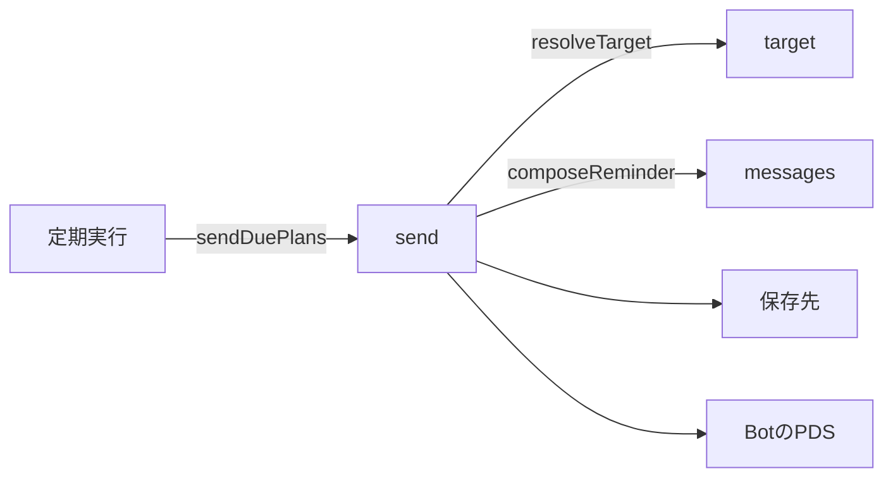
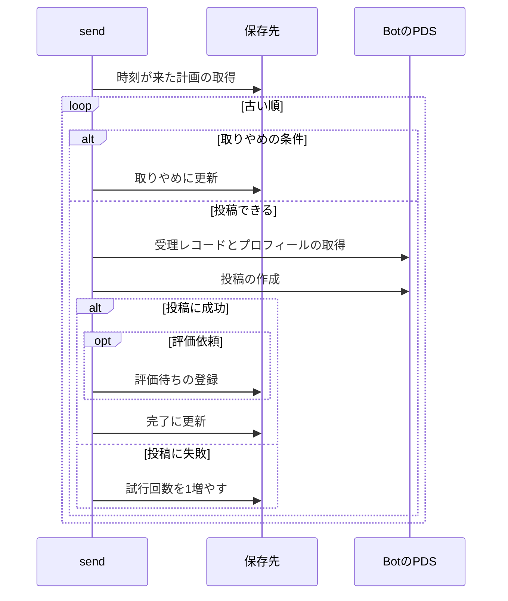

# リマインド 設計書

## 1. 構成

| パス                       | 責務                                             |
| -------------------------- | ------------------------------------------------ |
| `src/reminder/send.ts`     | 時刻が来た計画の取り出し、投稿、状態の更新       |
| `src/reminder/target.ts`   | 受理の起点から投稿の宛先（返信か新規か）を決める |
| `src/reminder/messages.ts` | リマインドと評価依頼の文面                       |

## 2. 関係図・ワークフロー

定期実行から投稿までの依存方向を示す。



1件の計画の処理の流れと、取りやめ・失敗の分岐を示す。



## 3. 設計項目

### D-1: 計画の取り出しと状態の更新 (FR-1, FR-5, NFR-2)

```ts
export const sendDuePlans: Job // 毎分の定期実行に登録する
```

1. duePlans(["remind", "ask"], 現在時刻, JOB_BATCH) で、pending の計画を時刻の古い順に取り出す。
2. 取り出した計画を順に処理する。1件の失敗は記録して次の計画へ進む。
3. 成功は state=done、失敗は attempts を 1 増やして pending のままにする。

毎分の実行で取り出すため、時刻から投稿までの遅れは 1 分の周期と処理の時間に収まる。

### D-2: 取りやめの規則 (FR-6)

| 種別   | 取りやめの条件                              | 更新後の状態 |
| ------ | ------------------------------------------- | ------------ |
| remind | 現在時刻が計画の時刻の 3 時間後を過ぎている | dropped      |
| remind | attempts が 3 以上                          | dropped      |
| ask    | attempts が 10 以上                         | dropped      |

取りやめの判定は、投稿の前に行う。取りやめにした計画は投稿しない。

### D-3: 宛先と投稿 (FR-2, FR-3, FR-8, NFR-1)

```ts
export type Target = { reply?: { rootUri: string; rootCid: string; parentUri: string; parentCid: string } }
export function resolveTarget(a: AcceptanceView): Target
```

| 起点の種類 | 宛先                                   |
| ---------- | -------------------------------------- |
| post       | 根を起点の根、親を起点の投稿とする返信 |
| task       | 返信なしの新規投稿                     |

1 件の投稿までの通信は次の 3 回とする。

| 順  | 通信                                         |
| --- | -------------------------------------------- |
| 1   | Bot のリポジトリから受理レコードを取得する   |
| 2   | 持ち主のプロフィールを取得してハンドルを得る |
| 3   | createPost で投稿を作る                      |

同じ持ち主の計画が 1 回の実行に複数あるときは、プロフィールの取得を 1 回にまとめる。

### D-4: 評価待ちの登録 (FR-4)

評価依頼の投稿に成功したら、次の行を保存先へ登録する。

| 列             | 値                     |
| -------------- | ---------------------- |
| post_uri       | 投稿した評価依頼の URI |
| acceptance_uri | 計画の acceptance_uri  |
| owner          | 持ち主の DID           |
| kind           | ask                    |
| state          | open                   |
| created_at     | 投稿の時刻             |

登録に失敗したときは計画を完了にせず、次の実行で再び投稿する。

### D-5: 文面 (FR-7)

```ts
export function composeReminder(kind: "remind" | "ask", vars: { handle: string; text: string; due: string }, seed: string): string
```

| 種別   | 文例の1つ                                                          |
| ------ | ------------------------------------------------------------------ |
| remind | 「資料作成」、10/25 までだよ。進んでるかな?                        |
| ask    | 「資料作成」の期限になったよ。できた?できなかった?返信で教えてね。 |

各種別は 3 つの文例を持ち、seed（計画の id）から決まった 1 つを選ぶ。評価依頼は必ず「できた」と「できなかった」の両方の語を含める。due は「M/D」の形にする。

## 4. エラー処理

| 事象                     | 処理                                     |
| ------------------------ | ---------------------------------------- |
| 受理レコードの取得に失敗 | 試行回数を増やして次の実行で再試行する   |
| プロフィールの取得に失敗 | 試行回数を増やして次の実行で再試行する   |
| 投稿の作成に失敗         | 試行回数を増やして次の実行で再試行する   |
| 評価待ちの登録に失敗     | 計画を完了にせず、次の実行で再び投稿する |
