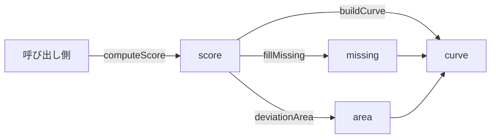
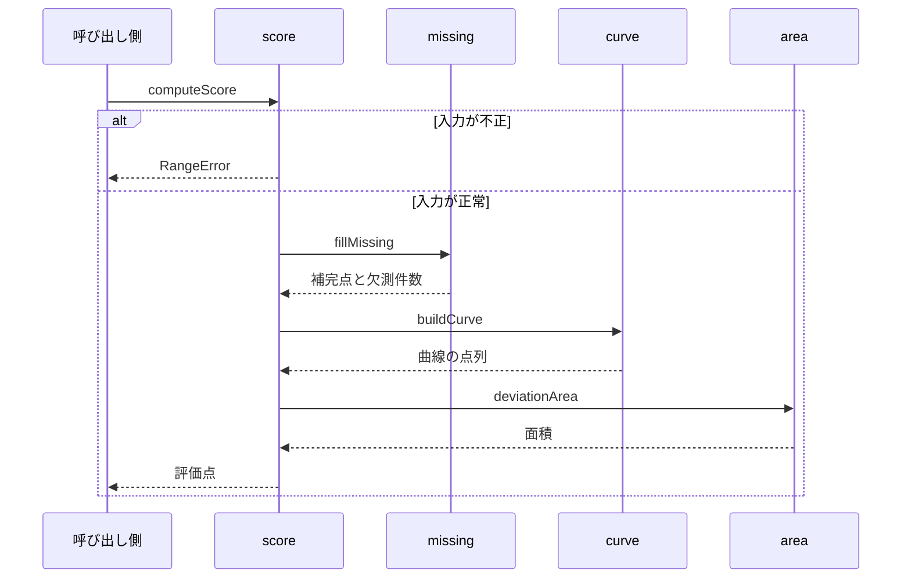

# 評価点の算出 設計書

## 1. 構成

| パス                     | 責務                           |
| ------------------------ | ------------------------------ |
| `src/scoring/curve.ts`   | 進捗曲線の構築と丸め           |
| `src/scoring/area.ts`    | 曲線と理想の直線との面積の計算 |
| `src/scoring/missing.ts` | 欠測の件数と補完点の生成       |
| `src/scoring/score.ts`   | 入力の検査と評価点の組み立て   |

## 2. 関係図・ワークフロー

算出処理の依存方向を示す。



算出の流れと、入力が不正な場合の分岐を示す。



## 3. 設計項目

### D-1: 入出力の型と入力検査 (FR-9, FR-10, FR-11, FR-12)

```ts
export type ScoreOptions = {
  penaltyPerMissingHundredths: number // 既定 200
  penaltyCapHundredths: number // 既定 1000
}

export type ScoreInput = {
  startedAt: number // ミリ秒
  endsAt: number
  dailyTarget: number // 1 以上 10 以下
  records: { at: number; permille: number }[] // 受理された進捗記録
  final: { permille: number } | null // 受理された結果報告
}

export type ScoreResult = {
  algorithm: "linear-v1"
  scoreHundredths: number // 0 以上 10000 以下
  finalRatePermille: number
  missingCount: number
}

export function computeScore(
  input: ScoreInput,
  options: ScoreOptions,
): ScoreResult
```

| 条件                                        | 処理                           |
| ------------------------------------------- | ------------------------------ |
| dailyTarget が整数でない、または 1〜10 の外 | RangeError                     |
| endsAt が startedAt 以下                    | RangeError                     |
| 記録の at が期間の外                        | その記録を無視する             |
| 同じ入力                                    | 乱数・現在時刻を使わず同じ結果 |

### D-2: 進捗曲線 (FR-1, FR-2, FR-3)

```ts
export type Point = { x: number; y: number }

export function buildCurve(input: ScoreInput, extra: Point[]): Point[] {
  const span = input.endsAt - input.startedAt
  const real = input.records
    .filter((r) => r.at >= input.startedAt && r.at <= input.endsAt)
    .map((r) => ({
      x: (r.at - input.startedAt) / span,
      y: clamp01(r.permille / 1000),
    }))
  const last = real.length > 0 ? real[real.length - 1].y : 0
  const end = input.final ? clamp01(input.final.permille / 1000) : last
  return [{ x: 0, y: 0 }, ...real, ...extra, { x: 1, y: end }].sort(
    (a, b) => a.x - b.x,
  )
}
```

x が同じ点は、並べた順に隣接させ、面積の計算で幅 0 の区間として扱う。

### D-3: 面積 (FR-4)

```ts
// 区間ごとに |曲線 − x| を積分する。符号が変わる区間は交点で分ける
export function deviationArea(curve: Point[]): number {
  let area = 0
  for (let i = 1; i < curve.length; i++) {
    const w = curve[i].x - curve[i - 1].x
    const d0 = curve[i - 1].y - curve[i - 1].x
    const d1 = curve[i].y - curve[i].x
    if (d0 * d1 >= 0) area += ((Math.abs(d0) + Math.abs(d1)) / 2) * w
    else {
      const t = Math.abs(d0) / (Math.abs(d0) + Math.abs(d1))
      area += ((Math.abs(d0) * t + Math.abs(d1) * (1 - t)) / 2) * w
    }
  }
  return area
}
```

評価点 = 10000 − round(面積 × 2 × 10000) − 減点。面積は 0 以上 0.5 以下なので、減点前は 0 以上 10000 以下に収まる。

| 例                    | 面積 | 減点前の評価点 |
| --------------------- | ---- | -------------- |
| 進捗が x と一致       | 0    | 10000          |
| 進捗が常に 0          | 0.5  | 0              |
| 進捗が常に 1          | 0.5  | 0              |
| 前半 0、後半 1 の階段 | 0.25 | 5000           |

### D-4: 欠測と補完 (FR-5, FR-6, FR-7, FR-8)

```ts
export function fillMissing(
  input: ScoreInput,
  options: ScoreOptions,
): { points: Point[]; missingCount: number; penaltyHundredths: number } {
  const day = 24 * 60 * 60 * 1000
  const days = Math.ceil((input.endsAt - input.startedAt) / day)
  const sorted = [...input.records].sort((a, b) => a.at - b.at)
  const points: Point[] = []
  let missing = 0
  for (let k = 0; k < days; k++) {
    const from = input.startedAt + k * day
    const inDay = sorted.filter((r) => r.at >= from && r.at < from + day)
    missing += Math.max(0, input.dailyTarget - inDay.length)
    if (inDay.length > 0) continue
    const prev = [...sorted].reverse().find((r) => r.at < from)
    const next = sorted.find((r) => r.at >= from + day)
    const ys = [prev, next]
      .filter(Boolean)
      .map((r) => clamp01(r!.permille / 1000))
    const y = ys.length === 0 ? 0 : ys.reduce((a, b) => a + b, 0) / ys.length
    points.push({ x: (k + 0.5) / days, y })
  }
  const penalty = Math.min(
    options.penaltyCapHundredths,
    missing * options.penaltyPerMissingHundredths,
  )
  return { points, missingCount: missing, penaltyHundredths: penalty }
}
```

補完点は記録が0件の日だけに置く。1件以上ある日の不足は、補完点を置かず減点だけに反映する。最終の評価点は 0 未満なら 0 に丸める。

### D-5: 計算量 (NFR-1)

| 処理                   | 計算量        | 備考                           |
| ---------------------- | ------------- | ------------------------------ |
| 日ごとの記録の数え上げ | 日数 × 記録   | 日数は 7 以下、記録は 100 以下 |
| 曲線の整列             | 記録 log 記録 |                                |
| 面積                   | 点の数        |                                |

最大入力（7日、記録100件）で 1 ミリ秒以内に収まる。配列の再確保を避けるため、日ごとの数え上げは整列済みの配列を走査して1回で行う。

## 4. エラー処理

| 事象                 | 処理                |
| -------------------- | ------------------- |
| 日の必須回数が範囲外 | RangeError を投げる |
| 期間が 0 以下        | RangeError を投げる |
| 進捗率が数値でない   | RangeError を投げる |
| 期間外の記録         | 無視する            |
