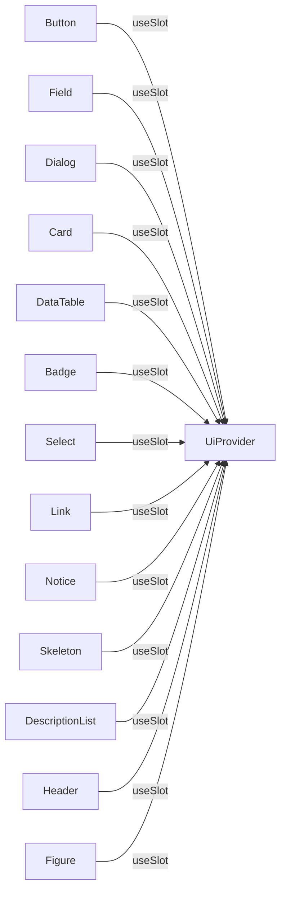
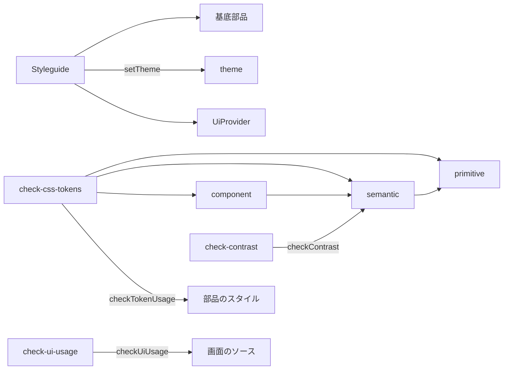
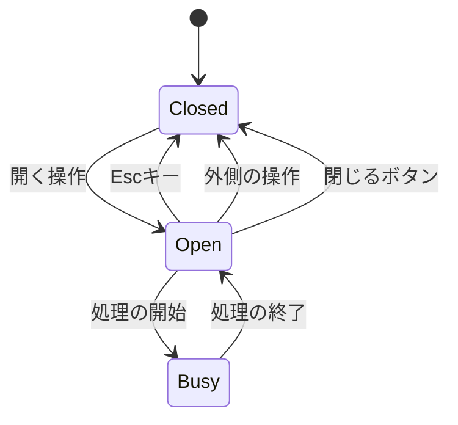

# UI基盤 設計書

## 1. 構成

| パス                             | 責務                                       |
| -------------------------------- | ------------------------------------------ |
| `src/web/tokens/primitive.css`   | 素の値（色の階調・余白の段階・角丸・文字） |
| `src/web/tokens/semantic.css`    | 用途の値と暗テーマの再定義                 |
| `src/web/tokens/component.css`   | 部品ごとの値                               |
| `src/web/ui/UiProvider.tsx`      | 基底実装の差し替えの文脈                   |
| `src/web/ui/theme.ts`            | テーマの保持と切り替え                     |
| `src/web/ui/Button.tsx`          | 基底のボタン                               |
| `src/web/ui/Field.tsx`           | 基底の入力欄（ラベル・入力・エラー）       |
| `src/web/ui/Select.tsx`          | 基底の選択欄                               |
| `src/web/ui/Dialog.tsx`          | 基底のダイアログ                           |
| `src/web/ui/Card.tsx`            | 基底のカード                               |
| `src/web/ui/DataTable.tsx`       | 基底の表                                   |
| `src/web/ui/Badge.tsx`           | 基底のバッジ                               |
| `src/web/ui/Link.tsx`            | 基底のリンク                               |
| `src/web/ui/Notice.tsx`          | 基底の通知（案内・エラー）                 |
| `src/web/ui/Skeleton.tsx`        | 基底の読み込み中の骨組み                   |
| `src/web/ui/DescriptionList.tsx` | 基底の定義リスト                           |
| `src/web/ui/Header.tsx`          | 基底のヘッダー                             |
| `src/web/ui/Figure.tsx`          | 基底の画像                                 |
| `src/web/ui/Styleguide.tsx`      | 部品の一覧の確認用画面                     |
| `scripts/check-css-tokens.mjs`   | 設計値の使い方の検査                       |
| `scripts/check-contrast.mjs`     | 配色のコントラスト比の検査                 |
| `scripts/check-ui-usage.mjs`     | 画面での素の要素の使用の検査               |

## 2. 関係図・ワークフロー

基底部品と差し替えの文脈の依存方向を示す。



確認用の画面と検査と設計値の依存方向を示す。



ダイアログの開閉と、閉じ方による分岐を示す。



## 3. 設計項目

### D-1: 設計値の3層 (FR-1, FR-4)

```css
/* primitive.css: 素の値のみ。ほかの変数を参照しない */
:root {
  --blue-500: #3b6fd4;
  --gray-900: #1c1f26;
  --gray-50: #f6f7f9;
  --space-2: 8px;
  --radius-1: 6px;
}

/* semantic.css: 用途の値。素の値だけを参照する */
:root {
  --color-primary: var(--blue-500);
  --color-text: var(--gray-900);
  --color-surface: var(--gray-50);
  --shape-radius-control: var(--radius-1);
}

/* component.css: 部品の値。用途の値だけを参照する */
:root {
  --button-bg: var(--color-primary);
  --button-radius: var(--shape-radius-control);
}
```

| 層       | 参照してよい先   | 参照してはならない先 |
| -------- | ---------------- | -------------------- |
| 素の値   | なし（直接の値） | すべての変数         |
| 用途の値 | 素の値           | 部品の値             |
| 部品の値 | 用途の値         | 素の値               |

### D-2: 検査スクリプト (FR-2, FR-12)

```js
// node scripts/check-css-tokens.mjs  — 違反があれば一覧を出力して終了コード 1
export function checkTokenUsage(files) {
  // 1. tokens/component.css の var() 参照先が semantic.css で定義された用途の値であること
  // 2. src/web/ui/*.module.css に色（#, rgb, hsl）と 0 以外の長さ（px, rem, em）がないこと
  // 3. tokens/semantic.css が部品の値を参照していないこと
}

// node scripts/check-contrast.mjs
export function checkContrast(pairs) {
  // 用途の値の組み合わせ（text/surface, primary-text/primary）を明暗の両方で計算する
}
```

| 組み合わせ                          | 基準     |
| ----------------------------------- | -------- |
| color-text と color-surface         | 4.5 以上 |
| color-primary-text と color-primary | 4.5 以上 |
| color-danger-text と color-danger   | 4.5 以上 |
| color-muted と color-surface        | 4.5 以上 |

### D-3: テーマ (FR-3)

```ts
export type Theme = "light" | "dark" | "system"

export function setTheme(theme: Theme): void {
  if (theme === "system") document.documentElement.removeAttribute("data-theme")
  else document.documentElement.setAttribute("data-theme", theme)
  try {
    localStorage.setItem("theme", theme)
  } catch {
    // 保存できない環境では保持しない
  }
}
```

```css
/* semantic.css の暗テーマ。環境設定と手動の指定の両方を扱う */
@media (prefers-color-scheme: dark) {
  :root:not([data-theme="light"]) {
    --color-surface: var(--gray-900);
    --color-text: var(--gray-50);
  }
}
:root[data-theme="dark"] {
  --color-surface: var(--gray-900);
  --color-text: var(--gray-50);
}
```

### D-4: 基底の差し替えと上書き (FR-7, FR-8)

```tsx
export type Slots = {
  Button: ComponentType<ButtonProps>
  Dialog: ComponentType<DialogProps>
  Card: ComponentType<CardProps>
  Badge: ComponentType<BadgeProps>
  Field: ComponentType<FieldProps>
  Select: ComponentType<SelectProps>
  DataTable: ComponentType<DataTableProps<never>>
  Link: ComponentType<LinkProps>
  Notice: ComponentType<NoticeProps>
  Skeleton: ComponentType<SkeletonProps>
  DescriptionList: ComponentType<DescriptionListProps>
  Header: ComponentType<HeaderProps>
  Figure: ComponentType<FigureProps>
}

export function UiProvider(props: {
  overrides?: Partial<Slots>
  children: ReactNode
}): JSX.Element

export function useSlot<K extends keyof Slots>(
  name: K,
  fallback: Slots[K],
): Slots[K]
```

上書きの方法は次の3つである。

| 方法                 | 範囲       | 例                                                       |
| -------------------- | ---------- | -------------------------------------------------------- |
| 既定値と種別の上書き | 個別の部品 | 個別の部品が基底のボタンを包み、種別と文言の既定値を渡す |
| 差し込み口の上書き   | 個別の部品 | 基底が持つ見出し・本文・操作の差し込み口へ別の要素を渡す |
| 実装の差し替え       | アプリ全体 | UiProvider の overrides に別の実装を渡す（全部品が対象） |

### D-5: 基底部品の共通規約 (FR-5, FR-6, FR-10)

| 部品            | 振る舞い                                      | アクセシビリティ                                  |
| --------------- | --------------------------------------------- | ------------------------------------------------- |
| Button          | 種別 primary / secondary / danger、busy、無効 | busy のとき aria-busy。無効時は操作を受けない     |
| Field           | ラベル・入力・説明・エラーを1組にする         | ラベルと入力を関連付け、エラーは aria-describedby |
| Dialog          | 開閉、フォーカスの閉じ込め、Esc で閉じる      | role=dialog、aria-modal、題の関連付け             |
| Card            | 見出しと本文の枠                              | 見出しの階層を props で指定                       |
| DataTable       | 列定義と行、並べ替えの指示                    | 並べ替えの列に aria-sort                          |
| Badge           | 短いラベルの表示                              | 色だけに頼らず文言を持つ                          |
| Select          | ラベル・選択肢・説明・エラーを1組にする       | ラベルと関連付け、エラーは aria-describedby       |
| Link            | 内部と外部（別タブ・noopener）、plain の種別  | 外部へのリンクは囲む要素の操作と独立に動く        |
| Notice          | info と error の通知、操作の差し込み口        | error は role=alert、info は role=status          |
| Skeleton        | 読み込み中の骨組み                            | aria-busy とラベル                                |
| DescriptionList | 項目名と内容の組の並び、改行の保持            | dl・dt・dd の構造                                 |
| Header          | 題と操作の並び                                | header と、名前付きの nav                         |
| Figure          | 画像と説明。読み込めない画像は取り除く        | alt を必須とする                                  |

見た目は `*.module.css` が部品の値だけで定める。フォーカスの輪郭は用途の値 `--color-focus` を使い、すべての操作部品で共通にする。

### D-6: ダイアログのフォーカス管理 (FR-9)

```tsx
export function Dialog(props: DialogProps): JSX.Element
```

| 操作                        | 処理                                                     |
| --------------------------- | -------------------------------------------------------- |
| 開く                        | 開く前の要素を保持し、ダイアログ内の最初の操作部品へ移す |
| Tab（最後の部品から）       | 最初の部品へ戻す                                         |
| Shift+Tab（最初の部品から） | 最後の部品へ移す                                         |
| Esc、外側の操作             | 閉じ、保持していた要素へフォーカスを戻す                 |
| 処理中（Busy）              | 閉じる操作を受け付けない                                 |

### D-7: レスポンシブと容量 (FR-11, NFR-1, NFR-2)

```css
/* primitive.css の画面幅の段階。部品はコンテナの幅に追従し、固定幅を持たない */
:root {
  --bp-1: 480px;
  --bp-2: 768px;
}
```

| 規則               | 内容                                                          |
| ------------------ | ------------------------------------------------------------- |
| 横スクロールの禁止 | 本文の最大幅は 100%。表は横方向に折り返すか、枠内でスクロール |
| 画面側の余白       | 16 ピクセル（--space-3）                                      |
| 容量の計測         | ビルド後に gzip した CSS と部品のスクリプトの合計を検査する   |

### D-8: 確認用の画面 (FR-5, FR-3, FR-11)

```tsx
export function Styleguide(): JSX.Element
```

| 区画     | 内容                                                |
| -------- | --------------------------------------------------- |
| テーマ   | 明・暗・環境設定の切り替えボタン                    |
| 部品     | 13 種の基底部品を、種別・状態の全組み合わせで並べる |
| 差し替え | UiProvider で全体を差し替えた例                     |

経路は `/styleguide`。本番のビルドにも含め、利用者向けの導線は置かない。

### D-9: 素の要素の使用の検査 (FR-5)

```ts
export function checkUiUsage(
  files: Record<string, string>,
): { file: string; rule: "raw-element"; detail: string }[]
```

| 項目 | 内容                                                                                         |
| ---- | -------------------------------------------------------------------------------------------- |
| 対象 | `src/web` の tsx。基底部品の実装（`ui` 配下）は対象外                                        |
| 禁止 | a・button・input・select・textarea・table・dialog・dl・img・figure・header・nav の直接の使用 |
| 結果 | 違反の一覧を出力し、終了コード 1 で失敗させる。`npm run check:ui` に含める                   |

## 4. エラー処理

| 事象                         | 処理                                            |
| ---------------------------- | ----------------------------------------------- |
| テーマの保存に失敗           | 保存せずに表示だけ切り替える                    |
| 差し替えの実装が未指定の部品 | 基底の実装を使う                                |
| 設計値の検査で違反           | 違反の一覧を出力し、終了コード 1 で失敗させる   |
| コントラスト比が基準未満     | 組み合わせと実測値を出力し、終了コード 1 にする |
