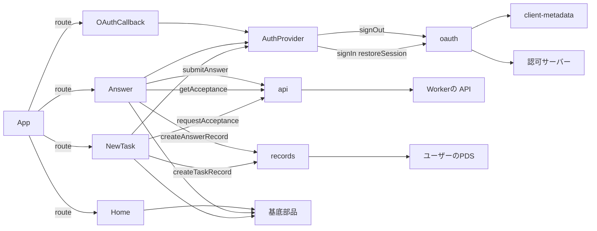
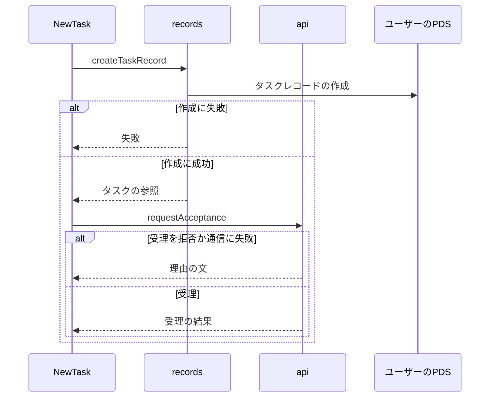
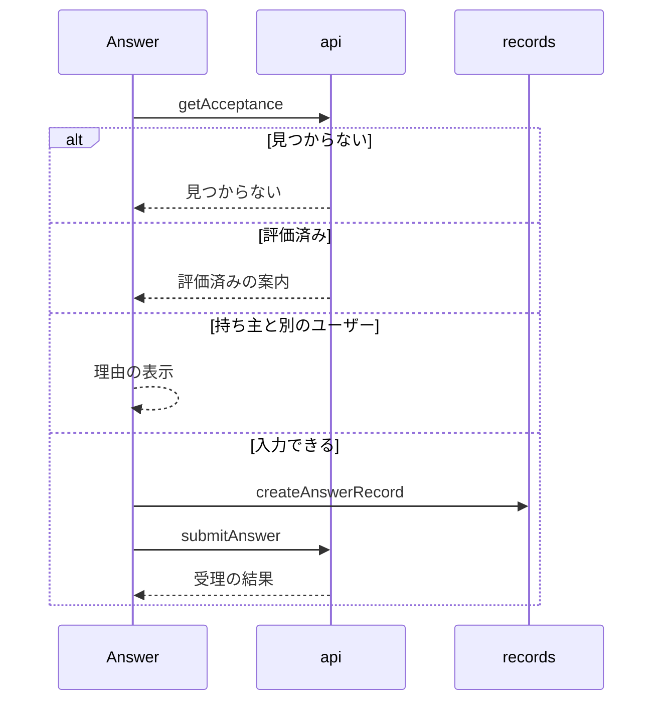

# Webフォーム 設計書

## 1. 構成

| パス                                | 責務                                     |
| ----------------------------------- | ---------------------------------------- |
| `public/oauth/client-metadata.json` | OAuth のクライアント情報                 |
| `src/web/auth/oauth.ts`             | サインイン・セッション復元・サインアウト |
| `src/web/auth/AuthProvider.tsx`     | セッションの保持と配布                   |
| `src/web/lib/api.ts`                | Worker の API の呼び出しと理由の日本語化 |
| `src/web/lib/records.ts`            | PDS へのレコードの書き込み               |
| `src/web/pages/Home.tsx`            | トップ画面                               |
| `src/web/pages/NewTask.tsx`         | タスクの登録画面                         |
| `src/web/pages/Answer.tsx`          | 評価の入力画面                           |
| `src/web/pages/OAuthCallback.tsx`   | OAuth の戻り先                           |
| `src/web/App.tsx`                   | 経路と共通のヘッダー                     |

## 2. 関係図・ワークフロー

画面・ライブラリ・外部サービスの依存方向を示す。



登録の確定の流れと、受理の拒否・途中の失敗の分岐を示す。



評価の入力の流れと、評価済み・持ち主違いの分岐を示す。



## 3. 設計項目

### D-1: サインインと権限 (FR-1, FR-2)

```json
{
  "client_id": "https://<PUBLIC_ORIGIN>/oauth/client-metadata.json",
  "client_name": "shinchoku-chan",
  "redirect_uris": ["https://<PUBLIC_ORIGIN>/oauth/callback"],
  "scope": "atproto repo:<NSID>.task?action=create repo:<NSID>.answer?action=create",
  "grant_types": ["authorization_code", "refresh_token"],
  "response_types": ["code"],
  "token_endpoint_auth_method": "none",
  "application_type": "web",
  "dpop_bound_access_tokens": true
}
```

```ts
export async function signIn(handle: string): Promise<never>
export async function restoreSession(): Promise<OAuthSession | null>
export async function signOut(): Promise<void>
```

| 項目           | 内容                                                                                         |
| -------------- | -------------------------------------------------------------------------------------------- |
| クライアント   | 公開クライアント。トークンはブラウザの IndexedDB に保存され、サーバーには送らない            |
| 開発時         | クライアントの識別子に http://localhost の形式（スコープとリダイレクト先を引数で渡す）を使う |
| 復元           | 起動時に restoreSession を 1 回呼び、AuthProvider が結果を配布する                           |
| 要求しない権限 | レコードの更新・削除、ほかのコレクション、投稿、画像、アカウントの管理                       |

### D-2: レコードの書き込み (FR-5)

```ts
export async function createTaskRecord(session: OAuthSession, form: TaskForm): Promise<StrongRef>
export async function createAnswerRecord(session: OAuthSession, form: AnswerForm, acceptance: StrongRef): Promise<StrongRef>
```

| 項目     | 内容                                                                                             |
| -------- | ------------------------------------------------------------------------------------------------ |
| 検証     | 保存前に validateRecord で検証し、違反は項目ごとの文言で表示する                                 |
| 再開     | 作成したレコードの参照を sessionStorage に保存し、同じ入力の再実行では作成せず保存した参照を使う |
| 保存の鍵 | 登録は「内容・期限日・リマインド時刻」、回答は「受理のキー」の組を鍵にする                       |

### D-3: 登録画面 (FR-3, FR-4)

| 入力欄         | 部品  | 制約                       |
| -------------- | ----- | -------------------------- |
| 内容           | Field | 1 文字以上 30 文字以下     |
| 期限日         | Field | 日付。翌日から 14 日後まで |
| リマインド時刻 | Field | 時刻。分の単位             |

未サインインのときは、ハンドルの入力とサインインのボタンを表示する。送信すると、createTaskRecord の後に requestAcceptance を呼び、結果を Notice で表示する。受理されたときは、確認が Bluesky に届くことを案内する。

### D-4: 評価の入力画面 (FR-6, FR-7, FR-8, FR-9)

URL は /answer/:key とする。getAcceptance の結果で次のように表示を分ける。

| 状態                               | 表示                                                       |
| ---------------------------------- | ---------------------------------------------------------- |
| 取得中                             | Skeleton                                                   |
| 見つからない                       | 見つからないことの Notice                                  |
| 評価済み                           | 内容と、評価済みであることの Notice。入力欄なし            |
| サインイン中で持ち主と別のユーザー | 理由の Notice。入力欄なし                                  |
| 上記以外                           | 内容と期限日、結果の選択（3 つ）、補足の入力欄、送信ボタン |

結果の選択は、できた(done)・できなかった(notdone)・一部できた(partial)とする。未サインインのときはサインインを促す。送信は createAnswerRecord の後に submitAnswer を呼ぶ。

### D-5: トップ画面 (FR-10)

| 項目           | 部品            | 内容                                                 |
| -------------- | --------------- | ---------------------------------------------------- |
| 説明文         | DescriptionList | Bot へのメンションで登録し、返信で評価することの説明 |
| 定型の例       | DescriptionList | @{Bot のハンドル} 10/25まで 18時に 資料作成          |
| フォームの案内 | Link            | 定型に合わないときの登録フォーム /new へのリンク     |

### D-6: API の呼び出し (FR-4, FR-7)

```ts
export function requestAcceptance(taskUri: string): Promise<Result>
export function getAcceptance(key: string): Promise<AcceptanceView | null>
export function submitAnswer(answerUri: string): Promise<Result>
```

| API                       | 用途               |
| ------------------------- | ------------------ |
| POST /api/tasks           | タスクの受理の依頼 |
| GET /api/acceptances/:key | 評価画面の表示     |
| POST /api/answers         | 回答の受理の依頼   |

| 種別              | 表示する文                                         |
| ----------------- | -------------------------------------------------- |
| range             | 期限は明日から 14 日先までにしてください           |
| too-soon          | 評価の時刻が近すぎます。もう少し先にしてください   |
| limit             | 同時に預かれる数の上限に達しています               |
| already_evaluated | この件は評価済みです                               |
| forbidden         | この件の持ち主のアカウントでサインインしてください |
| invalid           | 入力を確認してください                             |

通信に失敗したときは、再試行できることを示す文を表示する。

### D-7: 配信容量 (NFR-1)

| 対象             | 方法                                                                               | 上限                        |
| ---------------- | ---------------------------------------------------------------------------------- | --------------------------- |
| 画面のスクリプト | 経路ごとに分割して読み込む。OAuth のライブラリはサインインを使う画面だけが読み込む | 圧縮後の合計 200 キロバイト |

ビルドの後に圧縮後の合計の大きさを検査し、上限を超えたら失敗させる。

## 4. エラー処理

| 事象                 | 処理                                             |
| -------------------- | ------------------------------------------------ |
| サインインに失敗     | Notice に理由を表示し、入力欄は残す              |
| セッションの期限切れ | 未サインインの状態に戻し、再度のサインインを促す |
| レコードの作成に失敗 | 理由を表示し、再実行を促す                       |
| 受理の依頼に失敗     | 保存した参照を使って再実行できる状態にする       |
| API が拒否           | 種別に応じた文を表示する                         |
