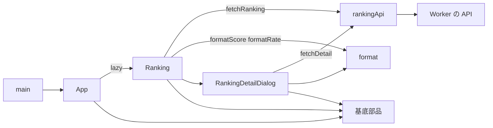
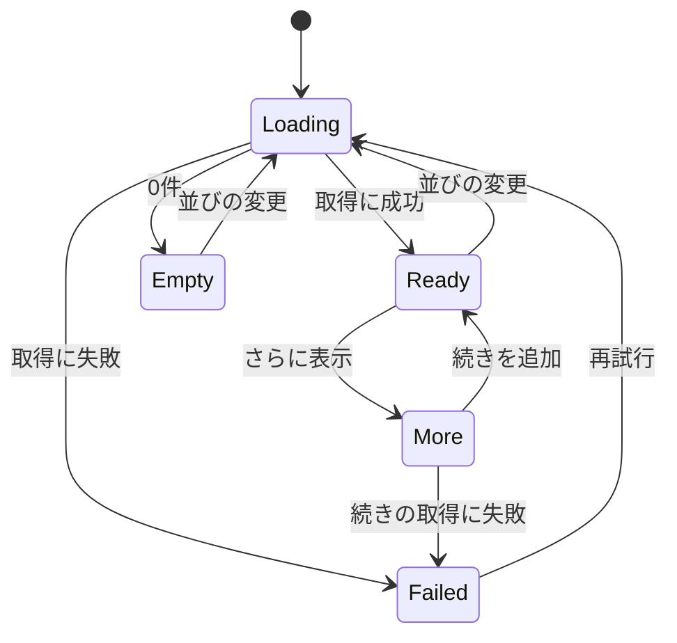

# ランキング画面 設計書

## 1. 構成

| パス                                    | 責務                           |
| --------------------------------------- | ------------------------------ |
| `src/web/main.tsx`                      | 起動と文脈の組み立て           |
| `src/web/App.tsx`                       | ヘッダーと画面遷移             |
| `src/web/lib/rankingApi.ts`             | ランキング API の呼び出し      |
| `src/web/lib/format.ts`                 | 評価点・進捗度・期間の表示形式 |
| `src/web/pages/Ranking.tsx`             | 一覧と並べ替えと続きの読み込み |
| `src/web/pages/RankingDetailDialog.tsx` | 詳細のダイアログ               |

## 2. 関係図・ワークフロー

画面とライブラリの依存方向を示す。



一覧の取得の状態遷移を示す。



## 3. 設計項目

### D-1: 一覧の取得と状態 (FR-4, FR-5, FR-9, NFR-2)

```ts
export type SortKey = "score" | "rate"
export type SortState = { sort: SortKey; order: "asc" | "desc" }

export async function fetchRanking(
  q: SortState & { cursor?: string },
): Promise<{ rows: RankingRow[]; next?: string }>
```

| 項目           | 内容                                                                         |
| -------------- | ---------------------------------------------------------------------------- |
| アドレス       | /?sort=score&order=desc の形式。既定は sort=score、order=desc                |
| 状態           | Loading / Ready / Empty / Failed / More。遷移は図のとおり                    |
| 続きの読み込み | next があれば「さらに表示」を出す。行は task_id で重複を除いて追加する       |
| 並びの変更     | cursor を捨てて 1 ページ目から取り直し、アドレスを置き換える                 |
| 失敗           | ApiError の message を表示し、retryable が true の場合は「再試行」を出す     |
| 初回の表示     | 取得中は骨組みを表示し、取得後に行を描く。取得は画面の描画と並行して開始する |

### D-2: 一覧の表示 (FR-1, FR-2, FR-3, FR-11)

```tsx
export function Ranking(): JSX.Element
```

| 列         | 内容                                                 | 並べ替え |
| ---------- | ---------------------------------------------------- | -------- |
| ユーザー名 | handle。https://bsky.app/profile/{handle} へのリンク | なし     |
| 概要       | 冒頭 80 文字（API が切り詰め済み）                   | なし     |
| 期間       | 「N日間」                                            | なし     |
| 評価点     | formatScore                                          | あり     |
| 最終進捗度 | formatRate                                           | あり     |

| 画面幅               | 表示                                                  |
| -------------------- | ----------------------------------------------------- |
| 480 ピクセルより広い | DataTable。ヘッダーの操作で並べ替え、aria-sort を設定 |
| 480 ピクセル以下     | 行ごとの Card。並べ替えは Select で選ぶ               |

ユーザー名のリンクは別の操作として扱い、行の選択（詳細の表示）とは独立させる。行の選択は Enter と Space でもできる。

### D-3: 詳細のダイアログ (FR-6, FR-7, FR-8)

```tsx
export function RankingDetailDialog(props: {
  taskId: string
  onClose: () => void
}): JSX.Element
```

| 項目     | 内容                                                                        |
| -------- | --------------------------------------------------------------------------- |
| 取得     | 開いたときに fetchDetail を呼ぶ。取得中は骨組み、失敗時は再試行             |
| 内容     | ゴール、最終進捗度、評価点、欠測件数、期間、概要の全文、結果の説明          |
| 画像     | 開始前と結果の画像を横に並べる。読み込みに失敗した画像は要素ごと取り除く    |
| 閉じる   | Esc、外側の操作、閉じるボタン。閉じたあとは一覧の状態とスクロール位置を保つ |
| アドレス | 開いている間は ?detail={taskId} を付け、直接開いた場合も同じ詳細を表示する  |

```ts
export async function fetchDetail(taskId: string): Promise<RankingDetail | null>
```

### D-4: 表示形式 (FR-12)

```ts
export function formatScore(scoreHundredths: number): string {
  return (scoreHundredths / 100).toFixed(2)
}

export function formatRate(permille: number): string {
  return `${Math.round(permille / 10)}%`
}
```

| 入力 | 関数        | 出力  |
| ---- | ----------- | ----- |
| 8735 | formatScore | 87.35 |
| 0    | formatScore | 0.00  |
| 1000 | formatRate  | 100%  |
| 1253 | formatRate  | 125%  |
| -50  | formatRate  | -5%   |

### D-5: ヘッダーと遷移 (FR-10)

```tsx
export function App(): JSX.Element
```

| 要素           | 内容                                                                       |
| -------------- | -------------------------------------------------------------------------- |
| ランキング     | / への遷移                                                                 |
| 作業を始める   | /new への遷移。未サインインでも開け、確定時にサインインを求める            |
| サインイン状態 | 未サインインはサインインの操作、サインイン中はハンドルとサインアウトの操作 |
| テーマ切り替え | 明・暗・環境設定の選択                                                     |

| 経路            | 画面             |
| --------------- | ---------------- |
| /               | ランキング       |
| /new            | 作業の登録       |
| /c/:id          | 報告の入力       |
| /oauth/callback | サインインの完了 |

Worker は、API とアセット以外のパスに index.html を返し（wrangler.toml の assets の not_found_handling を single-page-application にする）、遷移はブラウザ側で行う。ランキング以外の画面は遅延読み込みにする。

### D-6: 配信容量 (NFR-1)

| 項目 | 内容                                                                    |
| ---- | ----------------------------------------------------------------------- |
| 対象 | / の初回表示で読み込むスクリプト（main、App、Ranking、基底部品、React） |
| 上限 | gzip 後 120 キロバイト                                                  |
| 検査 | ビルド後に対象のファイルを gzip し、合計を検査する                      |

## 4. エラー処理

| 事象                          | 処理                                                         |
| ----------------------------- | ------------------------------------------------------------ |
| 一覧の取得失敗                | エラーと再試行を表示する                                     |
| 続きの取得失敗                | 取得済みの行を残し、続きの失敗を示して再試行できるようにする |
| 詳細が 404                    | 「見つかりませんでした」を表示し、閉じる操作を残す           |
| 不正な sort、order のアドレス | 既定値に置き換える                                           |
| 画像の読み込み失敗            | その画像だけ省略する                                         |
