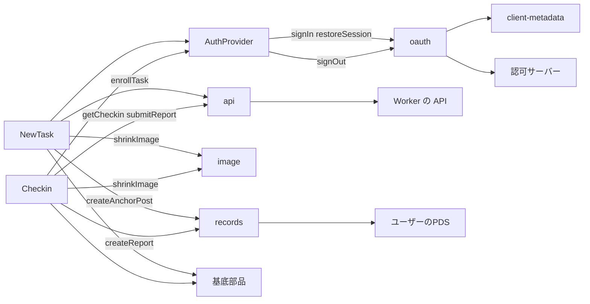
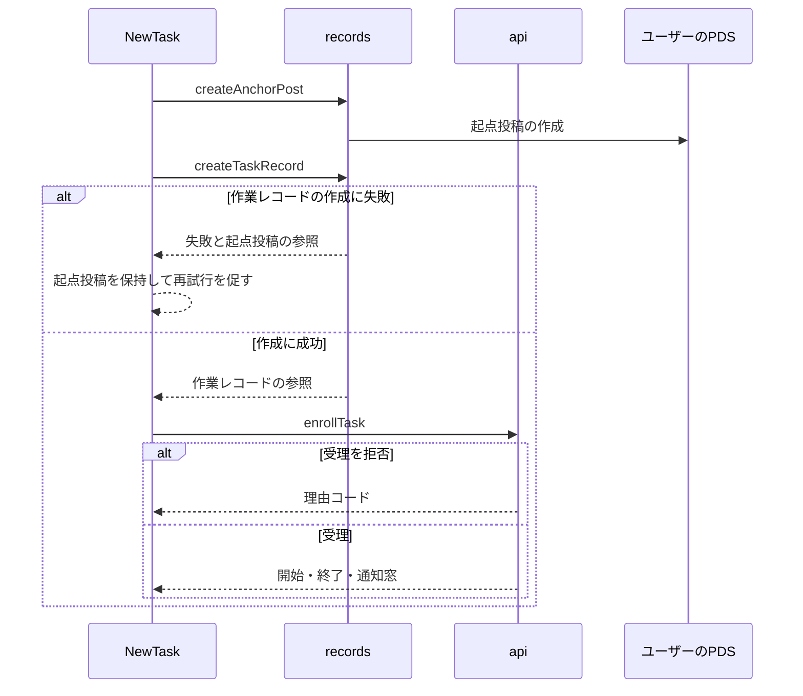

# 作業の登録と報告 設計書

## 1. 構成

| パス                                | 責務                                     |
| ----------------------------------- | ---------------------------------------- |
| `public/oauth/client-metadata.json` | OAuth のクライアント情報                 |
| `src/web/auth/oauth.ts`             | サインイン・セッション復元・サインアウト |
| `src/web/auth/AuthProvider.tsx`     | セッションの保持と配布                   |
| `src/web/lib/api.ts`                | Worker の API の呼び出し                 |
| `src/web/lib/image.ts`              | 画像の縮小                               |
| `src/web/lib/records.ts`            | PDS へのレコードと画像の書き込み         |
| `src/web/pages/NewTask.tsx`         | 作業の登録画面                           |
| `src/web/pages/Checkin.tsx`         | 報告の入力画面                           |

## 2. 関係図・ワークフロー

画面とライブラリの依存方向を示す。



登録の確定の流れと、途中で失敗した場合の分岐を示す。



## 3. 設計項目

### D-1: サインインと権限 (FR-1, FR-2)

```json
{
  "client_id": "https://<PUBLIC_ORIGIN>/oauth/client-metadata.json",
  "client_name": "shinchoku-chan",
  "redirect_uris": ["https://<PUBLIC_ORIGIN>/oauth/callback"],
  "scope": "atproto repo:<NSID>.task?action=create repo:<NSID>.progress?action=create repo:<NSID>.result?action=create repo:app.bsky.feed.post?action=create blob:image/*",
  "grant_types": ["authorization_code", "refresh_token"],
  "response_types": ["code"],
  "token_endpoint_auth_method": "none",
  "application_type": "web",
  "dpop_bound_access_tokens": true
}
```

```ts
export async function signIn(handle: string): Promise<never>
export async function restoreSession(): Promise<OAuthSession | null>
export async function signOut(): Promise<void>
```

| 項目           | 内容                                                                                         |
| -------------- | -------------------------------------------------------------------------------------------- |
| クライアント   | 公開クライアント。トークンはブラウザの IndexedDB に保存され、サーバーには送らない            |
| 開発時         | クライアントの識別子に http://localhost の形式（スコープとリダイレクト先を引数で渡す）を使う |
| 復元           | 起動時に restoreSession を 1 回呼び、AuthProvider が結果を配布する                           |
| 要求しない権限 | レコードの更新・削除、ほかのコレクション、アカウントの管理                                   |

### D-2: レコードの書き込み (FR-4, FR-6)

```ts
export async function createAnchorPost(
  session: OAuthSession,
  text: string,
  botDid: string,
): Promise<StrongRef>
export async function createTaskRecord(
  session: OAuthSession,
  form: TaskForm,
  anchor: StrongRef,
): Promise<StrongRef>
export async function createReport(
  session: OAuthSession,
  kind: "progress" | "result",
  form: ReportForm,
  refs: { task: StrongRef; checkin: StrongRef },
): Promise<StrongRef>
```

| 項目         | 内容                                                                                                        |
| ------------ | ----------------------------------------------------------------------------------------------------------- |
| 起点投稿     | 本文は「@{Bot のハンドル} 作業を始めます: {概要の冒頭 60 文字}」。メンションの facet に Bot の DID を付ける |
| 作業レコード | 保存前に validateRecord で検証する。値は toScaled で整数へ変換する                                          |
| 画像         | uploadBlob で送り、得た blob をレコードの項目へ入れる                                                       |
| 再開         | 起点投稿の参照を sessionStorage に保存し、同じフォームの再実行ではそれを再利用する                          |

### D-3: 登録画面 (FR-3, FR-7)

```tsx
export function NewTask(): JSX.Element
```

| 区画       | 内容                                                                                      | 部品   |
| ---------- | ----------------------------------------------------------------------------------------- | ------ |
| 概要       | 作業名（12 文字まで。Bot の返信に載る名前）、概要（300 文字まで）、ゴール（200 文字まで） | Field  |
| 指標       | 名称、単位、小数桁数（0〜3）、開始値、ゴール値                                            | Field  |
| 期間       | 1〜7 の日数。2 日以上で朝・昼・夕の選択を表示し、1 日では非表示                           | Field  |
| 開始前画像 | 任意。選択後にプレビューと縮小後のサイズを表示                                            | Field  |
| 確定       | 検証に失敗した項目は項目ごとにエラーを示す。確定中は Button の busy                       | Button |
| 結果       | 成功時に Card で開始・終了・通知窓を示し、Bot からの返信を待つ案内を表示                  | Card   |

受理依頼が拒否された場合は、理由コードごとに文言を表示する。

| 理由コード     | 文言                                                   |
| -------------- | ------------------------------------------------------ |
| limit-reached  | 進行中の作業があるため、新しい作業は始められません     |
| anchor-invalid | 起点投稿を確認できませんでした。もう一度お試しください |
| invalid-record | 入力内容に問題がありました                             |

### D-4: 報告画面 (FR-8, FR-9, FR-10, FR-11, FR-12)

```tsx
export function Checkin(): JSX.Element
```

| 状態                                  | 表示                                               |
| ------------------------------------- | -------------------------------------------------- |
| 読み込み中                            | 骨組みの表示                                       |
| 未サインイン                          | サインインの案内（サインイン後に同じリンクへ戻る） |
| サインイン中のユーザーが対象と異なる  | フォームを表示せず、対象のユーザーを示す           |
| status が accepted                    | 受理済みであることを示す                           |
| 期限が過ぎている（残り時間が 0 以下） | 期限切れの案内。フォームは表示しない               |
| 入力できる                            | 種別に応じたフォームと残り時間                     |

| 種別     | 入力                                                                           |
| -------- | ------------------------------------------------------------------------------ |
| progress | 実測値（必須）、メモ（140 文字まで）、証跡画像（開始前画像のある作業では必須） |
| result   | 最終実測値（必須）、結果の説明（500 文字まで、必須）、証跡画像（同上）         |

残り時間は、API が返す now と端末の時刻の差を補正して 1 秒ごとに更新する。送信は、画像のアップロード、createReport、受理依頼の順に行い、受理依頼が 410 のときは期限切れを表示する。

### D-5: 画像の縮小 (FR-5, NFR-2)

```ts
export async function shrinkImage(file: File, maxBytes: number): Promise<Blob>
```

| 手順 | 内容                                                                       |
| ---- | -------------------------------------------------------------------------- |
| 1    | 画像を読み込み、長辺を 1600 ピクセルに収める（それより小さければそのまま） |
| 2    | キャンバスに描画し、画質 0.85 で JPEG にする                               |
| 3    | maxBytes を超えていれば、画質を 0.1 ずつ下げて最小 0.5 まで繰り返す        |
| 4    | それでも超える場合は、長辺を 0.8 倍にして手順 2 からやり直す（最大 3 回）  |

画像以外の形式、または読み込めないファイルは、エラーとして扱う。

### D-6: API の呼び出し (FR-7, FR-10)

```ts
export async function enrollTask(taskUri: string): Promise<EnrollResponse>
export async function submitReport(recordUri: string): Promise<SubmitResponse>
export async function getCheckin(id: string): Promise<CheckinInfo>
```

| 項目   | 内容                                                                         |
| ------ | ---------------------------------------------------------------------------- |
| エラー | 共通のエラー形式を ApiError として投げる。retryable が true なら再試行を促す |
| 通信   | 同じオリジンへの fetch。認証ヘッダーは付けない                               |

### D-7: 配信容量 (NFR-1)

| 項目 | 内容                                                                                        |
| ---- | ------------------------------------------------------------------------------------------- |
| 分割 | NewTask と Checkin を遅延読み込みにし、OAuth クライアントは初回のサインインまで読み込まない |
| 計測 | ビルド後に両画面の遅延読み込み分を gzip し、合計 250 キロバイト以下を検査する               |

## 4. エラー処理

| 事象                       | 処理                                                 |
| -------------------------- | ---------------------------------------------------- |
| サインインの失敗・拒否     | 理由を表示し、入力は保持する                         |
| セッションの期限切れ       | 再サインインを案内し、入力は保持する                 |
| 画像の縮小の失敗           | 添付せずにエラーを示し、別の画像の選択を促す         |
| PDS への書き込み失敗       | 理由を表示し、再試行できるようにする                 |
| 受理依頼の 5xx と通信失敗  | レコードは作成済みのため、受理依頼だけを再試行できる |
| 確認依頼の id が存在しない | 見つからない旨を表示する                             |
